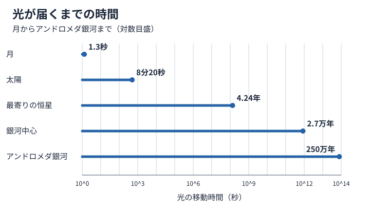

# 人間は宇宙のどこにいるのか

::: {.callout-note title="この章で学ぶ理由"}
宇宙の話を理解するためには、地球、太陽系、銀河、そして宇宙全体がどれほど異なる尺度にあるかを知る必要があります。距離と光の到着時刻を手がかりに、私たちが見る宇宙の意味を理解します。
:::

## 地球から離れてみる

夜空の星は、天井に貼りついた小さな光の点のように見えます。しかし、実際には互いに全く異なる距離にあります。宇宙船に乗って地球を出発することを想像しましょう。

最初に見えるのは月です。地球の直径は約1万2700キロメートル。月までは平均約38万4400キロメートルあります。地球を直径1センチメートルの球に縮めると、月は約30センチメートル先です。同じ模型では太陽は約117メートルも先にあります。

地球の周囲を離れるだけで、私たちの日常的な距離感は使いにくくなります。

## 光を時計にする

光はほぼ瞬時に届くように感じますが、速さは有限です。太陽の光は地球に約8分20秒かけて到着します。つまり、いま見ている太陽は、およそ8分前の太陽です。

光年は時間ではなく距離の単位です。真空中の光が1年間に進む距離を指します。

| 目的地 | 地球からの距離の目安 | 光が到着するまで |
|---|---|---|
| 月 | 約38万km | 約1.3秒 |
| 太陽 | 約1億5000万km | 約8分20秒 |
| プロキシマ・ケンタウリ | 約4.24光年 | 約4.24年 |
| 天の川銀河中心 | 約2万7000光年 | 約2万7000年 |
| アンドロメダ銀河 | 約250万光年 | 約250万年 |

{#fig-light-travel width=100%}

表の値は概数です。太陽系内の距離は公転により変動します。遠方宇宙では光の飛行時間と現在の距離を単純に同じ尺度で扱えないため、この比較は近傍天体に限っています。

## 太陽も一つの恒星にすぎない

太陽系を離れても、すぐ別の星に到着できるわけではありません。太陽に最も近い恒星プロキシマ・ケンタウリからの光ですら、私たちに届くまでに4年以上かかります。

地球と太陽の間隔を1メートルに縮める模型では、最寄りの恒星は約270キロメートル先になります。太陽の近所にも、途方もない空間が広がっています。

恒星は銀河の中に分布しています。私たちの太陽系は天の川銀河の中にあり、その中心から約2万7000光年離れています。銀河の中心から見れば太陽も無数にある恒星の一つです。

## 銀河の外には何があるのか

天の川銀河は宇宙に一つしかないわけではありません。アンドロメダ銀河は約250万光年先にあります。私たちがその光を観測するとき、約250万年前に出た光を受け取っています。

銀河は単独で一様に散らばっているのではなく、集団や巨大な網目状の構造を作ります。その間には銀河の少ない領域もあります。これらの構造は第3章で再訪します。

## 宇宙の年齢と観測できる範囲

宇宙背景放射や宇宙膨張の観測を標準宇宙論で解釈すると、宇宙の年齢は約138億年と推定されます。

では宇宙の半径は138億光年でしょうか。必ずしもそうではありません。光が長い時間をかけて進む間にも、宇宙の空間の尺度は変化してきました。宇宙年齢と、現在の尺度で測る観測可能範囲の半径は別の量です。後編の宇宙論でこの違いを計算します。

また、観測可能な宇宙は宇宙全体と同じとは限りません。観測範囲の外側まで空間が広がっている可能性はありますが、全体の大きさは確定していません。

## 観測者の中心と宇宙の中心

私たちを中心とした観測可能範囲を描くことは、私たちが宇宙の特別な中心にいることを意味しません。別の銀河に観測者がいれば、その観測者にも自身を中心とした観測可能範囲があります。

観測できる範囲の中心と、宇宙全体の物理的な中心を混同しないことが大切です。標準宇宙論では大きな尺度で特別な場所を仮定しません。

## この章のまとめ

| 分かったこと | 科学的な位置づけ |
|---|---|
| 光の速度は有限であり、遠方観測は過去の情報を受け取ること | 観測と確立した理論 |
| 太陽系は銀河の一部で、銀河は巨大構造の一部であること | 観測に基づく理解 |
| 宇宙の年齢は約138億年であること | 観測と宇宙論モデルに基づく推定 |
| 宇宙全体の大きさ | 未確定 |

### 思考実験と理解度確認

1. 地球から太陽を見たとき、なぜ現在の太陽そのものを見ているとはいえないのでしょうか。
2. 光年は時間と距離のどちらの単位でしょうか。
3. 宇宙の年齢と観測可能な宇宙の現在の半径を同一視できないのはなぜでしょうか。
4. 私たちの観測範囲の中心が地球であることは、宇宙全体の中心が地球であることを意味しますか。

**解答**

1. 光が地球に届くまで約8分かかるためです。
2. 距離です。
3. 光が伝わる間に宇宙の空間の尺度が変化するためです。
4. 意味しません。観測範囲は観測者の位置と宇宙史に依存します。

### 後編への接続

第27章（指数・対数・次元解析）で尺度の比較を、第49〜50章（宇宙の幾何学・膨張方程式）で宇宙年齢と距離の違いを扱います。次章では、遠方天体までの距離がどのように測定されたかを学びます。

### 参考資料

- [NASA, Cosmic Distances](https://science.nasa.gov/universe/cosmic-distances/)
- [NASA, Proxima Centauri](https://science.nasa.gov/asset/hubble/proxima-centauri/)
- [NASA, Messier 31](https://science.nasa.gov/mission/hubble/science/explore-the-night-sky/hubble-messier-catalog/messier-31/)
- [EHT, Magnetic Fields at the Milky Way’s Central Black Hole](https://eventhorizontelescope.org/blog/astronomers-unveil-strong-magnetic-fields-spiraling-edge-milky-way%E2%80%99s-central-black-hole)
- [ESA, Planck science highlights](https://www.esa.int/ga/articles/about-us/directorates/science/planck/planck-science-highlights)

確認日：2026年11月28日。図は独自作成。数値の精密な出典対応と図版の表示レビューは次回実施する。
