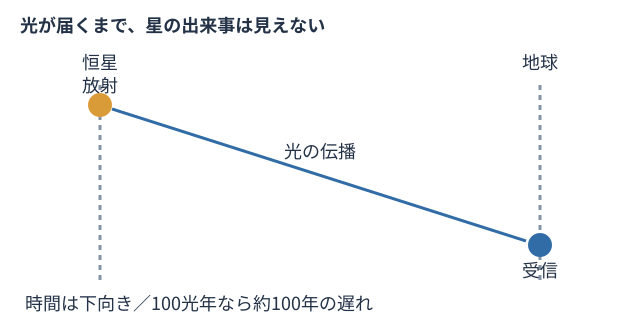
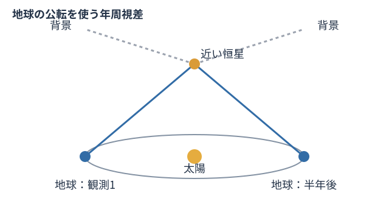
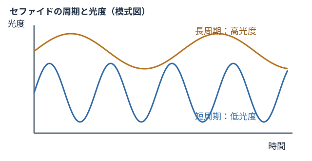
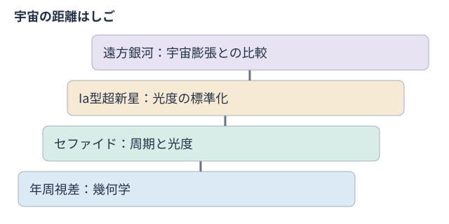
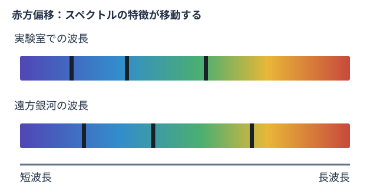

# 遠くを見ると過去が見える

::: {.callout-note title="この章で学ぶ理由"}
宇宙の遠くを眺めることは、昔の宇宙を眺めることでもあります。しかし、望遠鏡に距離や年齢が直接表示されるわけではありません。この章では、光の到着、星の見かけの位置、明るさ、色の変化を手掛かりに、人類が宇宙の時間と距離を測る仕組みを学びます。
:::

## 望遠鏡は過去への窓

夜空の星が今この瞬間に輝いているのか、それとも既に姿を変えているのか。地球に届く光だけから、その星の現在を即座に知ることはできません。

例えば、地球から100光年離れた恒星から光が出たとします。その光が地球に着くまで約100年かかります。今日、その恒星が爆発したとしても、地球で爆発を目撃するのは約100年後です。これは恒星と地球の距離がほぼ一定とした場合の思考実験です。

{#fig-lookback width=100%}

宇宙では、異なる距離にある天体を一枚の写真に収めると、異なる年代の姿が同時に写ります。一枚の深宇宙画像は、宇宙の一瞬を撮った集合写真ではなく、様々な時代の光を集めた記録です。

## 地球の公転を巨大な物差しにする

片目を閉じ、腕を伸ばして親指を立ててください。左右の目を交互に開けると、親指が背景に対して動いたように見えます。腕を縮めると、見かけの動きが大きくなります。このずれを視差と呼びます。

天文学者は両目の間隔の代わりに地球の公転軌道を使います。半年間隔の観測では、地球は太陽を挟んでおよそ反対側に移ります。遠くの背景天体に対する近くの恒星の見かけの位置を比較すれば、三角形の幾何学を使って距離を推定できます。

{#fig-parallax width=100%}

恒星の距離が遠いほど、見かけのずれは小さくなります。1パーセクは、地球と太陽の平均距離を基準とした年周視差が1秒角になる距離で、約3.26光年です。半年間の最大の位置差は、この視差角の約2倍です。

欧州宇宙機関ESAのガイアは、恒星の位置の精密観測を通じて天の川銀河の立体地図を作る計画です。恒星は実際にも移動しているため、公転に伴う周期的なずれと恒星の固有運動を、多数回の観測から分離します。距離が遠く視差が測定誤差に近づくと、単純に視差を距離へ変換する方法にも限界があります。[1]

## 星の明るさを距離の目印にする

同じ種類の街灯が並んでいると、遠い街灯ほど暗く見えます。星でも、もともとどれほど光を放つかが分かれば、地球で観測した明るさを用いて距離を推定できます。

ただし、暗く見える恒星が遠いとは限りません。近くても本来暗い恒星はあります。星が放つ光の強さと、観測者に届く光の強さを区別する必要があります。また、途中の塵によって光が吸収されることもあります。

ここで役立つのがセファイド変光星です。明るさが規則的に変化する恒星の一種で、変化の周期と本来の光度の間には関係があります。

1912年にヘンリエッタ・リービットは、この関係を確立する重要な研究を発表しました。距離の近い星の視差などによって関係を較正し、遠くのセファイドの周期を測れば、その光度を推定できます。[2]

{#fig-cepheid width=100%}

セファイドは恒星自体が周期的に膨張・収縮する脈動変光星です。単に星の周囲を別の天体が通過して暗くなる現象とは異なります。周期だけで距離が正確に決まるわけではなく、化学組成、塵の影響、恒星の種類などの補正が必要です。

## 宇宙の距離はしご

さらに遠くの銀河では、個々のセファイドを見分けることが難しくなります。そこで、銀河全体の中でも非常に明るく輝くIa型超新星を利用します。

Ia型超新星はすべて全く同じ明るさではありませんが、光度の時間変化などを補正すると、距離推定に利用できる標準化された光源になります。セファイドとIa型超新星の両方を観測できる銀河で超新星の光度を較正することで、さらに遠い銀河への距離を推定できます。[3]

{#fig-distance-ladder width=100%}

| 方法 | 観測する量 | 推定に使う知識 | 主な限界 |
|---|---|---|---|
| 年周視差 | 見かけの位置変化 | 地球軌道の大きさ・幾何学 | 遠方で角度が小さくなる |
| セファイド | 明るさ・変光周期 | 周期と光度の関係 | 塵・化学組成・較正 |
| Ia型超新星 | 明るさの時間変化 | 標準化された光度 | 光度補正・塵・選択効果 |
| 赤方偏移 | スペクトルの波長変化 | 宇宙膨張モデル | 固有速度・宇宙論の前提 |

これを宇宙の距離はしごと呼びます。下の段の較正に誤差があれば、上の段にも伝わります。現代では独立した幾何学的測定や別の距離指標も組み合わせ、結果が一致するか調べます。

## 光の色から宇宙の歴史を測る

光を波長ごとに分けたものをスペクトルと呼びます。元素や分子は決まった波長に特徴的な吸収・放射の痕跡を持ちます。実験室で分かった波長と遠方銀河のスペクトルを比べると、その痕跡が長い波長に移っている場合があります。これが赤方偏移です。

{#fig-redshift width=100%}

音を出しながら遠ざかる車の音が低くなるドップラー効果は、直感を得る手掛かりになります。しかし、遠方宇宙の赤方偏移には宇宙の膨張が重要です。光が伝わる間に宇宙の尺度が変化し、波長も引き伸ばされます。近くの銀河では宇宙膨張以外の運動も波長に影響します。

赤方偏移そのものはスペクトルから推定する観測量です。それを何億年前の光か、現在どれほど遠くにあるのかに換算するには、宇宙の膨張史を記述するモデルが必要です。[4]

## 宇宙誕生から約2億8000万年後の銀河

ジェイムズ・ウェッブ宇宙望遠鏡は赤外線を利用して、初期宇宙から届く光を調べます。2026年のNASAの報告では、銀河MoM-z14の宇宙論的赤方偏移が分光観測によって14.44と確認されたと紹介されています。

標準的な宇宙論に基づけば、光が放たれたのはビッグバンから約2億8000万年後で、光は約135億年かけて地球に届きました。[5]

ここで注意したいのは、望遠鏡が銀河の年齢を直接測ったわけではないことです。スペクトルを測定し、赤方偏移を推定し、宇宙論モデルにより宇宙の当時の年齢を求めています。銀河自体が何年生きていたかも別の問題です。

 ／ [CC BY 4.0](https://creativecommons.org/licenses/by/4.0/)。](../figures/external/mom_z14_weic2603a.jpg){#fig-mom-z14 width=100%}

スペクトルはNASAの公開資料[5]で確認できます。最遠記録は今後変わる可能性があるため、本書では観測例として扱います。

## 宇宙には見ることのできない場所がある

宇宙の年齢は有限で、光の速度も有限です。そのため、これまでの宇宙史において私たちまで信号が届くことができた範囲には限界があります。この境界を粒子地平線と呼びます。

さらに、今から送られた光が未来の私たちに届くかどうかを区切る事象の地平線という概念もあります。後者の存在や位置は宇宙の将来の膨張史に依存します。粒子地平線の外側にあるものが永久に見えないとは限らず、事象の地平線と混同しないことが重要です。[6]

もう一つ、初期宇宙は光が自由に進みにくい高温のプラズマでした。現在の電磁波観測によって見通せる初期宇宙には、この物質による制約もあります。宇宙マイクロ波背景放射は宇宙が透明になる時代の情報を伝えます。光の届く範囲と、光を用いて内部を観測できる範囲は異なる問題です。

## この章のまとめ

| 分かったこと | 科学的な位置づけ |
|---|---|
| 年周視差による近傍恒星の距離推定 | 幾何学と観測 |
| セファイド・Ia型超新星の距離推定 | 観測で較正された関係 |
| 赤方偏移 | スペクトルの測定に基づく |
| 赤方偏移から宇宙の年齢や距離への換算 | モデルに依存する推定 |
| 地平線の存在・位置 | 時空構造と膨張史に依存する理論的理解 |

### 思考実験と理解度確認

1. 半年前と今日で近い星の位置が変わって見えるのはなぜでしょうか。
2. 暗く見える星が必ず遠いとはいえない理由は何でしょうか。
3. セファイドとIa型超新星を同じ銀河で観測する意義は何でしょうか。
4. 赤方偏移の測定と宇宙の年齢の推定は、なぜ別の段階なのでしょうか。
5. 粒子地平線と事象の地平線はどのように異なりますか。

**解答**

1. 地球が公転し、観測する位置が変わるためです。恒星固有の運動も分離する必要があります。
2. 恒星そのものの光度や塵による吸収も明るさを変えるからです。
3. セファイドから推定した距離を利用して、超新星を次の距離指標として較正できます。
4. スペクトルの波長変化は観測できますが、時間への換算には宇宙の膨張史が必要だからです。
5. 粒子地平線は現在までに届き得た信号の範囲、事象の地平線は未来まで含めて到達可能性を区切る境界です。

### 後編への接続

第28章では三角形とベクトル、第32章では波動と分光、第49〜50章では宇宙の幾何学と膨張史を学び、距離・赤方偏移・過去の時間の関係を再現します。次の章では、こうして測った銀河の距離から、宇宙の大規模構造を描きます。

### 参考資料

1. [ESA, Parallax](https://www.esa.int/ga/articles/about-us/directorates/science/gaia/parallax)、[How does Gaia study the Milky Way?](https://www.esa.int/nb/articles/about-us/directorates/science/gaia/how-does-gaia-study-the-milky-way)
2. [NASA, What is Dark Energy?](https://science.nasa.gov/missions/roman-space-telescope/the-universe-is-expanding-faster-these-days-and-dark-energy-is-responsible-so-what-is-dark-energy/)
3. [NASA, Three Steps to the Hubble Constant](https://science.nasa.gov/asset/hubble/three-steps-to-the-hubble-constant-2/)、[Hubble Constant and Tension](https://science.nasa.gov/mission/hubble/science/science-behind-the-discoveries/hubble-constant-and-tension/)
4. [NASA, Hubble Cosmological Redshift](https://science.nasa.gov/mission/hubble/science/science-behind-the-discoveries/hubble-cosmological-redshift/)、[D. W. Hogg, Distance measures in cosmology (1999)](https://arxiv.org/abs/astro-ph/9905116)
5. [NASA, Webb Pushes Boundaries of Observable Universe Closer to Big Bang (2026)](https://science.nasa.gov/missions/webb/nasa-webb-pushes-boundaries-of-observable-universe-closer-to-big-bang/)
6. [David Tong, Cosmology, The Expanding Universe](https://www.damtp.cam.ac.uk/user/tong/cosmo/cosmohtml/S1.html)

資料確認日：2026年11月28日。図はすべて独自の模式図。原著・観測データの全面レビューは未実施。
