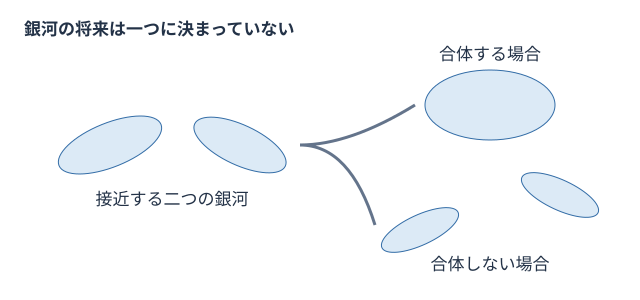
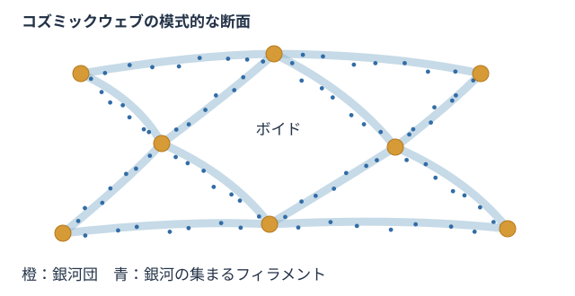

# 銀河と宇宙の巨大構造

::: {.callout-note title="この章で学ぶ理由"}
第1章では宇宙の大きさを、第2章では遠くの天体までの距離を知る方法を学びました。距離が分かると、夜空の二次元の光の点から宇宙の立体地図を作れます。本章では、星が銀河を作り、銀河が集団を作り、その集団がさらに巨大な網目を形作ることを理解します。
:::

## 銀河は一つの星ではない

暗い夜空に浮かぶ天の川は、私たちの銀河の内側から眺めた星の集まりです。天の川銀河は直径およそ10万光年の恒星円盤を持ちます。その外側にも希薄な恒星やガス、重力によって存在が推定されるダークマターが広がります。銀河の大きさはどの成分を基準にするかで変わります。

銀河を一つの巨大な星と考えると、内部の構造を理解できません。恒星、恒星間ガス、塵、そして重力源となる物質が集まった系であり、その中で新しい星が生まれ、古い星が死んでいきます。中心に超大質量ブラックホールを持つ銀河も多くありますが、銀河全体の恒星がブラックホールの引力だけで回っているわけではありません。

## 銀河の形はなぜ異なるのか

銀河には様々な姿があります。観測画像では、腕を持つ円盤、滑らかな楕円形、整った形を持たない星の集まりなどを比較できます。

### 渦巻銀河と棒渦巻銀河

 ／ [CC BY 4.0](https://creativecommons.org/licenses/by/4.0/)。](../figures/external/ngc1300.jpg){#fig-ngc1300 width=100%}

円盤を回転する星やガスが渦巻腕を描きます。腕には若く明るい星や星形成領域が見られ、塵が暗い筋を作ります。渦巻腕はすべての星が固定されたまま回る固い物体ではありません。密度の高い構造や一時的な腕が生まれる仕組みには複数のモデルがあります。

中心に星の棒状構造があるものを棒渦巻銀河と呼びます。天の川銀河もこの種類と考えられています。ただし私たちはその内側にいるため、外から撮影した天の川銀河の写真はありません。観測データに基づく地図や想像図と区別します。

### 楕円銀河

 ／ [CC BY 4.0](https://creativecommons.org/licenses/by/4.0/)。](../figures/external/ngc1132.jpg){#fig-ngc1132 width=100%}

楕円銀河は一般に渦巻腕を持たず、古い恒星が多い傾向があります。星の軌道も円盤銀河ほど整列していない場合があります。ガスや新しい星が全く存在しないという意味ではありません。NGC 1132は複数の銀河が合体して生まれた巨大な銀河である可能性が研究されています。

### 不規則銀河

 ／ [CC BY 4.0](https://creativecommons.org/licenses/by/4.0/)。](../figures/external/ic10.jpg){#fig-ic10 width=100%}

小さな銀河や他の銀河の重力の影響を受けた銀河には、明確な円盤や楕円形を持たないものがあります。IC 10は局所銀河群にあり、活発な星形成で知られます。

| 形態 | 見分ける手掛かり | 注意点 |
|---|---|---|
| 渦巻銀河 | 円盤・渦巻腕 | 横から見れば腕は分かりにくい |
| 棒渦巻銀河 | 中心の棒状構造 | 渦巻銀河の一種 |
| 楕円銀河 | 滑らかな楕円形の光分布 | 色・形だけで年齢を決められない |
| レンズ状銀河 | 円盤と膨らみ、目立つ腕がない | 楕円銀河と似て見える場合がある |
| 不規則銀河 | 規則的な形が目立たない | 形成史は一様ではない |

この分類は銀河の見た目を整理する方法であって、全ての銀河が一定の順序で変化するという進化の一本道ではありません。

## 天の川銀河とアンドロメダ銀河の未来

アンドロメダ銀河は約250万光年先にあり、私たちに近づいています。天の川銀河とアンドロメダ銀河、小さな伴銀河などは局所銀河群を作ります。宇宙全体は膨張していても、局所的な重力や銀河固有の運動によって互いに接近することがあります。

2012年のHubble観測に基づく研究では、約40億〜50億年後の接近・衝突が有力視されていました。しかし、2025年のSawalaらの研究はGaiaとHubbleの測定、銀河の質量の推定、大マゼラン雲やさんかく座銀河の重力などを考慮し直しました。その解析では、今後100億年以内に天の川銀河とアンドロメダ銀河が合体しない可能性も約半分あると推定されました。[1]

{#fig-galaxy-encounters width=100%}

約半分という値は一度きりの宇宙で実際に何度も衝突を観測した頻度ではなく、現在の観測誤差やモデルを考慮した予測です。銀河が接近すれば恒星の軌道やガスの分布が変わりますが、恒星同士は互いに非常に離れているため、多くの星が直接衝突するわけではありません。

## 銀河団は巨大な重力の実験室

銀河は数個から数十個程度の群や、さらに多数の銀河を含む銀河団を作ります。銀河団には恒星や銀河の外側に広がる高温のガスがあり、X線観測でも調べられます。銀河の運動や背景天体の光の曲がり方は、見える物質だけでは説明しにくい重力源を推定する手掛かりになります。

 ／ [CC BY 4.0](https://creativecommons.org/licenses/by/4.0/)。](../figures/external/abell2744.jpg){#fig-abell2744 width=100%}

Abell 2744は複数の銀河団が集まって形成されたと考えられている例です。[2] 巨大な質量によって背後の天体の光が曲がり、遠方銀河の像が引き伸ばされたり明るくなったりします。これは第15章の重力レンズ、第21章のダークマターにつながります。

## 超銀河団は銀河団よりも大きな構造

銀河群や銀河団の分布を広い範囲で調べると、さらに巨大な集まりが見つかります。これを超銀河団と呼びます。ただし、銀河団のように全体が重力で結びついた一つの物体とは限りません。

2014年、Tullyらは銀河の距離と固有速度から物質の流れを再構成し、天の川銀河を含む領域をラニアケア超銀河団と呼びました。[3] 山に降った雨がどの川へ流れるかで流域を定めるように、銀河の運動の流れから領域の境界を推定する方法です。この比喩は流れの分類を理解するためのものであり、宇宙の物質が地面を流れる水であるという意味ではありません。超銀河団の境界は定義や再構成方法によって変わり得ます。

## 宇宙は巨大な網目になっている

遠方銀河の位置と赤方偏移を測り、第2章の距離推定を使って立体的に並べると、銀河が一様に散らばっていないことが分かります。銀河は糸状のフィラメントや面状の構造に集まり、密度の高い交点には銀河団が現れます。この分布をコズミックウェブと呼びます。

{#fig-cosmic-web width=100%}

DESIは多数の銀河のスペクトルを観測して宇宙の立体地図を作っています。[4] 立体地図には距離換算に用いた宇宙論と、観測対象の選び方、銀河固有の運動の影響が含まれます。

2025年にはESOのVLTに搭載されたMUSEを用いた約150時間の観測で、二つの遠方銀河を結ぶ長さ約300万光年のガスのフィラメントが画像化されました。光が地球まで届くのに約110億年かかったと報告されています。[5]

 ／ [CC BY 4.0](https://creativecommons.org/licenses/by/4.0/)。](../figures/external/cosmic_filament.jpg){#fig-filament width=100%}

現在の標準的な構造形成の考え方では、初期宇宙のわずかな密度の偏りが重力によって成長し、物質が集まる場所と少ない場所ができていきます。ダークマターの重力が構造形成に重要な役割を果たすと考えられています。ただし、その粒子の正体は未解明です。

## 銀河の少ない巨大空間：ボイド

フィラメントの間には、平均より銀河や物質が少ない広大な領域があります。ボイドは空っぽの穴ではありません。希薄なガスやダークマター、少数の銀河も存在します。低密度領域と周囲の高密度領域の違いが時間とともに成長してきたと考えられます。

人類は宇宙全体を外から眺めているのではなく、内部から限られた領域を測っています。銀河の少ない部分が本当にボイドなのか、望遠鏡の感度や観測の範囲のために見えないだけなのかを判断する必要があります。統計的な解析や数値モデルとの比較は第52章で学びます。

## この章のまとめ

| 成果 | 科学的な位置づけ |
|---|---|
| 銀河の多様な形態、銀河団、フィラメント、ボイド | 観測から確認される構造 |
| 銀河の合体・重力による構造形成 | 観測で支持される物理モデル |
| 天の川銀河の将来の合体確率 | 初期条件とモデルに依存する予測 |
| ラニアケアの境界 | 定義と速度場の再構成に依存する推定 |
| ダークマターの粒子の正体 | 未解決 |

### 理解度確認

1. 銀河は一つの恒星とどう異なるでしょうか。
2. 天の川銀河の外側から見た写真が存在しないのはなぜでしょうか。
3. 宇宙が膨張していても、アンドロメダ銀河が近づくことがあるのはなぜでしょうか。
4. 銀河団を通る背景天体の光はどのような情報を伝えますか。
5. ボイドは本当に何もない空間でしょうか。
6. 天の川銀河とアンドロメダ銀河の合体確率を、確定した未来として扱えないのはなぜでしょうか。

**解答**

1. 銀河は多くの恒星、ガス、塵、その他の重力源からなる巨大な系です。
2. 私たちは天の川銀河の内部におり、外側まで移動して撮影したことがないからです。
3. 局所的な重力と固有運動があるため、膨張が全ての銀河の相対運動を決めるわけではありません。
4. 光の曲がり方は、銀河団の質量分布の推定に使えます。
5. いいえ。周囲より物質が少ない領域であって、完全な真空ではありません。
6. 観測誤差、銀河の質量や運動、他の銀河の影響などによって計算結果が変わるからです。

### 後編への接続

第30〜31章で重力と軌道を、第44〜45章で曲がった時空を通る光の運動を、第52章で密度揺らぎと構造形成を学びます。銀河の進化は多体系・ガスの物理も必要とするため、一つの公式だけで全ての形を予測できるわけではありません。

次章では、銀河の構成要素である恒星がなぜ輝き、どのように誕生するのかを学びます。

### 参考資料

1. [Sawala et al., No certainty of a Milky Way–Andromeda collision, Nature Astronomy (2025)](https://doi.org/10.1038/s41550-025-02563-1)、[ESA/Hubbleの解説（2025-06-02）](https://esahubble.org/news/heic2508/)
2. [ESA/Hubble, Hubble Frontier Fields view of Abell 2744 (2014)](https://esahubble.org/images/heic1401a/)
3. [Tully et al., The Laniakea supercluster of galaxies, Nature (2014)](https://doi.org/10.1038/nature13674)
4. [DESI, The beginnings of the 3-dimensional map (2021)](https://www.desi.lbl.gov/2021/07/22/the-beginnings-of-the-3-dimensional-map/)、[Fifty Years of Cosmic Cartography in Your Hands (2026)](https://www.desi.lbl.gov/2026/11/15/fifty-years-of-cosmic-cartography-in-your-hands/)
5. [ESO, Revealing a filament from the cosmic web (2025-01-29)](https://www.eso.org/public/images/potw2504a/)
6. [ESA/Hubble, Spiral Galaxy](https://esahubble.org/wordbank/spiral-galaxy/)、各観測画像の個別ページ。

資料確認日：2026年11月28日。原著は公開概要を参照。図版の全クレジットとライセンスは図の直近と図版台帳に記載。
