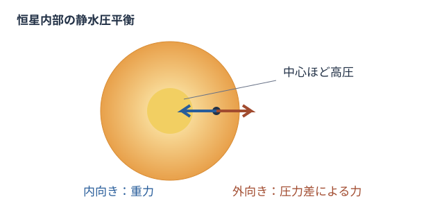
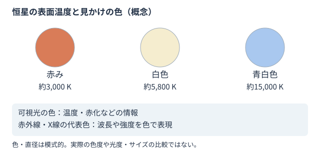
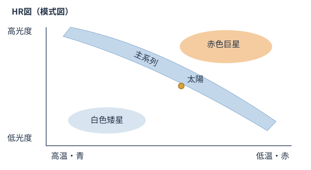

# 星はなぜ輝くのか

::: {.callout-note title="この章で学ぶ理由"}
地球に届く太陽の光は生命の活動を支えています。しかし普通の燃焼では、恒星が何十億年も光を放つことを説明できません。星が生まれる場所から核融合の起こる内部へ進み、星の光からその状態を推定する方法まで学びます。
:::

## 星が生まれる場所

星と星の間は完全な真空ではありません。とりわけ冷たく密度の高い分子雲には、水素分子を中心とするガスと微小な塵が含まれています。雲のある部分が周囲より密になり、重力が熱運動や磁場、乱流などの支えに勝つと、ガスは集まり始めます。

 ／ [CC BY 4.0](https://creativecommons.org/licenses/by/4.0/)。](../figures/external/pillars_creation.jpg){#fig-pillars width=85%}

集まる物質は必ずしもまっすぐ中心に落ちません。回転がある場合、角運動量が重要になり、物質は中心の原始星を囲む円盤を形成します。中心の天体は成長しながら、周囲にガスを放出することもあります。

 ／ [CC BY 4.0](https://creativecommons.org/licenses/by/4.0/)。](../figures/external/protostar_l1527.jpg){#fig-protostar width=85%}

L1527はおうし座方向、約460光年先にある形成途中の恒星です。原始星の光には重力収縮や降着によって解放されたエネルギーも含まれます。星が光っていることだけから、中心で水素核融合が安定して続いているとは判断できません。[1][2]

## 重力で集まるとなぜ熱くなるのか

高い場所から落ちた物体が地面に衝突すると、運動のエネルギーの一部が熱へ変わります。星を作るガスも、重力で落ち込むと運動のエネルギーを得て、衝突などを通じて熱を生じます。

重力収縮は、中心部の密度と温度を高めます。熱は外へ逃げるため、ガスが収縮しながら内部が熱くなる場合があります。この過程を重力収縮といいます。ただし、ガスが十分に集まるとは限りません。質量が小さすぎる天体では、水素を安定して融合させる段階に達しません。

## 太陽は燃えているのではない

ろうそくの燃焼では、物質を構成する原子の結び付きが変わり、化学エネルギーが放出されます。恒星の中心では原子核そのものが変化します。

太陽の中心は約1500万度です。物質は主に電離したプラズマとなっています。太陽では主として陽子・陽子連鎖反応が起こり、水素の原子核から最終的にヘリウムの原子核ができます。その過程で生じる質量の差に対応するエネルギーが、光や粒子の運動などに移ります。[3][4]

陽子は互いに電気的に反発します。古典的に考えると核が近づくことは難しいのですが、量子力学では障壁を通過する確率が存在します。これがトンネル効果です。太陽の核融合を理解するためには、重力だけでなく量子力学も必要です。

{#fig-fusion-overview width=100%}

太陽のような恒星は中心で水素を安定して融合させる期間を長く過ごします。この段階が主系列です。より重い恒星では炭素・窒素・酸素を触媒として使う反応の寄与が大きくなります。核融合は、恒星の温度・密度・組成によって速さが変わります。

## 星はなぜ重力で潰れないのか

地球の大気では、下の方ほど上に載っている空気の重さを支えるために圧力が高くなる傾向があります。恒星でも内側ほど高い圧力が必要です。中心に向かう重力を、内側から外側へ低くなる圧力の分布が支えます。この状態を静水圧平衡と呼びます。

{#fig-stellar-balance width=100%}

核融合が重力と直接逆向きの力を出しているわけではありません。核融合は星が失うエネルギーを補い、温度と圧力を保つことに寄与します。

典型的な主系列星では、中心温度が上がり核融合が活発になると、星が膨張して中心が冷える方向に応答します。逆にエネルギー生成が減ると収縮による加熱が起きる場合があります。この自己調整が安定した状態を支えます。縮退した物質や爆発現象などでは同じ安定性を期待できません。

## 中心で生まれたエネルギーはどう届くのか

太陽を内部から外側へ進むと、核融合の主な場所である中心部、放射によってエネルギーが運ばれる領域、物質の流れによる対流が重要になる領域があります。

| 領域 | 主な役割 |
|---|---|
| 中心部 | 水素核融合によるエネルギー生成 |
| 放射層 | 光の吸収・再放射などを通じたエネルギー輸送 |
| 対流層 | 高温の物質の上昇、冷えた物質の下降 |
| 光球 | 可視光の多くが外へ出る層 |

太陽の可視光の多くが出る光球は約5500度です。中心での反応から生じたエネルギーが外へ運ばれる過程は、光が真空中を一方向に飛ぶ過程とは異なります。中心で生じた個々の光子がそのまま地球へ到達するわけではありません。[4]

## 星の色から温度が分かる

鉄を熱すると赤く光り、温度が上がるにつれて明るく白っぽくなります。恒星でも、表面から放たれる熱放射の波長分布は温度によって変わります。一般に赤い恒星は比較的低温で、青白い恒星は高温です。

| 主系列星の分光型（代表） | 有効温度の目安 | 色の傾向 |
|---|---:|---|
| O | 30,000 K以上 | 青 |
| A | 7,500〜10,000 K | 白 |
| G | 5,200〜6,000 K | 黄白色 |
| M | 2,400〜3,700 K程度 | 赤 |

分類境界は資料や光度階級によって異なり、表は概数です。有効温度とは、同じ面積から同じ総エネルギーを放射する理想的な黒体の温度です。恒星の色だけで中心温度や年齢を一意に求められるわけではありません。塵の吸収、元素の吸収線、測光フィルターも考慮します。[5]

## 星空の色と写真の色を読み分ける

恒星の光には温度の情報が含まれます。表面温度が高い星は青白く、低い星は赤みを帯びる傾向があります。太陽は約5800 Kで、地球の大気の外で見た光はおおむね白色です。夕日が赤いのは主に大気中で短波長の光が散乱するためで、太陽の温度が急変したわけではありません。恒星の温度・スペクトル・星間塵による赤化は区別して考えます。

{#fig-stellar-appearance width=100%}

天体写真で星の周りに十字や六本・八本の光が伸びている場合、それは望遠鏡の回折によることがあります。星から実際に棒状の物質が飛び出しているとは限りません。星が光点に見える画像でも、光点の大きさは主に望遠鏡の分解能や露光・画像処理に左右され、星の直径そのものではありません。

Webbの赤外線画像やX線画像では、人間の目に見えない波長を色に割り当てます。この代表色（疑似カラー）は構造や波長帯を識別するための情報であり、肉眼の色ではありません。例えばカシオペヤ座AのWebb画像の白い成分は、シンクロトロン放射に関係することが報告されています。白い部分が常に最高温という意味ではありません。

**画像を読む三つの確認**：何の波長を測ったか、色と明暗は何を表すか、観測・再構成・数値可視化・想像図のどれか。今後の天体画像にも同じ確認を適用します。

参考：[NASA 恒星の色と分類](https://science.nasa.gov/exoplanets/stars/)、[NASA 恒星の連続スペクトル](https://science.nasa.gov/asset/webb/continuous-spectra-blackbody-curves-of-stars/)、[ESA/Webb 代表色の作り方](https://esawebb.org/about/general/image-processing/)、[ESA/Webb Cas A 2023](https://esawebb.org/news/weic2330/)（確認日：2026-11-29）。

## 恒星の家族写真：HR図

第2章の距離測定を利用して、地球で観測する見かけの明るさから恒星本来の光度を推定できます。光度と表面温度を並べると、恒星は無秩序には分布せず、特徴的な帯や集団を作ります。これがヘルツシュプルング・ラッセル図（HR図）です。

{#fig-hr width=100%}

主系列は左上から右下へ伸びる帯です。太陽もその一員です。赤色巨星は表面温度が低くても、表面積が大きいので高い光度を持てます。白色矮星は高温でも半径が小さいため、光度が低い領域に現れます。

ESAのGaiaは恒星の距離や色などを精密に測定し、2018年のデータ公開によって非常に詳細なHR図が得られました。[6][7] HR図は恒星が必ず同じ方向に動く道筋ではありません。初期質量、組成、年齢などの異なる恒星が分布した観測図であり、進化モデルと比較することが重要です。

## 太陽の中心をニュートリノで見る

太陽の中心では、核融合の過程でニュートリノという粒子も生まれます。ニュートリノは物質との相互作用が弱いため、太陽の内部をほぼ妨げられずに抜け出すことができます。中心で起きる反応を知るための重要な観測手段です。

初期の観測では、太陽モデルが予測した数よりも少ない電子ニュートリノしか見つかりませんでした。太陽モデルが間違っているのか、ニュートリノに未知の性質があるのかが問題になりました。

2002年、カナダのサドベリー・ニュートリノ観測所（SNO）は、太陽から来たニュートリノの種類が変化していることを強く支持する観測結果を発表しました。電子ニュートリノ以外の成分も含めると、太陽モデルとの整合性が改善しました。[8] これはニュートリノ振動とニュートリノ質量の研究に結び付き、2015年のノーベル物理学賞の対象となりました。[9]

星のエネルギー源を調べる研究が、素粒子の性質に対する新しい理解をもたらしたのです。

## この章のまとめ

| 内容 | 科学的な位置づけ |
|---|---|
| 分子雲や原始星の存在 | 観測 |
| 核融合と静水圧平衡による主系列星の理解 | 観測で支持される物理モデル |
| 恒星の色と光度の分布 | 測光・分光・距離測定による観測 |
| 太陽の内部温度と構造 | 太陽モデルと観測による推定 |
| ニュートリノの種類の変化 | 実験による強い証拠 |

### 理解度確認

1. 原始星が輝いていても主系列星とは限らないのはなぜか。
2. 核融合と化学燃焼は何が異なるか。
3. 星の静水圧平衡では何が釣り合うか。
4. 赤色巨星は比較的低温なのに明るくなれるのはなぜか。
5. 太陽ニュートリノの研究はなぜ重要か。

**解答**

1. 重力収縮や降着によってもエネルギーが放出されるから。
2. 核融合では原子核が変化する。化学燃焼では主として電子を介した結合が変わる。
3. 内向きの重力と、圧力の空間変化による外向きの力。
4. 大きな表面積から光を放つため。
5. 太陽内部の核反応を検証でき、粒子の種類の変化など素粒子物理にもつながるから。

### 後編への接続

第30〜31章で重力とエネルギー、第32〜33章で光・黒体放射、第34章で静水圧平衡、第35章で核融合を再訪する。太陽ニュートリノの量子論的な振動は既存の量子力学・場の量子論の教材とも接続する。次章では恒星の寿命と最期を学ぶ。

### 参考資料

1. [ESA/Webb, Protostar L1527（2022-11-16）](https://esawebb.org/images/weic2219a/)
2. [ESA/Webb, Pillars of Creation（2022-10-19）](https://esawebb.org/images/weic2216e/)
3. [NASA, Stars](https://science.nasa.gov/universe/stars/)
4. [NASA, Sun: Facts](https://science.nasa.gov/sun/facts/)
5. [NASA, Stars in an Exoplanet World](https://science.nasa.gov/exoplanets/stars/)
6. [ESA, Gaia’s Hertzsprung-Russell diagram（2018）](https://www.esa.int/media/gaia-s-hertzsprung-russell-diagram)
7. [OpenStax Astronomy, The H–R Diagram](https://openstax.org/books/astronomy/pages/18-4-the-h-r-diagram)
8. [SNO Collaboration, Direct evidence for neutrino flavor transformation（2002）](https://pubmed.ncbi.nlm.nih.gov/12097025/)
9. [Nobel Prize in Physics 2015](https://www.nobelprize.org/prizes/physics/2015/press-release/)

確認日：2026-11-28。画像は公式観測画像、残りの図は独自の模式図。太陽内部の詳細な反応率・物理量は後編で扱う。
