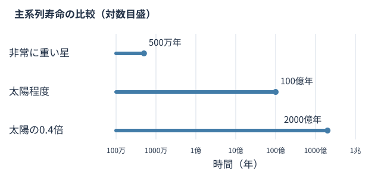
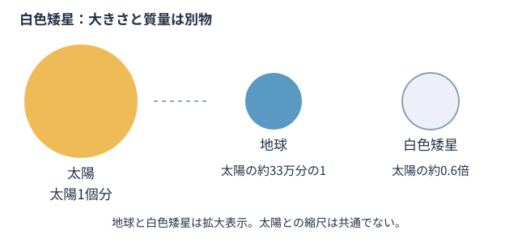
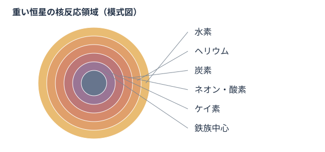
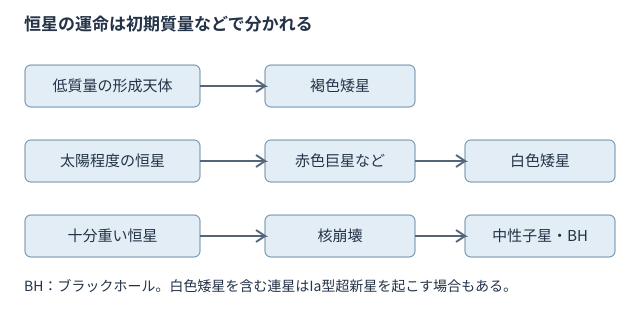

# 星の一生と宇宙の大爆発

::: {.callout-note title="この章で学ぶ理由"}
第4章で、恒星は核融合によって長い間輝くことを学びました。ところが、重くて燃料を多く持つ星ほど短命です。そして星の最期は、静かに冷えていく白色矮星から、宇宙を照らす超新星爆発まで大きく異なります。質量とエネルギーの使い方が星の運命をどう変えるかを理解します。
:::

## 燃料が多い星ほど短命になる

車の燃料タンクが大きければ、普通は長く走れそうです。しかし、同時に燃料を消費する速さも何倍にもなるなら、走れる時間は短くなります。恒星でも同じことが起こります。

質量が大きい恒星では、強い重力を支えるために中心部の温度と圧力が高くなり、核融合反応が活発になります。多くの水素を持っていても、その水素を使う速さはもっと大きくなる傾向があります。したがって、主系列で過ごす期間は短くなります。

| 初期質量の目安 | 主系列での寿命の目安 |
|---|---|
| 太陽の約0.4倍 | 約2000億年 |
| 太陽と同程度 | 約100億年 |
| 非常に重い恒星 | 数百万年程度 |

{#fig-stellar-lifetime width=100%}

これらは恒星進化モデルの代表的な値です。組成、回転、質量損失などでも寿命は変わります。宇宙の年齢は約138億年なので、約2000億年の寿命を持つ星について、最初から最後までの進化を直接観測したわけではありません。[1]

::: {.callout-tip title="どうやって星の一生を調べるのか"}
同じ星を何十億年も観測する代わりに、年齢の異なる恒星集団を比較します。ほぼ同じ時期に生まれた星団では、どの質量の恒星まで主系列を離れているかが年齢の手掛かりになります。これは第4章のHR図と恒星進化モデルを結び付けた方法です。[2]
:::

## 太陽は赤色巨星になる

太陽は現在、約46億歳の主系列星です。今から約50億年後には中心の水素が少なくなり、主系列を離れて赤色巨星へ進むと考えられています。[3]

中心で水素を融合する反応が弱まると、中心部は収縮し、その周囲の水素が核融合する殻が形成されます。内部の温度・圧力やエネルギー輸送が変わり、外側の層は大きく膨張します。表面は比較的低温になりますが、表面積が増えるため光度は高くなることがあります。

赤色巨星は核融合が完全に止まった天体ではありません。太陽程度の星では中心のヘリウム融合も起こり、炭素や酸素が作られます。その後、中心での核反応を支えられなくなり、外層を失う段階へ進みます。

太陽が膨張すれば水星・金星が取り込まれると予想され、地球も取り込まれる可能性があります。地球の軌道変化や潮汐相互作用、太陽の質量損失などを考慮する必要があり、厳密な未来の軌道はモデルに依存します。地球が生命に適した環境でなくなる時期と、太陽が地球を飲み込むかどうかは別の問題です。[3]

## 星が残した美しい殻

 ／ [CC BY 4.0](https://creativecommons.org/licenses/by/4.0/)。](../figures/external/ring_nebula.jpg){#fig-ring-nebula width=85%}

太陽程度の星は終末期に外側のガスを放出します。残された高温の中心天体からの紫外線などがガスを電離し、星雲が輝きます。これを惑星状星雲と呼びます。名前は望遠鏡で見た形に由来し、惑星が生まれたことを意味しません。

リング星雲のような形を調べると、恒星がどのように物質を失い、伴星との相互作用がどのように構造を作ったかを推定できます。星の最期は次世代の恒星や惑星の材料を宇宙空間に返す過程でもあります。[4]

## 地球ほどの大きさに恒星の質量を詰める

外層を失った太陽程度の恒星の中心には白色矮星が残ります。典型的な白色矮星は地球に近い大きさですが、質量は太陽の数割から太陽と同程度です。[5]

{#fig-white-dwarf width=100%}

通常の気体では、温度を下げると圧力が低下します。しかし白色矮星では、電子を同じ量子状態に押し込めないという量子力学の性質に由来する電子の縮退圧が重要な支えになります。内部で持続的な核融合をしていなくても重力と釣り合うことができます。

この支えにも質量の限界があります。理想化した非回転の冷たい白色矮星では約1.4太陽質量が目安で、チャンドラセカール限界と呼ばれます。組成、回転、温度などの影響もあり、すべての白色矮星がその質量に達するわけではありません。

白色矮星は蓄えていた熱を放出しながら長い時間をかけて冷えます。十分に冷えた仮想的な天体を黒色矮星と呼びますが、宇宙はまだそのような段階に至るほど古くないと考えられています。白色矮星の冷却を利用して古い恒星集団の年齢を推定する研究もあります。

## 褐色矮星は星の死骸ではない

白色矮星と褐色矮星は、名前は似ていますが成り立ちが違います。

褐色矮星は形成時の質量が小さく、普通の水素を安定して融合する恒星になれなかった天体です。一部は重水素を短期間融合できますが、主系列星のように長期間水素核融合で輝くことはできません。[6]

| 天体 | 主な成り立ち | エネルギー・支え |
|---|---|---|
| 赤色矮星 | 低質量の主系列星 | 水素核融合 |
| 褐色矮星 | 恒星形成に似た過程などで形成される低質量天体 | 収縮・冷却、場合により短期の核反応 |
| 白色矮星 | 恒星進化後に残る中心部 | 電子縮退圧で支持され、蓄えた熱を放出 |

褐色矮星と巨大惑星の境界には、質量による分類と形成過程による分類があります。重水素燃焼の境界はしばしば木星の約13倍の質量とされますが、組成によって変わり、形成史を直接示す境界でもありません。

## 重い星は鉄の中心を作る

十分重い恒星では、ヘリウム融合の後も中心の収縮によって温度が上がり、炭素、ネオン、酸素、ケイ素などの核反応が進む場合があります。最後に中心には鉄族元素に富む領域が形成されます。

{#fig-onion-star width=100%}

鉄族付近の原子核は結合が強く、それより重い原子核を融合する過程を通常の恒星の持続的なエネルギー源として利用することは難しくなります。

中心の質量が増すと電子縮退圧による支持にも限界が訪れます。電子捕獲や高温での原子核の分解が進み、中心の収縮を助長します。核崩壊が起きると、中心部は非常に短い時間で圧縮されます。[5][7]

## 超新星：星の内部が宇宙へ飛び出す

核崩壊では、中心が原子核程度の密度に達して急激に硬くなり、衝撃波が生じる場合があります。しかし衝撃波は物質の分解などでエネルギーを失い、単に跳ね返るだけでは外層を吹き飛ばすのは難しいと考えられています。

ニュートリノによる加熱、流体の不安定性、回転・磁場などが爆発に関与します。核崩壊型超新星のエネルギー源は主に中心部の重力収縮です。星によっては明るい超新星を起こさずブラックホールを形成する可能性もあります。爆発の成否と最終的な残骸を初期質量だけで一意に決めることはできません。

 ／ [CC BY 4.0](https://creativecommons.org/licenses/by/4.0/)。](../figures/external/cassiopeia_a.jpg){#fig-cassiopeia-a width=85%}

カシオペヤ座Aは約1万1000光年離れた超新星残骸です。噴出した物質と周囲のガスの相互作用を調べることで、星の内部組成や爆発後の変化を研究できます。[8]

残された中心天体が中性子星になるか、ブラックホールになるかは、崩壊する中心部の質量や物質の状態、爆発後に再び落ち込む物質などに依存します。第9〜12章で詳しく扱います。

## もう一つの超新星：白色矮星の熱核爆発

第2章で距離測定に利用したIa型超新星は、核崩壊型超新星とは異なる機構で起きます。少なくとも一つの白色矮星を含む連星系が起源と考えられています。伴星から物質を受け取ったり、白色矮星同士が相互作用・合体したりする過程で、熱核反応が暴走する場合があります。[9]

縮退した物質は温度が上がっても通常の気体ほど容易には膨張しないため、反応の加速を抑えにくいことが重要です。典型的なIa型超新星では白色矮星が破壊されます。必ずチャンドラセカール限界に到達してから爆発するわけではなく、複数の起源経路が研究されています。

| 比較 | 核崩壊型 | Ia型 |
|---|---|---|
| 主な起源 | 重い恒星の中心崩壊 | 白色矮星を含む連星系 |
| 主なエネルギー源 | 重力収縮 | 熱核反応 |
| 残骸 | 中性子星・ブラックホールなど | 典型例では白色矮星が破壊される |
| 観測への利用 | 恒星内部、元素、ニュートリノ | 標準化した光度による距離測定 |

{#fig-stellar-fates width=100%}

## この章のまとめ

| 内容 | 科学的な位置づけ |
|---|---|
| 恒星の質量と主系列寿命 | 星団観測で支持される進化モデル |
| 赤色巨星・白色矮星・褐色矮星 | 観測された天体 |
| 太陽の将来の進化 | 恒星進化モデルによる予測 |
| 核崩壊型超新星の存在・残骸 | 観測と理論による理解 |
| 爆発の成否・Ia型の詳細な起源経路 | 研究が続く問題 |

### 理解度確認

1. 燃料が多い恒星ほど短命になりやすい理由は何でしょうか。
2. 同じ星を何十億年も観測せずに進化モデルを検証する方法は何でしょうか。
3. 白色矮星は核融合がなくてもなぜ潰れないのでしょうか。
4. 褐色矮星と白色矮星の成り立ちはどう違いますか。
5. 核崩壊型超新星とIa型超新星のエネルギー源の違いは何でしょうか。
6. 恒星の初期質量だけでは残骸の種類を確定できないのはなぜでしょうか。

**解答**

1. 重い星の核融合と燃料消費が、燃料の増加以上に速くなる傾向があるためです。
2. 年齢の異なる星団のHR図や主系列から離れる恒星の質量などを比較します。
3. 電子縮退圧が重力を支えるためです。
4. 褐色矮星は安定した水素核融合に至らなかった天体、白色矮星は恒星進化後の中心部です。
5. 前者は主に重力収縮、後者は熱核反応です。
6. 組成、質量損失、連星相互作用、崩壊時の中心部の構造、爆発などにも依存するためです。

### 後編への接続

第34章で恒星の平衡、第35章で核反応とエネルギー、第36章で電子縮退圧、第47章で相対論的恒星構造を扱います。爆発の詳細な数値流体力学は発展的な話題として区別します。

次章では、星の内部や爆発・合体で作られた元素が、どのように地球と私たちの身体に至ったかを学びます。

### 参考資料

1. [OpenStax Astronomy 2e §22.1](https://openstax.org/books/astronomy-2e/pages/22-1-evolution-from-the-main-sequence-to-red-giants)
2. [OpenStax Astronomy 2e §22.2](https://openstax.org/books/astronomy-2e/pages/22-2-star-clusters)
3. [NASA Sun: Facts](https://science.nasa.gov/sun/facts/)、[OpenStax §22.4](https://openstax.org/books/astronomy-2e/pages/22-4-further-evolution-of-stars)
4. [ESA/Webb Ring Nebula（2023）](https://esawebb.org/images/weic2320b/)
5. [NASA Stars: Types](https://science.nasa.gov/universe/stars/types/)
6. [NASA Hubble Glossary](https://science.nasa.gov/mission/hubble/multimedia/hubble-glossary/)、[NASA Webb Brown Dwarf](https://science.nasa.gov/missions/webb/nasas-webb-identifies-tiniest-free-floating-brown-dwarf/)
7. 核崩壊の詳細・限界質量は後編で原著・専門資料を追加検証する。
8. [ESA/Webb Cas A（2023）](https://esawebb.org/images/weic2330a/)
9. [NASA Type Ia Supernovae](https://science.nasa.gov/mission/roman-space-telescope/type-ia-supernovae/)

公開資料確認日：2026-11-28。画像はCC BY 4.0の公式配布版。自作図は模式図であり恒星進化計算の出力ではない。詳細な核崩壊・限界質量の専門文献レビューは未完了。
