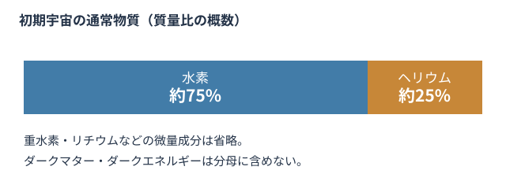
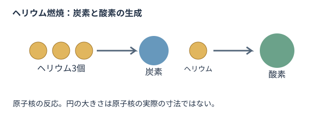
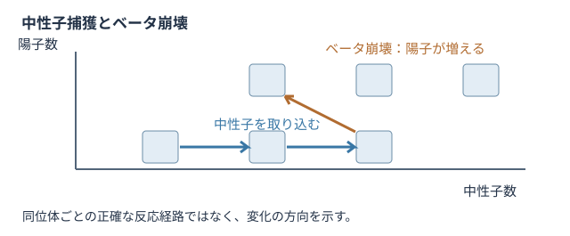
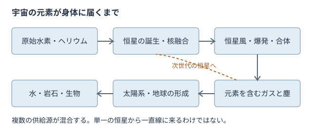

# 私たちの身体は星から生まれた

::: {.callout-note title="この章で学ぶ理由"}
第4章で恒星のエネルギー源を、第5章で恒星の最期を学びました。核反応にはもう一つの重要な役割があります。宇宙に新しい種類の原子核を作ることです。コップ一杯の水や血液、骨の材料が、どのような宇宙の歴史を経てここにあるのかを考えます。
:::

## コップ一杯の水にある二つの歴史

水を構成するのは水素と酸素です。水の分子としては現在の地球で結び付いていますが、その原子核の歴史は大きく異なります。普通の水素の原子核の多くは宇宙初期にさかのぼり、酸素の原子核の多くは後の恒星の内部で作られました。

私たちの身体には、炭素、窒素、酸素、リン、硫黄、カルシウム、鉄なども含まれています。これらは生物が新たに原子核を作って得たものではありません。食べ物や水、呼吸を通じて取り込んだ原子を、細胞が化学的に組み替えて利用しています。[1]

「私たちは星のかけらである」という表現は、重い元素の起源を考える上で適切です。ただし、水素のように恒星誕生以前から存在する物質もあり、すべての原子が恒星の内部で作られたという意味ではありません。また、原子核の生成と、電子を含む原子や分子の形成は別の出来事です。

## 最初の数分間に生まれた元素

宇宙初期は、原子も恒星も存在できないほど高温でした。宇宙が膨張して冷えると、陽子と中性子が結び付いて軽い原子核が作られるようになりました。この過程をビッグバン元素合成といいます。

普通の水素の原子核は陽子一つです。重水素、ヘリウムの原子核、少量のリチウムにつながる原子核も生成されました。標準的なビッグバン元素合成によれば、その後の通常物質の質量の約4分の3は水素、約4分の1はヘリウムになりました。重水素などの微量成分を丸めた代表値です。ダークマターやダークエネルギーを含む宇宙全体の質量・エネルギーの内訳ではありません。[2]

{#fig-primordial-elements width=100%}

なぜもっと重い元素が大量に作られなかったのでしょうか。宇宙は急速に膨張し、反応の時間が限られたからです。さらに安定な質量数5や8の原子核が存在しないことも、より重い元素への経路を難しくします。高温・高密度を長期間保つ恒星の誕生を待つ必要がありました。

この時点ではまだ電子は自由に飛び回っていました。宇宙がさらに冷えて、中性の原子が多く形成されるのは約38万年後です。原子核を作る時代と光が自由に進めるようになる時代を区別します。第18〜19章で宇宙初期の歴史を再訪します。

## 恒星は炭素と酸素の工場

太陽のような恒星は主系列の間、水素をヘリウムへ変えます。中心の水素が減って進化が進むと、条件によってヘリウムの原子核同士が反応するようになります。

ヘリウムの原子核二つが一時的に結び付いても、できた原子核は非常に短寿命です。しかし高温で密度の高い中心部では、それが壊れる前に別のヘリウム原子核が加わることがあります。その結果として炭素ができます。これが三重アルファ反応です。炭素がさらにヘリウム原子核を取り込めば酸素ができます。

{#fig-carbon-oxygen width=100%}

炭素は低・中質量星の終末期や重い星から供給され、酸素は主に重い恒星から放出されると考えられています。窒素も核反応によって作られ、特に中間質量の漸近巨星分枝（AGB）星が重要な供給源となるモデルがあります。AGB星とは、低・中質量星が進化後期に水素・ヘリウム燃焼殻を持つ段階の恒星です。[3]

ただし一つの元素に一つの生成場所が対応するわけではありません。同じ元素でも中性子の数が異なる同位体があり、生成経路や供給源の比率が異なる場合があります。

## 鉄はどこから来たのか

第5章で見た重い恒星は、中心に鉄族元素に富む領域を作る場合があります。ところがその鉄がすべて外へ放出されるわけではありません。一部は中性子星やブラックホールなどの残骸に取り込まれます。

超新星の高温環境では新たな核反応が起こります。とくに放射性のニッケル56がコバルト56を経て鉄56へ変わる経路は、超新星の光度が時間とともに変化する仕組みにも関わります。鉄の宇宙への供給には核崩壊型とIa型の両方が寄与し、太陽系近傍の化学進化モデルではIa型が重要な役割を持ちます。[3][4]

 ／ [CC BY 4.0](https://creativecommons.org/licenses/by/4.0/)。](../figures/external/crab_nebula.jpg){#fig-crab-nebula width=90%}

恒星の外へ放出されたガスには、恒星の内部で作られた物質や爆発中に生成された物質が含まれます。骨のカルシウム、血液のヘモグロビンに含まれる鉄にも、太陽系形成以前の恒星や爆発で生まれた原子核が受け継がれています。

## 鉄より重い元素を作る方法

鉄付近の原子核は強く結合しており、そこから重い原子核を作る核融合は通常の恒星の主なエネルギー源になりません。それでも宇宙には金、白金、鉛、ウランがあります。

重要な仕組みの一つが中性子捕獲です。中性子は電荷を持たないため、正の電荷同士の反発を受ける陽子とは異なります。原子核が中性子を取り込むと、まず同じ元素のより重い同位体になります。中性子過剰な原子核の一部では、ベータ崩壊によって中性子が陽子へ変わり、元素の種類も変化します。

{#fig-neutron-capture width=100%}

### s過程：ゆっくり中性子を取り込む

放射性原子核の崩壊を待てるほど中性子捕獲が比較的遅い場合を、s過程と呼びます。AGB星などの内部で進行し、バリウムや鉛の一部を供給します。重い恒星にもs過程の寄与があります。[3]

### r過程：崩壊より速く中性子を取り込む

中性子が非常に多い環境では、原子核が崩壊するよりも速く次の中性子を取り込むことがあります。これをr過程と呼びます。多数の中性子を持つ原子核が生まれ、後の崩壊によって重い元素が作られます。

sとrは人間にとってゆっくりか速いかではなく、中性子捕獲と放射性崩壊の相対的な速さの区別です。また、全ての重い同位体がこの二つの過程だけで作られるわけではありません。

## 中性子星の合体は重元素の工場なのか

2017年8月17日、重力波GW170817と、その後に現れた電磁波の対応天体が観測されました。中性子星合体に伴って放出された物質の放射性崩壊などで輝く現象をキロノバと呼びます。

2019年、ESOのVLTで得られたスペクトルの再解析から、ストロンチウムに対応する吸収の特徴が同定されたと報告されました。中性子星の合体で中性子捕獲による元素が生成されたことを支持する重要な成果です。[5]

金や白金もr過程の生成物と考えられます。ただし、GW170817で金や白金の個別のスペクトル線が確実に検出された、という意味ではありません。観測した放射の色・時間変化、元素合成モデル、核データを組み合わせて生成物を推定します。

### 新しい観測で理解が変わる

2023年には、ガンマ線バーストGRB 230307Aの対応天体をWebbで観測し、赤外線のスペクトルの特徴をテルルの放射と解釈する研究が発表されました。[6]

 ／ [CC BY 4.0](https://creativecommons.org/licenses/by/4.0/)。](../figures/external/grb230307a.jpg){#fig-grb230307a width=90%}

しかしその放射線の同定や赤外線の発生機構には検討の余地があります。2026年の研究では、赤外線の連続放射が新たに形成された塵によるものと仮定した場合、中性子星を含むコンパクト連星の合体モデルとは整合しにくいという指摘がなされています。[7] これは中性子星合体がr過程の生成場所であること一般を否定するものではなく、この個別事象の解釈には不確実性が残ることを意味します。

## 私たちの身体の元素はどこから来たのか

| 元素 | 身体や身近な物質での例 | 主な宇宙での起源・生成経路 |
|---|---|---|
| 水素 | 水、有機分子 | ビッグバン後の原始物質 |
| 炭素 | DNA、タンパク質など | 恒星のヘリウム燃焼、恒星風や爆発による放出 |
| 窒素 | DNA、タンパク質 | 恒星の水素燃焼、AGB星などからの放出 |
| 酸素 | 水、有機分子 | 恒星のヘリウム燃焼など、主に重い星からの供給 |
| リン | DNA、ATP | 重い恒星の核反応など。詳細な供給量は研究途上 |
| カルシウム | 骨、歯 | 重い恒星の進化・超新星など |
| 鉄 | ヘモグロビン | 核崩壊型・Ia型超新星など |
| 金 | 装飾品（必須栄養素ではない） | r過程など。中性子星合体や一部の恒星爆発が候補 |

これは代表的な起源を示す表であって、元素の生成割合を測定した一覧ではありません。銀河の時代や環境によって供給源の割合は変わります。[3]

## 宇宙の物質は循環している

初期宇宙のガスから最初の恒星が形成され、核反応を経て作られた物質は恒星風や爆発などで宇宙空間へ戻ります。そのガスから新しい恒星が生まれると、前の世代の物質が受け継がれます。

約46億年前には、それまでの世代の恒星が供給した重い元素を含むガスと塵から太陽系が形成されました。[8] 地球に取り込まれた原子は岩石、水、大気、生物の間で循環し続けています。

{#fig-element-cycle width=100%}

私たちの身体がどの恒星の何年の爆発に由来するかを、個々の原子について追跡することはできません。しかし元素の存在量や同位体比、古い恒星のスペクトル、隕石に残る物質を調べることで、銀河の化学進化の歴史を復元できます。

第1章で宇宙の中での人間の小ささを学びました。この章では逆に、人間の身体そのものが宇宙の長い進化の結果であることを学びました。

## この章のまとめ

| 成果 | 科学的な位置づけ |
|---|---|
| 原始水素・ヘリウムの生成 | 軽元素存在量で検証されるビッグバン元素合成モデル |
| 恒星による炭素・酸素の生成 | 核物理と恒星観測に支持される理解 |
| 超新星による鉄族元素の供給 | 放射性崩壊の観測と元素合成モデル |
| GW170817のストロンチウム同定 | スペクトル解析に基づく観測的証拠 |
| GRB 230307Aのテルル解釈 | 候補。個別事象の起源・放射機構の議論が継続 |
| 各供給源が銀河の重元素に占める割合 | 化学進化モデルに依存する研究課題 |

### 理解度確認

1. 水素と酸素の原子核の起源はどう違うか。
2. ビッグバンで重元素が大量にできなかった理由は何か。
3. 中性子を捕獲しただけで別の元素になるか。
4. s過程とr過程の違いは何か。
5. GW170817でストロンチウムを同定したことは、金の直接検出を意味するか。
6. 私たちの身体の原子核の起源を一つの恒星に特定できない理由は何か。

**解答**

1. 水素の多くは原始物質、酸素の多くは恒星での核反応に由来する。
2. 膨張・冷却で反応時間が限られ、安定な原子核の質量数にも飛びがあるため。
3. いいえ。陽子の数が変わると元素の種類が変わる。
4. 中性子捕獲と放射性崩壊の相対的な速さ。
5. 意味しない。金などの生成は別途モデル・観測から推定する。
6. 多数の恒星世代から供給された物質が混合されているため。

### 後編への接続

第35章で原子核の結合と反応、第36章・第48章でコンパクト天体と合体、第51章で初期宇宙の熱史・元素合成を扱います。中性子捕獲の反応ネットワーク全体を解くことは発展課題とします。

次章では、このような元素を材料として生まれた太陽系以外の惑星について学びます。

### 参考資料

1. [NASA, Are we really made of star stuff?](https://science.nasa.gov/astrobiology/learning-resources/alp/are-we-really-made-of-star-stuff/)
2. [NASA Universe Overview](https://science.nasa.gov/universe/overview/)
3. [Kobayashi, Karakas & Lugaro, The Origin of Elements from Carbon to Uranium (2020), ApJ 900, 179](https://arxiv.org/abs/2008.04660)（序論・元素別の議論・結論を参照）
4. [NASA, Stars](https://science.nasa.gov/universe/stars/)
5. [ESO, First Identification of a Heavy Element Born from Neutron Star Collision (2019-10-23)](https://www.eso.org/public/news/eso1917/)
6. [Levan et al., Heavy-element production in a compact object merger observed by JWST, Nature 626 (2024), online 2023](https://www.nature.com/articles/s41586-023-06759-1)
7. [Arunachalam et al., GRB 230307A formed no dust or was not a binary neutron-star merger, MNRAS 550 (2026)](https://academic.oup.com/mnras/article/550/2/stag1158/8735174)（公開概要と[プレプリント](https://arxiv.org/abs/2510.16121)の研究結論を参照）
8. [NASA Solar System Facts](https://science.nasa.gov/solar-system/solar-system-facts/)

資料確認日：2026年11月29日。観測画像はCC BY 4.0で公開された公式画像を用いる。図は独自の概念図。元素別の生成割合の定量化と反応率の導出は後編で扱う。
