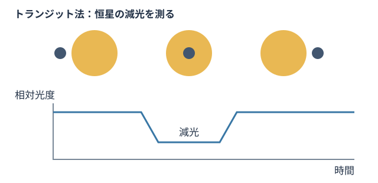
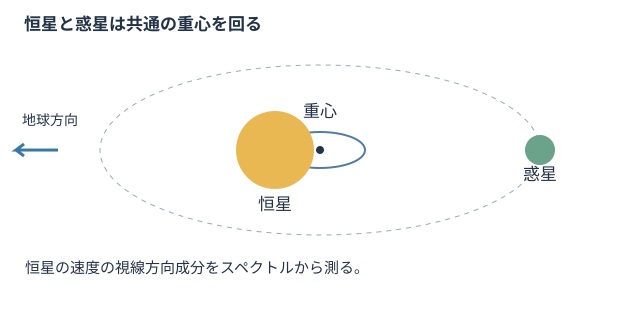
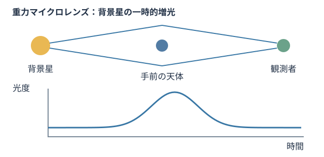
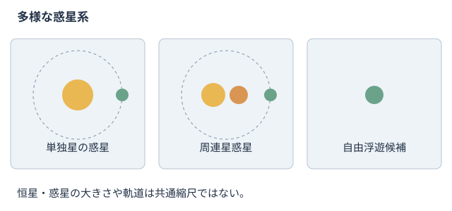

# 太陽系の外に広がる無数の世界

::: {.callout-note title="この章で学ぶ理由"}
前章までに、恒星が生まれ、元素を作って次の世代へ渡す過程を学びました。その材料から惑星も生まれます。かつて太陽系は唯一知られた惑星系でしたが、現在は多様な世界が見つかっています。見えにくい惑星をどう発見し、その性質をどこまで知ることができるのかを考えます。
:::

## 太陽系は特別な存在なのか

夜空に見える恒星の周囲にも惑星が存在すると長く考えられていました。しかし恒星の強い光の近くにある小さく暗い惑星を見つけるのは容易ではありません。

1992年にはパルサーを回る惑星の発見が報告され、1995年には太陽に似た恒星の周りを回る51 Pegasi bが発見されました。前者は死んだ恒星の残骸を回る惑星、後者は普通の恒星を回る巨大惑星です。1995年の発見を全ての系外惑星の最初の発見と混同しないようにしましょう。[1]

NASAの集計では、2022年3月に確認済み系外惑星が5000個、2025年9月に6000個に達しました。これは歴史的な節目であり、宇宙に存在する惑星の総数でも、2026年時点の最新確認数でもありません。[2]

## 惑星はどのように生まれるのか

第4章の原始星を思い出してください。ガスと塵が重力で集まり、回転する物質が中心天体の周囲に円盤を作ることがあります。この原始惑星系円盤の中で塵が集まり、より大きな固体へ成長します。微惑星や原始惑星が形成され、十分大きな核が周囲のガスを取り込むこともあります。成長には衝突、円盤との相互作用、軌道移動などが関わります。円盤の重力不安定性によって物質が直接まとまる形成経路も研究されています。

 ／ [CC BY 4.0](https://creativecommons.org/licenses/by/4.0/)。](../figures/external/hh30.jpg){#fig-hh30 width=100%}

2025年公開のHH 30の観測例では、異なる波長のデータを組み合わせて円盤の塵や流出するガスを調べています。[3] 見えているのは形成環境であり、個別の惑星が確認されたという意味ではありません。

## 光のわずかな減少で惑星を見つける

地球と恒星の間を惑星が通過すると、恒星の光の一部が遮られます。この一時的な減光を測る方法がトランジット法です。

{#fig-exoplanet-transit width=100%}

太陽を地球ほどの半径の惑星が正面から横切れば、明るさの低下はおよそ0.0084パーセントです。木星ほどの半径ならおよそ1パーセントです。恒星表面の明るさを均一とした概算ですが、小さな惑星の発見が難しい理由を示しています。

減光が繰り返される間隔は公転周期の手掛かりです。減光の深さは恒星に対する惑星の面積比を反映するため、恒星の半径を別に推定できれば惑星半径を求められます。ただし食連星や恒星の活動も光度変化を生むので、信号の検証が必要です。

KeplerやTESSはこの原理で多くの候補を見つけてきました。大きく、短い周期で回る惑星ほど観測しやすい傾向があります。発見数の分布を惑星全体の分布とそのまま解釈できない点が重要です。[4]

## 恒星も惑星に引っ張られる

惑星は恒星の重力で回っていますが、恒星も惑星から重力を受けます。二つの天体は共通の重心の周りを運動します。恒星が地球に近づくとスペクトルの波長は短い側へ、遠ざかると長い側へ移ります。この周期的変化から視線方向の速度を測る方法を視線速度法と呼びます。第2章の赤方偏移と同様に光の波長を測りますが、ここで利用するのは主に恒星の運動によるドップラー効果です。

{#fig-exoplanet-velocity width=100%}

視線速度法だけでは軌道の傾きが分からず、質量の下限に相当する量しか求まらないことがあります。トランジットなどを組み合わせれば、質量と半径を同時に推定できます。[4] 同じ恒星に複数の惑星があれば、速度変化にも複数の周期が重なることがあります。

## 惑星を直接見る

 ／ [CC BY 4.0](https://creativecommons.org/licenses/by/4.0/)。](../figures/external/hip65426b.jpg){#fig-hip65426b width=100%}

恒星の光を抑えるコロナグラフなどを利用し、周囲の暗い天体の光を取り出せます。2022年のWebbの観測では、既知の巨大惑星HIP 65426 bを複数の赤外線波長で撮像しました。若く高温で自ら赤外線を放ち、主星から大きく離れて見える惑星はこの方法で検出しやすくなります。[5]

## 恒星を持たない惑星を探す

広大な恒星間空間にも、惑星程度の質量を持ち恒星の周りを回っていない天体が存在すると考えられています。自由浮遊惑星と呼ばれる天体です。惑星系内の重力相互作用によって放り出された場合や、恒星形成に似た過程で直接形成された場合などが考えられます。

恒星を持たない暗い惑星でも、遠方の恒星の手前を通り過ぎると、その重力で背景の光を曲げ、一時的に明るく見せることがあります。これが重力マイクロレンズ法です。

{#fig-exoplanet-microlensing width=100%}

増光の時間尺度には天体の質量だけでなく距離や相対速度も影響します。短時間の増光だけで質量や恒星に束縛されていないことまで必ず確定できるわけではありません。Roman宇宙望遠鏡のマイクロレンズ観測計画は、広い軌道の惑星や自由浮遊惑星の個数・質量分布を調べることを目指しています。[6]

| 方法 | 主な観測量 | 推定できること・限界 |
|---|---|---|
| トランジット | 恒星の減光 | 半径・周期。軌道の向きに依存 |
| 視線速度 | スペクトルの変化 | 質量への制約・周期。傾きに依存 |
| 直接撮像 | 惑星の光 | 明るさ・分光。主星との分離が課題 |
| マイクロレンズ | 背景星の増光 | 遠方惑星、自由浮遊候補。再観測困難 |
| 位置天文学 | 恒星の見かけの位置 | 重心運動。精密な位置測定が必要 |

## 太陽系には存在しない惑星たち

### ホットジュピター

51 Pegasi bは巨大ガス惑星ですが、公転周期は約4.2日しかありません。太陽系では巨大惑星は外側にありますが、このような惑星は恒星に極めて近い軌道を回ります。巨大惑星の形成場所と現在の軌道が同じとは限らず、円盤との相互作用や他天体との重力相互作用による軌道移動が研究されています。[1][2]

### スーパーアース

スーパーアースは地球より大きい、あるいは重い惑星を指す分類で、定義は資料により異なります。地球の環境に似ていることや生命の存在を意味しません。例えば55 Cancri eは公転周期が18時間未満の高温の惑星です。[7]

質量と半径から平均密度を求めれば、岩石主体か、ガスや水などの軽い成分を多く持つかを制約できます。ただし異なる内部組成で同じ平均密度になる場合があり、大気分光など独立した情報を加える必要があります。

### 二つの太陽を持つ世界

Kepler-16 bは二つの恒星をまとめて回る周連星惑星です。2011年の発見により、二つの恒星の周囲を公転する惑星の存在が観測的に示されました。[8]

{#fig-exoplanet-systems width=100%}

連星系では一方の恒星の周囲だけを回る惑星もあり、二つの恒星の間隔や惑星の軌道によって安定性が変わります。Kepler-16 bはガスの多い巨大惑星であり、地球のような地表から二つの夕日を見られることを示した観測ではありません。

## どれほど多くの世界が存在するのか

発見された惑星の数は観測時間、感度、観測対象の選び方に依存します。例えば地球と同じ一年の周期を持つ惑星をトランジットで確認するには、複数年にわたる観測や追加確認が必要になる場合があります。恒星の前を通らない向きの軌道なら、この方法では見えません。

惑星の存在頻度を求めるには、見つからなかった惑星の存在も考慮し、検出効率をモデル化する必要があります。異なる観測方法を組み合わせることで、惑星系の多様性をより正確に調べられます。

## この章のまとめ

| 成果 | 科学的な位置づけ |
|---|---|
| 数千個の系外惑星と多様な公転軌道 | 観測で確認 |
| 原始惑星系円盤と塵の分布 | 観測 |
| 惑星形成・軌道移動の詳細 | 観測と理論に基づく研究 |
| 質量・半径・平均密度 | 観測と力学モデルによる推定 |
| 自由浮遊惑星の総数・形成経路 | 未確定 |

### 理解度確認

1. 恒星の周期的な減光から惑星の何が分かるか。
2. 視線速度法で恒星を観測するのはなぜか。
3. 直接撮像の惑星の光点は地表を写した写真なのか。
4. 暗い自由浮遊候補を探す方法は何か。
5. スーパーアースは生命が存在しやすい惑星を意味するか。
6. 発見された惑星の分布を銀河全体の分布と同一視できない理由は何か。

**解答**

1. 周期から公転周期、減光の深さと恒星半径から惑星半径を推定できる。
2. 恒星も惑星の重力で重心の周りを運動するから。
3. いいえ。惑星からの光を捉えた像で、通常は地表を分解していない。
4. 背景星の重力マイクロレンズによる増光を測る方法。
5. いいえ。大きさや質量に関する分類である。
6. 検出方法や観測対象による選択効果があるから。

### 後編への接続

第30〜31章で重心と軌道運動、第32章でドップラー効果、第37章で惑星の軌道と熱収支、第44〜45章で重力による光の曲がり方を学ぶ。次章では、液体の水や生命が存在できる条件を考える。

### 参考資料

1. [NASA, Nobel Winners Changed Our Understanding with Exoplanet Discovery (2019)](https://science.nasa.gov/universe/exoplanets/nobel-winners-changed-our-understanding-with-exoplanet-discovery/)
2. [NASA, 30 Years of Exoplanets](https://science.nasa.gov/exoplanets/30-years-of-exoplanets-compilation/)
3. [ESA/Webb, The many faces of HH 30 (2025-02-04)](https://esawebb.org/images/potm2501b/)
4. [NASA, The Search for Other Earths](https://science.nasa.gov/resource/the-search-for-other-earths-fact-sheet/)、[How We Find and Characterize](https://science.nasa.gov/exoplanets/how-we-find-and-characterize/)
5. [ESA/Webb, Webb Takes Its First Exoplanet Image (2022-09-01)](https://esawebb.org/images/HIP-65426b/)（公開当時は査読前の画像）
6. [NASA Roman, Microlensing](https://science.nasa.gov/mission/roman-space-telescope/microlensing/)
7. [NASA, What Is a Super-Earth?](https://science.nasa.gov/exoplanets/super-earth/)、[55 Cancri e](https://science.nasa.gov/exoplanet-catalog/55-cancri-e/)
8. [NASA, Kepler-16 b](https://science.nasa.gov/exoplanets/other-stars-other-worlds/kepler-16-b-almost-a-real-life-tatooine/)

確認日：2026-11-29。公式画像は各画像ページのクレジットを保持してCC BY 4.0で利用。自作図は原理説明用で実測値ではない。トランジットの概算は地球・太陽・木星の代表半径の面積比から求めた。
