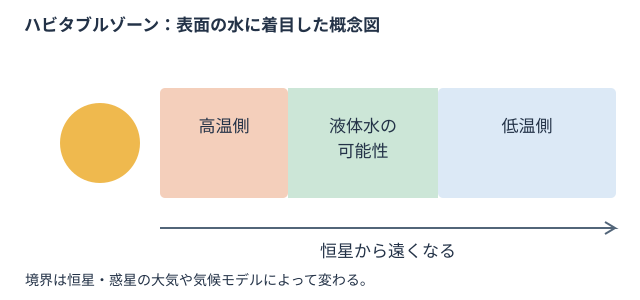
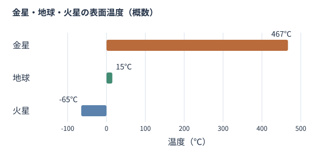
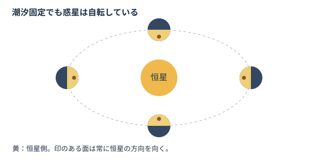
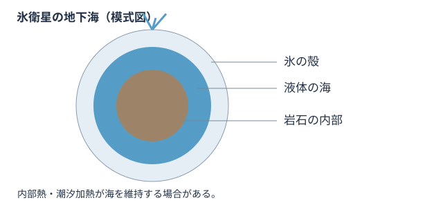
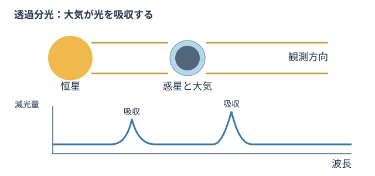
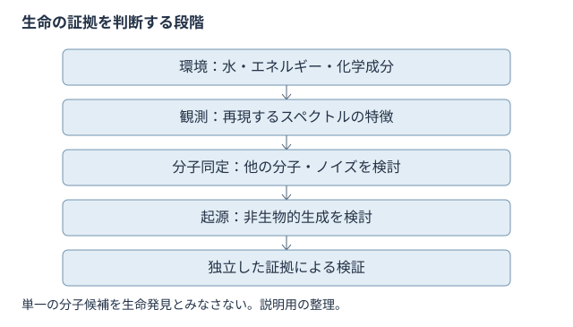

# 生命が存在できる惑星の条件

::: {.callout-note title="この章で学ぶ理由"}
第7章では、恒星を回る惑星の発見方法と、太陽系にはない世界を学びました。しかし惑星を発見すること、液体の水を保てると推定すること、生命を発見することはそれぞれ違います。本章では地球を出発点として、別の世界に生命が存在する可能性をどう調べるかを考えます。
:::

## 地球はなぜ水を保てるのか

第6章で学んだ水素と酸素があっても、それだけで海ができるわけではありません。水が液体でいられるには温度と圧力が関係します。地球は太陽からエネルギーを受け取り、吸収したエネルギーを赤外線として宇宙へ放出します。大気や海は、そのエネルギーを地表でどう分配するかにも影響します。

太陽から遠くなるほど、同じ面積が受け取る光のエネルギーは減ります。例えば距離が2倍なら受け取る光は4分の1です。ただし、惑星が反射する光の割合、大気の組成、内部から出る熱も温度を変えます。

## ハビタブルゾーンは生命の存在証明ではない

恒星の周囲で、適切な大気を持つ岩石惑星が表面に液体の水を保ち得る距離の範囲をハビタブルゾーンと呼びます。液体の水を生命探索の目印とするのは、現時点で知られている生命が水を利用しているからです。

{#fig-habitable-zone width=100%}

太陽から地球までの平均距離に相当する約1億5000万キロメートルを1天文単位と呼びます。Kopparapuらの2013年の気候モデル（訂正を含む）では、太陽系の水損失限界と最大温室効果限界はそれぞれ約0.99、1.70天文単位です。[1] これは特定の大気・気候モデルでの数値例であり、雲や惑星質量などの条件を変えると境界も変わります。

光度の低い恒星では同じ程度のエネルギーを得るために近くを回る必要があります。例えば太陽の100分の1の光度を持つ恒星から、地球が受けるのと同じエネルギーを受け取る距離は約0.1天文単位です。ただし恒星の光の波長分布が異なるため、同じ受光量が同じ気候を保証するわけではありません。

## 金星・地球・火星から学ぶ温室効果

表面温度は恒星からの距離だけでは決まりません。地表が放射する赤外線の一部を大気が吸収・再放射すると、地表や大気の温度分布が変わります。これが温室効果です。

| 惑星 | 太陽からの距離（天文単位、概数） | 代表的な表面温度 | 主な特徴 |
|---|---:|---:|---|
| 金星 | 0.72 | 約467℃ | 非常に厚い二酸化炭素大気 |
| 地球 | 1.00 | 約15℃ | 水の海、窒素・酸素を主成分とする大気 |
| 火星 | 1.52 | 約マイナス65℃ | 薄い二酸化炭素大気 |

{#fig-terrestrial-temperatures width=100%}

金星と地球は大きさが似ていますが、大気が大きく違います。金星は強い温室効果で非常に高温です。火星は過去に液体の水が流れた証拠がある一方、現在の表面環境は寒冷で気圧も低く、液体の水を長く保つことが困難です。[2]

ここから、大気の組成だけではなく、量、気圧、惑星の重力、恒星の活動や惑星の歴史も重要であると分かります。二酸化炭素を検出しただけでは温室効果の強さを決められません。

## 赤色矮星の近くでは昼と夜が固定されるのか

潮汐とは、天体の近い側と遠い側で重力の強さが異なる効果です。恒星の近くを回る惑星は、長い時間をかけて潮汐の影響で自転が公転と同期することがあります。この状態を同期回転または潮汐固定と呼びます。円軌道で自転軸の傾きが小さければ、恒星に同じ面を向け続けます。

{#fig-tidal-locking width=100%}

恒星に近い赤色矮星のハビタブルゾーンでは、潮汐固定が起きていると考えられる惑星があります。恒星に面した側が永遠の昼、反対側が夜なら、激しい温度差が生じるかもしれません。しかし厚さや組成が適切な大気・海があれば熱を運び、差を緩和する可能性もあります。逆に恒星のフレアや高エネルギー放射が大気を失わせることも考えられます。[3] 潮汐固定だけで居住可能性を否定することはできません。

## 氷の下に海があれば生命は存在できるのか

地表の液体の水だけが生命候補の環境ではありません。太陽から遠い氷衛星でも、内部熱や潮汐による変形が熱源となって、氷の下の液体の海を維持できる可能性があります。

木星の衛星エウロパでは、Galileo探査機の磁場測定が導電性の層の存在を示し、塩水の海が有力な説明になっています。Europa Clipperの目的はその環境の居住可能性を詳しく調べることであり、生命を直接検出することを主目的とする探査ではありません。[4]

土星の衛星エンケラドゥスでは、Cassini探査機が南極付近から噴出する物質を調べました。2023年のPostbergらの研究は、氷粒子の質量スペクトルからリン酸塩を同定し、内部の海にリンが存在することを支持しました。[5]

{#fig-subsurface-ocean width=100%}

水、化学反応に使える物質、エネルギー源は生命にとって重要な条件ですが、それらがそろっているだけでは生命が発生したとは言えません。地球外の海の探索は、表面のハビタブルゾーンという目印を越えて生命候補の環境を考えるきっかけになります。

## 大気をどうやって調べるのか

第7章のトランジット法をさらに詳しく使います。惑星に大気があると、恒星の光の一部が大気を通って地球に届きます。大気中の分子は特定の波長の光を吸収するため、見かけ上の惑星の大きさは波長によって異なります。この変化を測るのが透過分光です。

{#fig-transmission-spectrum width=100%}

観測されるのは波長ごとの減光であり、分子名が望遠鏡に直接表示されるわけではありません。分子の吸収の実験データ、大気の温度や気圧、雲・霞などを考慮したモデルで観測を説明します。異なる分子が似た波長の特徴を持つことや、恒星表面の黒点・白斑が信号に混入することもあります。

## TRAPPIST-1：地球サイズの惑星の大気を探す

TRAPPIST-1には地球程度の大きさの惑星が7個あり、そのうちe、f、gはハビタブルゾーンにあると推定されています。[6] しかし、表面に海があると確認されたわけではありません。

 ／ [CC BY 4.0](https://creativecommons.org/licenses/by/4.0/)。](../figures/external/trappist1e_spectrum.jpg){#fig-trappist1e-spectrum width=100%}

2025年のデータからは厚い水素主体の大気が否定的とされましたが、大気が全くないとは断定できません。[6][7] 2026年には内側の惑星b・cの熱位相曲線から厚い大気を支持しない結果も報告されています。[8] これをe、f、gにもそのまま適用することはできません。惑星ごとに観測することが重要です。

## バイオシグネチャーとは何か

生命活動の存在を示す候補となる観測特徴をバイオシグネチャーと呼びます。地球では酸素やメタンなどが生命活動と深く関係しています。しかし、光化学反応や地質活動でも生じる分子があります。例えば酸素は水の光分解と水素の散逸でも蓄積する可能性があり、メタンにも非生物的な生成経路があります。

重要なのは分子があるかだけではなく、その量、他の分子との組み合わせ、恒星の放射、惑星の地質や大気の反応を踏まえて、生命なしで説明できるかを検討することです。

### K2-18 b：生命発見の報道をどう読むか

地球から約120光年のK2-18 bはハビタブルゾーンを回るサブネプチューンです。地球より重く、大気や内部構造が地球と同じとは限りません。2023年にWebbの近赤外線観測からメタンや二酸化炭素が報告され、DMS（硫化ジメチル）の候補も示されました。[9]

 ／ [CC BY 4.0](https://creativecommons.org/licenses/by/4.0/)。](../figures/external/k218b_spectrum.jpg){#fig-k218b-spectrum width=100%}

2025年には中赤外線観測の解析からDMSまたはDMDS（二硫化ジメチル）の候補が改めて報告されました。[10] しかし、別の研究ではデータ処理や比較する大気モデルによって候補分子の有意性が変わることが示されました。2025年12月公開・2026年巻のNature Astronomyの研究では、候補モデルを広げると他の分子などでも説明でき、当初の生命指標の主張が頑健ではないと指摘しました。[11] 2026年の別の大気研究では、水の海を仮定しなくても観測を説明できる水素・ヘリウム主体のモデルが報告されています。[12]

この事例から、あるモデルが観測を説明できることと、そのモデルだけが観測を説明できることを区別する必要があると分かります。DMS/DMDSが確実に存在することも、その生成源が生命であることも確立していません。

{#fig-biosignature-evidence width=100%}

## この章のまとめ

| 成果 | 科学的な位置づけ |
|---|---|
| ハビタブルゾーン | 大気・気候モデルによる表面水の可能性の推定 |
| 金星・地球・火星の大気と温度 | 観測、物理モデルで理解 |
| 氷衛星の地下海 | 複数の観測による強い証拠 |
| エンケラドゥスのリン酸塩 | 噴出物の分析から同定 |
| TRAPPIST-1 eの大気 | 厚い水素主体の大気は否定的、詳細は未確定 |
| K2-18 bのDMS/DMDSと生命 | 未確認。分子同定・非生物的起源の検証が必要 |

### 理解度確認

1. ハビタブルゾーンに入っている惑星に液体の水があるとは限らないのはなぜか。
2. 金星と地球の温度差を距離だけで説明できない理由は何か。
3. 同期回転する惑星は自転していないのか。
4. 太陽から遠い氷衛星に液体の水が存在し得る理由は何か。
5. 透過分光では何を測定するか。
6. DMS候補の報告を生命発見と見なせない理由は何か。

**解答**

1. 大気、気圧、反射率、内部熱などの条件が異なるから。
2. 大気の温室効果などが温度を大きく変えるから。
3. 自転している。公転一周に対して自転一周する。
4. 潮汐による加熱などの内部熱が、氷の下の海を維持できる場合があるから。
5. 惑星が恒星の前を通る際の波長ごとの減光。
6. 分子の同定自体が未確定で、仮に存在しても非生物的な生成経路を排除する必要があるから。

### 後編への接続

第32章で分光、第33章で熱放射、第37章で軌道と熱収支を計算する。温室効果や透過スペクトルの完全な再現には大気の放射輸送・化学モデルも必要であり、簡単な熱収支との違いを明示する。

次章では、星の最期に残された中性子星を取り上げ、日常の物質とは極端に異なる環境を学びます。

### 参考資料

1. [Kopparapu et al. 2013, Habitable Zones Around Main-sequence Stars: New Estimates](https://doi.org/10.1088/0004-637X/765/2/131)、[訂正](https://doi.org/10.1088/0004-637X/770/1/82)、[著者の更新値説明](https://personal.ems.psu.edu/~jfk4/ruk15/)
2. [NASA, Solar System Temperatures](https://science.nasa.gov/resource/solar-system-temperatures/)、[Venus Facts](https://science.nasa.gov/venus/venus-facts/)
3. [NASA, The Habitable Zone](https://science.nasa.gov/exoplanets/habitable-zone/)、[Earth-sized planets](https://science.nasa.gov/universe/exoplanets/earth-sized-planets-the-newest-weirdest-generation/)
4. [NASA, Europa Facts](https://science.nasa.gov/jupiter/jupiter-moons/europa/europa-facts/)、[Europa Clipper FAQ](https://science.nasa.gov/mission/europa-clipper/mission-faq/)
5. [Postberg et al. 2023, Detection of phosphates originating from Enceladus's ocean](https://doi.org/10.1038/s41586-023-05987-9)
6. [NASA, What is Webb Revealing About the TRAPPIST-1 System?](https://science.nasa.gov/mission/webb/science-overview/science-explainers/what-is-webb-revealing-about-the-trappist-1-system/)
7. [ESA/Webb, TRAPPIST-1 e Transmission Spectrum](https://esawebb.org/images/trappist1e/)
8. [No thick atmosphere around TRAPPIST-1 b and c from JWST thermal phase curves, Nature Astronomy (2026)](https://doi.org/10.1038/s41550-026-02806-9)
9. [ESA/Webb, Spectra of exoplanet K2-18 b (2023)](https://esawebb.org/images/weic2321b/)
10. [Madhusudhan et al. 2025, New Constraints on DMS and DMDS in the Atmosphere of K2-18 b from JWST MIRI](https://arxiv.org/abs/2504.12267)
11. [Challenges in the detection of gases in exoplanet atmospheres, Nature Astronomy 10 (2026), online 2025-12-16](https://doi.org/10.1038/s41550-025-02730-4)（公開概要参照）、[K2-18b Does Not Meet the Standards of Evidence for Life](https://arxiv.org/abs/2508.05961)
12. [The atmospheric composition of the sub-Neptune K2-18b and insights into its formation (2026)](https://doi.org/10.1051/0004-6361/202557718)

確認日：2026年11月29日。公式図版2点は観測データとモデルの比較図で、惑星表面の写真ではない。自作図6点は概念図または代表値のグラフ。論文は公開概要を主に参照。網羅的な分光再解析は未実施。
