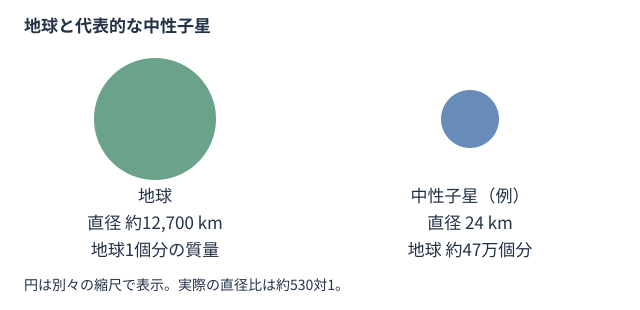
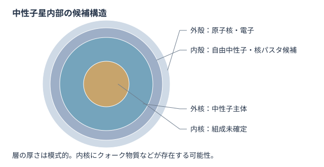
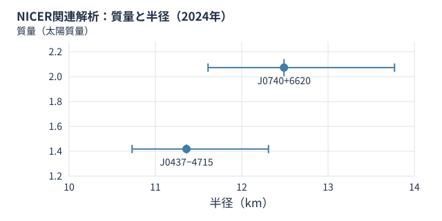
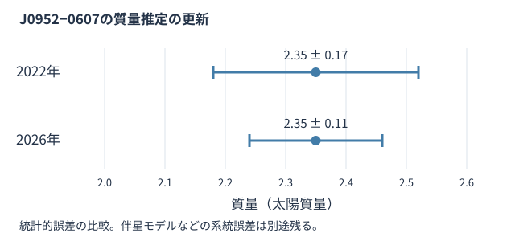

# 中性子星という異常な天体

::: {.callout-note title="この章で学ぶ理由"}
第5章では重い恒星の核崩壊を、第6章では中性子星の合体による元素合成を学びました。ここでは合体する前の中性子星そのものを調べます。太陽以上の質量が都市ほどの大きさに閉じ込められると、物質はどうなるのでしょうか。その答えは、量子力学、原子核物理学、一般相対性理論の接点にあります。
:::

## 都市ほどの大きさに恒星の質量が詰まる

代表的な中性子星として、太陽の1.4倍の質量、半径12キロメートルの天体を想定します。直径は24キロメートルです。地球の直径約1万2700キロメートルと比べると、約530分の1にすぎません。しかし質量は地球の約47万倍です。

{#fig-neutron-star-scale width=100%}

普通の球として体積を見積もって質量を割ると、平均密度の目安は1立方メートルあたり約38京キログラムです。小さじ1杯を5ミリリットルとすれば、その体積に相当する質量は約19億トンにもなります。東京ドームに詰めるのではなく、たった小さじ1杯です。

これは質量と半径による平均密度の概算です。一般相対論では体積の定義にも注意が必要で、内部密度も一様ではありません。また、中性子星の物質を地球へ持ち帰ってその密度を保てるという意味ではありません。強大な重力と高圧が失われると状態も変わります。

 ／ [CC BY 4.0](https://creativecommons.org/licenses/by/4.0/)。](../figures/external/rxj1856_hubble.jpg){#fig-rxj1856 width=85%}

この画像から中性子星の直径を直接測ったわけではありません。遠方の小さな天体の性質は、光や運動に関する観測を組み合わせて推定します。[1]

## 原子が通常の形を保てなくなる

日常の物質では、原子核の周囲に電子が広がっています。第5章で学んだ白色矮星は電子縮退圧で重力を支えていますが、さらに重い恒星の中心では電子捕獲によって陽子と電子から中性子やニュートリノが生じる反応が進みます。

核崩壊の過程で密度は原子核内部に匹敵する領域に達します。そこで核力による物質の硬さが重要になり、崩壊が止まって中性子星が残ることがあります。中性子星は単に中性子だけが密に並んだ巨大な原子核ではありません。表面付近には原子核と電子があり、内部には中性子に富む物質と少量の陽子・電子などが存在すると考えられています。

中性子も電子と同じくフェルミ粒子です。量子状態を占有する際の制約に由来する縮退圧が生じます。ただし中性子星の支持を縮退圧だけで説明するのは不十分です。粒子間の強い相互作用、組成、密度に応じた圧力の変化と一般相対論的な重力を合わせて扱います。[2]

 ／ [CC BY 4.0](https://creativecommons.org/licenses/by/4.0/)。](../figures/external/vela_remnant.jpg){#fig-vela-remnant width=85%}

## 中性子星の内部を想像する

{#fig-neutron-star-layers width=100%}

| 領域 | 代表的な物質・状態 | 注意点 |
|---|---|---|
| 表面・大気 | 薄い大気、場合により凝縮した表面 | 温度、磁場、組成に依存 |
| 外殻 | 中性子に富む原子核と電子 | 原子核が格子を形成すると考えられる |
| 内殻 | 原子核、自由中性子、電子 | 中性子の超流動や核パスタが候補 |
| 外核 | 中性子主体の高密度物質、陽子・電子など | 超流動・超伝導の可能性 |
| 内核 | より高密度の物質 | ハイペロンやクォーク物質なども候補 |

ここでいう超流動は、量子力学的な集団状態によって粘性のない流れなどが可能になる性質です。中性子星の自転速度の突然の変化（グリッチ）を説明するモデルにも関係します。第10章で詳しく扱います。層の境界や物質の状態は温度・質量・状態方程式によって異なります。[2]

## 核パスタ：原子核が棒や板になる世界

通常の原子核は小さなまとまりですが、中性子星の内殻の底に近い高密度環境では、原子核同士の距離が小さくなり、核力と電荷による反発の競合で複雑な形状が安定になる可能性があります。

{#fig-nuclear-pasta width=100%}

球状はニョッキ、棒状はスパゲティ、板状はラザニアと呼ばれることがあります。料理に似ているのは形だけであり、実際の食材とは無関係です。

2018年のCaplanらの研究は、分子動力学シミュレーションによって核パスタの変形と破断を調べ、非常に高い強度を持つ可能性を示しました。[3] これは地球の実験装置で試料の強度を直接測った結果ではありません。星の内部にその構造が形成されるか、どの形がどの範囲に存在するかも理論に依存します。

## 中性子星の重力はどれほど強いのか

半径12キロメートルに太陽の1.4倍の質量が集まる場合、ニュートン力学で見積もる表面重力は地球の約1300億倍です。ただしこのような天体では一般相対論の補正が重要です。光も重力の影響を受けるため、表面から出る光の経路や、観測される光のエネルギー・時間間隔が変化します。

中性子星とブラックホールの重要な違いは、中性子星には物質の表面があり、そこからの光が遠方へ届き得ることです。ブラックホールには外へ光が逃げられない領域の境界である事象の地平面があります。高密度であることとブラックホールであることは同じではありません。

## どうやって半径を測るのか

中性子星の表面に高温領域があると、自転につれて観測されるX線の強さやスペクトルが変化します。強い重力が光を曲げるため、通常の球なら見えない側の一部も見える場合があります。星の質量と半径、観測方向、高温領域の形状、大気などを仮定して、観測されたX線の変化を再現するモデルを調べます。

NASAのX線観測装置NICERは、このようなパルス形状の解析を利用して中性子星の半径を推定します。2024年に報告された二つの解析例を比較します。[4][5]

| 天体 | 質量（太陽の質量を1とする） | 半径（km） |
|---|---:|---:|
| PSR J0437−4715 | 1.418（±0.037） | 11.36（10.73〜12.31） |
| PSR J0740+6620 | 2.073（±0.069） | 12.49（11.61〜13.77） |

{#fig-neutron-star-mass-radius width=100%}

これはすべての中性子星がこの半径を持つという測定でも、単純に重い星ほど大きくなるという発見でもありません。観測誤差、モデル、事前分布を考慮する必要があります。

## 中性子星には最大質量がある

物質の密度が増したときに圧力がどの程度増えるかという関係を、状態方程式と呼びます。一般相対論の下で、重力と圧力の釣り合いを計算すると、与えた状態方程式に対して安定な非回転星の最大質量が得られます。これをトルマン・オッペンハイマー・ヴォルコフ（TOV）限界と呼びます。

チャンドラセカール限界は白色矮星に関する限界です。中性子星のTOV限界は別の物質と重力の問題です。状態方程式が完全には分からないため、その値も一つに確定していません。

PSR J0952−0607について、2022年の研究は太陽の2.35倍、統計的な誤差0.17倍という質量推定を報告しました。2026年刊行のRomaniらの研究では、追加測光と視線速度解析によって誤差が0.11倍に縮小されました。[6][7] この天体は高速回転し、伴星の加熱を含む光学モデルが質量推定に関係します。系統誤差は残っています。

{#fig-neutron-star-heavy-mass width=100%}

存在する重い中性子星を観測できれば、少なくともそのような星を支えられない状態方程式は制約されます。ただし自転による支持もあるため、観測された回転星の質量をそのまま非回転星のTOV限界とみなすことはできません。

## 重力波で物質の硬さを調べる

第6章で触れたGW170817では、二つの中性子星が近づく際に互いの潮汐力によって変形することが、重力波の波形を通じて調べられました。物質がどの程度変形するかは、半径や状態方程式に依存します。[8]

X線の光度変化、連星運動、重力波は異なる情報を与えます。これらを組み合わせれば、どの状態方程式が観測と両立できるかをより厳しく調べられます。

## クォーク星は存在するのか

中性子や陽子はクォークから構成されます。非常に高密度になると、個々の中性子や陽子というまとまりが維持されず、クォークが閉じ込めから解放された物質状態が形成される可能性があります。

2023年のAnnalaらは、天体観測と量子色力学の理論的制約を組み合わせたベイズ推定から、最大質量に近い中性子星の中心にクォーク物質が存在する可能性を論じました。[9] ただしこの結論は状態方程式の推定方法や相転移の扱いに依存し、クォークを直接検出したものではありません。

中性子星の中心だけがクォーク物質である混成星と、星の大部分がクォーク物質である仮説的なクォーク星は区別します。後者の存在も確立していません。

## この章のまとめ

| 内容 | 科学的な位置づけ |
|---|---|
| 中性子星の存在と高密度 | 複数の観測と理論に支持される |
| 質量・半径 | 天体ごとの観測・モデルによる推定 |
| 電子捕獲、縮退圧、核力 | 既知の物理に基づく説明 |
| TOV限界 | 状態方程式を与えた場合の理論的限界。真の値は未確定 |
| 核パスタ・クォーク物質 | 理論と観測制約による候補。内部の直接観測ではない |

### 理解度確認

1. 中性子星が白色矮星と違う主な点は何か。
2. 中性子星の平均密度を求めるときに必要な二つの量は何か。
3. NICERは星の表面の直径を写真から測っているのか。
4. 重い中性子星が発見されると何が制約されるのか。
5. 核パスタの強度を示す研究は直接測定か。
6. クォーク物質の可能性を論じた研究はクォーク星の発見を意味するか。

**解答**

1. 白色矮星よりはるかに高密度で、中性子に富む物質、核力、相対論的重力が重要になる。
2. 質量と半径（体積の目安）。
3. いいえ。X線のパルス形状を重力による光の曲がりなどを含むモデルと比較して推定する。
4. 高密度物質の状態方程式と、星が安定に存在できる最大質量への制約。
5. いいえ。分子動力学シミュレーションによる予測。
6. 意味しない。クォーク物質を含む中心と星の大部分がクォーク物質である天体は別で、いずれも直接同定されていない。

### 後編への接続

第34章で静水圧平衡、第36章でフェルミ粒子と縮退圧、第43章で相対論的な重力、第47章でTOV方程式と質量・半径関係、第48章で重力波と潮汐の情報を学びます。核力の微視的導出や高密度量子色力学は本書の発展的課題です。

次章では、自転する中性子星から周期的に届く信号と、極端な磁場について学びます。

### 参考資料

1. [ESA/Hubble, Hubble Sees a Neutron Star Alone in Space (1997)](https://esahubble.org/images/opo9732a/)、[ESO Vela残骸 (2009)](https://www.eso.org/public/images/vela-snr-schmidtourcomp/)
2. [Astrophysical constraints on the cold equation of state of the strongly interacting matter (2026)](https://doi.org/10.1140/epjs/s11734-026-02286-y)、[What We Have Learned from NICER About Neutron Star Radii (2026)](https://doi.org/10.1146/annurev-nucl-100824-043815)（公開要旨・取得可能な抜粋参照）
3. [Caplan et al., Elasticity of Nuclear Pasta, Phys. Rev. Lett. 121, 132701 (2018)](https://doi.org/10.1103/PhysRevLett.121.132701)
4. [A NICER View of the Nearest and Brightest Millisecond Pulsar: PSR J0437–4715 (2024)](https://doi.org/10.3847/2041-8213/ad5a6f)
5. [The Radius of the High-mass Pulsar PSR J0740+6620 with 3.6 yr of NICER Data (2024)](https://doi.org/10.3847/1538-4357/ad5f1f)
6. [Romani et al. (2022)](https://doi.org/10.3847/2041-8213/ac8007)
7. [Romani et al., PSR J0952-0607: Tightening a Record-High Neutron Star Mass, ApJ 996, 101 (2026)](https://arxiv.org/abs/2512.05099)（観測・フィット・回転補正・系統誤差の議論を参照）
8. [LIGO, GW170817: How big are neutron stars?](https://ligo.org/science-summaries/GW170817EoS/)、[LIGO/Virgo, Measurements of Neutron Star Radii and Equation of State (2018)](https://doi.org/10.1103/PhysRevLett.121.161101)
9. [Annala et al., Strongly interacting matter exhibits deconfined behavior in massive neutron stars, Nature Communications 14, 8451 (2023)](https://doi.org/10.1038/s41467-023-44051-y)（結果・議論を参照）

確認日：2026-11-29。平均密度・小さじの質量・表面重力は太陽質量1.9885×10の30乗kg、地球質量5.9722×10の24乗kg、半径12000m、万有引力定数6.6743×10のマイナス11乗のSI値を用いた概算。数式による導出は後編に回す。図の実測値は出典の値を転記した自作図。状態方程式の推定を独立に再現したわけではない。
