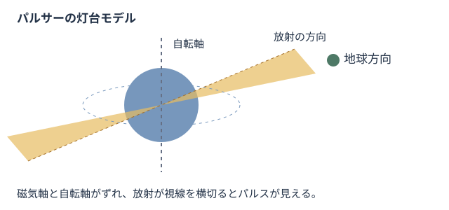
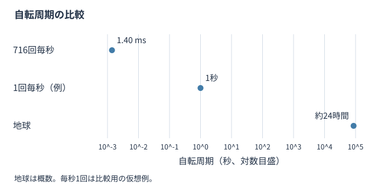
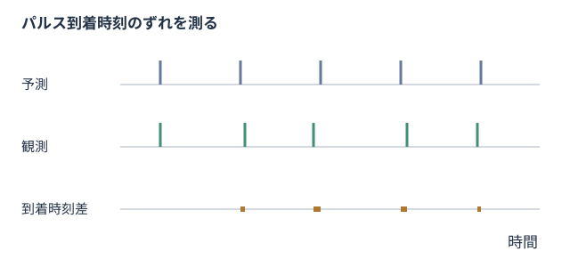
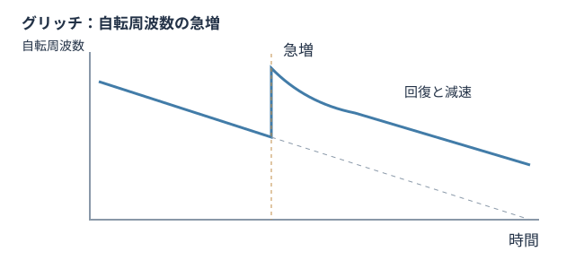
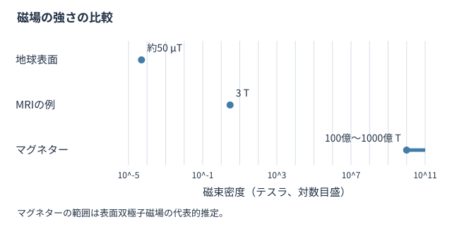
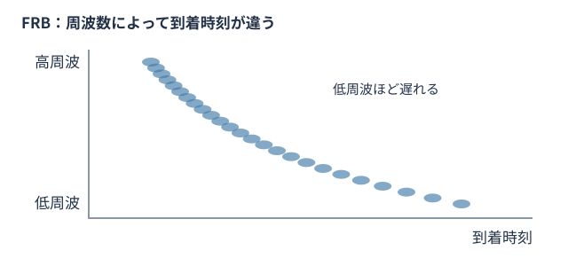

# パルサーとマグネター

::: {.callout-note title="この章で学ぶ理由"}
第9章では中性子星の密度と内部構造を学びました。中性子星は小さいだけではありません。高速で自転し、強い磁場を持ち、規則的な信号や突然の爆発を生み出すことがあります。その信号を利用すると、星の内部だけでなく、遠い宇宙の時空まで調べられます。
:::

## 宇宙の灯台を見つける

1967年、ジョスリン・ベル・バーネルらは規則正しく繰り返される電波信号を発見しました。普通の恒星の明るさの変化とは異なり、非常に短い周期で繰り返される信号です。現在では多くのパルサーが自転する中性子星と理解されています。

磁場の軸と自転の軸は必ずしも一致しません。磁極付近などから電波が一定の方向に放射され、星が回転するたびにその方向が地球を向けば、観測者にはパルスとして届きます。灯台の光が回転し、遠くにいる人からは周期的に光って見えるのと似ています。

{#fig-pulsar-lighthouse width=100%}

星全体が周期ごとに光り始め、消えるという意味ではありません。また、電波の放射がどのようなプラズマ過程で生じるかは研究が続いています。放射の向きが地球を横切らなければ、同じ種類の中性子星でもパルスを観測できないことがあります。

## 恒星が一秒間に716回も回転する

第5章で学んだ恒星の核崩壊では、中心部の大きさが急激に小さくなります。回転するスケート選手が腕を縮めると回転が速くなるように、外部との角運動量のやり取りが小さければ収縮によって自転は速くなります。

ただし、高速自転の中性子星がすべて誕生時からその速さだったわけではありません。連星では伴星から流れ込む物質が角運動量を運び、中性子星を再び高速回転させることがあります。これをリサイクルと呼びます。自転周期が数ミリ秒程度のパルサーはミリ秒パルサーと呼ばれ、多くはそのような進化を経験したと考えられています。

2006年に報告されたPSR J1748−2446adは毎秒716回自転します。自転一周は約1.40ミリ秒です。[1] 第9章の代表的な半径12キロメートルを仮に当てはめると、赤道付近の速度は毎秒約5万4000キロメートル、光速の約18パーセントになります。これは単純な円周と周期による概算であり、同天体の半径を実測した値ではありません。実際の高速回転星は球形から変形し、一般相対論の補正も必要です。

{#fig-pulsar-periods width=100%}

## パルサーが周囲の星雲を輝かせる

 ／ [CC BY 4.0](https://creativecommons.org/licenses/by/4.0/)。](../figures/external/crab_2024_hubble.jpg){#fig-crab-2024 width=85%}

回転する磁化した中性子星は、電磁場や粒子の流れを通じて回転エネルギーを外へ運びます。かにパルサーでは、このエネルギーが周囲の星雲の放射を支えています。磁場の中で高速の荷電粒子が曲げられると、シンクロトロン放射と呼ばれる電磁波を放ちます。

2026年3月にESA/Hubbleが公開した画像は、2024年の観測を用いたものです。1999〜2000年の観測との比較によって、約四半世紀にわたる星雲の拡大や変化を研究できます。[2] 星雲の光は中心星の表面の光だけではなく、外側の粒子やガスの放射でもあります。

## 宇宙の時計で時空を測る

通常の回転駆動パルサーはエネルギーを失い、長期的には自転が遅くなる傾向があります。しかし、その変化をモデルに含めれば、パルスの到着時刻を非常に精密に予測できる天体があります。

地球の運動、観測装置の時計、パルサー自身の運動、星間空間にある自由電子の影響などを補正して、観測された到着時刻とモデルによる予測の差を求めます。個々のパルスにはばらつきがあるため、多数のパルスの情報を合わせることも重要です。

{#fig-pulsar-timing width=100%}

この方法は連星の軌道や重力の検証にも利用されます。さらに、空の異なる方向にあるミリ秒パルサーを同時に長期間観測すると、長い周期の重力波の影響を探せます。これがパルサータイミングアレイです。

2023年のNANOGravの15年データ解析は、67個のパルサーに共通する、一般相対論の重力波背景と整合的な相関の証拠を報告しました。[3] 非常に大きなブラックホールの連星集団は有力な起源候補ですが、信号の全てがその起源だと確定したわけではありません。第16章で重力波、第48章でその物理を再訪します。

## 時計が突然速くなる：グリッチ

自転の速度が突然増加することがあります。これをグリッチと呼びます。外側の殻と内部の超流動の回転が少しずつ異なり、ある時に内部から外側へ角運動量が移るというモデルが有力です。

第9章で学んだように、中性子星内部の物質は超流動になっている可能性があります。回転する超流動では、回転の情報が量子化された渦に関係します。渦が原子核の格子などに捕らえられ、後に外れる過程が、急な角運動量の移動につながると考えられています。

{#fig-pulsar-glitch width=100%}

2016年12月にVelaパルサーで起きたグリッチは、連続的な電波観測で捉えられました。2018年のPalfreymanらはグリッチ時の電波放射の変化を報告し、2019年のAshtonらは自転の詳細な時間変化を解析しました。[4][5] これは内部の状態を推定する手掛かりですが、渦や超流動を直接撮影したわけではなく、回復過程の解釈にも複数のモデルがあります。

## マグネター：磁場に蓄えられたエネルギー

中性子星の中でも、非常に強い磁場に蓄えられたエネルギーが放射活動の主な源となる天体をマグネターと呼びます。代表的な表面双極子磁場の推定値は100億〜1000億テスラ程度です。[6][7] 地球表面の磁場はおよそ数十マイクロテスラなので、桁違いの強さです。

{#fig-magnetar-fields width=100%}

強い磁場は星の殻や周囲のプラズマに力を及ぼし、磁場の構造が急激に変わると大量のエネルギーが放射される可能性があります。殻の変形や破壊、磁場のつなぎ替え（磁気リコネクション）などが候補ですが、個別の爆発機構は完全には解明されていません。

2004年12月27日、SGR 1806−20から極めて強いガンマ線の巨大フレアが観測されました。[6] 多くの検出器が飽和するほど明るく、磁場に蓄えられたエネルギーが短時間に解放される現象を理解する重要な事例となりました。

| 観点 | 回転駆動パルサー | マグネター |
|---|---|---|
| 主な放射のエネルギー源 | 自転エネルギー | 磁場の自由エネルギー |
| 典型的な観測 | 周期的な電波・X線・ガンマ線など | X線・ガンマ線の活動、場合により電波パルス |
| 自転の特徴 | ミリ秒から秒程度など多様 | 秒程度の周期が多い |
| 分類の注意 | 観測される放射による区別もある | パルサーと排他的な分類ではない |

## 高速電波バーストはどこから来るのか

高速電波バースト（FRB）は、ミリ秒程度の短い時間に非常に強い電波が届く現象です。多くは天の川銀河の外から来ています。一度だけ検出されたものも、繰り返し観測されるものもあります。

電波は星間空間の自由電子の影響を受け、低周波の成分は高周波の成分より遅れて到着します。この分散から、電波が通過してきた自由電子の総量を推定できます。ただし電子の分布や発生源周辺の影響も含まれるため、分散だけで距離を正確に決められるわけではありません。

{#fig-frb-dispersion width=100%}

2020年4月28日、CHIMEとSTARE2が銀河系内のマグネターSGR J1935+2154から短く強い電波バーストを検出しました。[8][9] この成果は、少なくとも一部のFRBにマグネターが関与し得ることの強い観測証拠です。

2026年2月のMNRAS掲載研究では、同じマグネターで2022年10月14日に観測されたX線バーストとFRBの対応が報告されました。2020年とは別の事象でも対応が確認されたことで、両現象の関連を調べる手掛かりが増えました。[7]

しかし、2020年の銀河系内イベントは遠方の非常に明るいFRBと同じエネルギーを持つわけではありません。すべてのFRBがマグネターから発生し、同一の放射機構を持つと確定したわけでもありません。発生源の環境、磁場、粒子の運動を結び付けて研究する必要があります。

## この章のまとめ

| 成果 | 科学的な位置づけ |
|---|---|
| 周期的なパルスと高速自転 | 観測 |
| 灯台モデル、リサイクル | 観測で支持される説明 |
| グリッチ | 観測。超流動の角運動量移動は理論的解釈 |
| マグネターの磁場・巨大フレア | 放射活動の観測とモデルによる磁場推定 |
| 2020年・2022年の銀河系内FRB | 電波と高エネルギー放射の関連を支持する証拠 |
| FRB全体の起源と放射過程 | 未解決 |

### 理解度確認

1. パルサーの光が周期的に届くのはなぜか。
2. 716回毎秒の自転は一周何ミリ秒程度か。
3. ミリ秒パルサーが連星進化で高速回転する仕組みは何か。
4. グリッチの観測が内部物質の研究につながるのはなぜか。
5. 回転駆動パルサーとマグネターの主なエネルギー源の違いは何か。
6. 銀河系内のマグネターからFRBが観測されたことは、全FRBの起源の確定を意味するか。

**解答**

1. 自転に伴って放射の方向が変わり、観測者の視線を周期的に横切るから。
2. 約1.40ミリ秒。
3. 伴星から降着する物質によって角運動量が運ばれる。
4. 自転速度の急変や回復が、殻と内部の角運動量交換に関する情報を与えるから。
5. 前者は主に自転エネルギー、後者は主に磁場に蓄えられたエネルギー。
6. 意味しない。一部の発生源を説明する証拠であり、放射過程と他の発生源には未解決問題が残る。

### 後編への接続

第31章で角運動量、第32章で電磁波と分散、第36章・第47章で高密度物質と恒星構造、第48章で重力波を学ぶ。パルサー磁気圏のプラズマ力学や超流動渦の微視的理論は発展課題とする。

次章では、重力によって光さえ外へ逃げられなくなるブラックホールについて、どのように存在が予言され、観測されたのかを学びます。

### 参考資料

1. [Hessels et al., A Radio Pulsar Spinning at 716 Hz, Science (2006)](https://doi.org/10.1126/science.1125125)、[NRAO公式解説](https://www.nrao.edu/pr/2006/mspulsar/)
2. [ESA/Hubble, Hubble revisits Crab Nebula to track 25 years of expansion (2026-03-23)](https://esahubble.org/news/heic2607/)、[画像](https://esahubble.org/images/heic2607a/)
3. [Agazie et al., The NANOGrav 15 yr Data Set: Evidence for a Gravitational-wave Background (2023)](https://arxiv.org/abs/2306.16213)
4. [Palfreyman et al., Alteration of the magnetosphere of the Vela pulsar during a glitch, Nature (2018)](https://pubmed.ncbi.nlm.nih.gov/29643483/)
5. [Ashton et al., Rotational evolution of the Vela pulsar during the 2016 glitch (2019)](https://doi.org/10.1038/s41550-019-0844-6)
6. [Palmer et al., A giant gamma-ray flare from the magnetar SGR 1806−20, Nature (2005)](https://doi.org/10.1038/nature03525)
7. [GECAM discovery of the second FRB-associated magnetar X-ray burst from SGR J1935+2154, MNRAS (2026-02-18)](https://doi.org/10.1093/mnras/stag312)（公開概要・序論参照）
8. [CHIME/FRB Collaboration, A bright millisecond-duration radio burst from a Galactic magnetar, Nature (2020)](https://doi.org/10.1038/s41586-020-2863-y)
9. [Bochenek et al., A fast radio burst associated with a Galactic magnetar, Nature (2020)](https://doi.org/10.1038/s41586-020-2872-x)

資料確認日：2026-11-29。論文は公開概要・利用可能な本文を参照。自作図は代表値または概念図であり、パルス時系列・分散・グリッチの観測データの再解析は行っていない。Hubbleの画像の取得と表示はCIで検証する。
