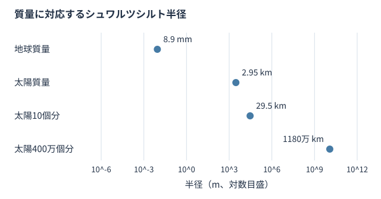
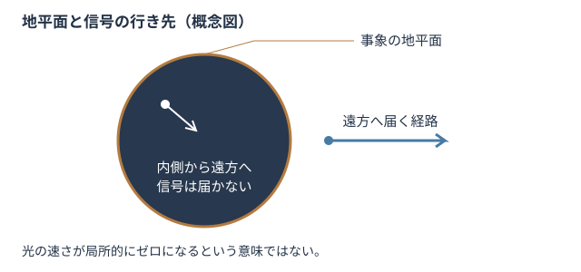
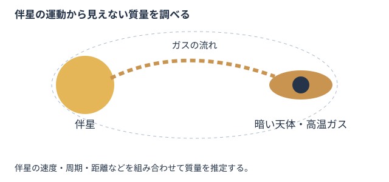
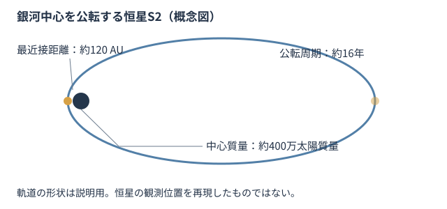
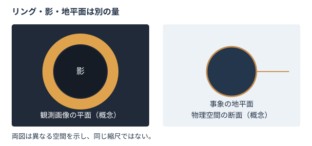
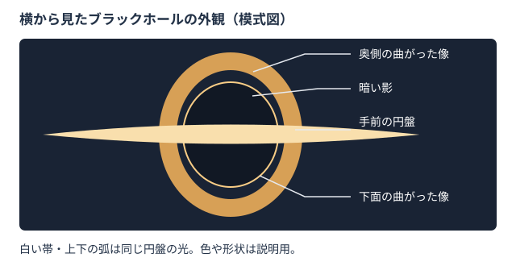

# ブラックホールの発見

::: {.callout-note title="この章で学ぶ理由"}
第9章では中性子星の内部を支える物質、第10章ではその自転や磁場を学びました。もし重力に対して物質が十分な支えを持てなかったら、どのような天体が生まれるのでしょうか。光すら外へ逃がさないブラックホールの発想が、いかに理論から観測へ進んだかを追います。
:::

## 18世紀に考えられた暗黒星

地球上から上向きに石を投げると、通常は落ちてきます。十分な速度で投げれば、空気抵抗を無視した場合、地球の重力に引き戻されずに遠方へ逃げることができます。このために必要な最小の速度を脱出速度と呼びます。地球の表面では毎秒約11.2キロメートル、太陽の表面では毎秒約618キロメートルです。

質量が同じなら、小さな半径に物質が集まるほど表面から逃げるために必要な速度は大きくなります。18世紀のジョン・ミッチェルは、光を粒子として扱う当時の考え方とニュートン力学を用いて、光が逃げられないほど重力の強い星を考えました。1783年に報告され、1784年に出版された議論です。ラプラスも後に同様の発想を示しました。[1]

これは現代のブラックホールと同一の理論ではありません。現代の光はニュートン力学で速度が変わる普通の粒子として扱えず、暗黒星の発想だけでは事象の地平面や時空の構造を説明できません。しかし、見えない星を周囲への重力作用で調べるという着想は、現在の観測にも通じます。

## アインシュタインの理論が変えた重力の意味

1915年、アインシュタインは一般相対性理論の重力場の方程式を完成させました。この理論では重力を単に遠くから引っ張る力と考えるのではなく、物質やエネルギーが時空の幾何学に関係し、物体や光がその時空の中を運動すると考えます。

1916年、カール・シュワルツシルトは球対称で回転しない質量の外側の真空領域を記述する厳密解を得ました。[2] 現代的な形でこの解を調べると、質量に対応する特徴的な半径が現れます。非回転・無電荷のブラックホールでは、その半径が事象の地平面の位置になります。

{#fig-schwarzschild-scales width=100%}

| 質量 | 対応するシュワルツシルト半径（概数） |
|---|---:|
| 地球1個分 | 約8.9 mm |
| 太陽1個分 | 約2.95 km |
| 太陽10個分 | 約29.5 km |
| 太陽400万個分 | 約1180万 km |

質量が増すと、この半径は比例して大きくなります。ただし、地球を約9ミリメートル、太陽を約3キロメートルの半径まで圧縮できるという技術的な意味ではありません。地球も太陽も実際の半径はこの値よりはるかに大きく、外側に事象の地平面を持ちません。

後編では脱出速度から同じ数値を得る近似的な発想と、一般相対論の厳密解から地平面の意味を導く議論を区別します。一般相対論の方程式は高校力学から導出されるものではなく、観測で検証される物理的入力として扱います。

## 事象の地平面とは何か

ブラックホールは、遠方の外部へ信号を送れない時空の領域です。事象の地平面はその境界です。光がその場所で止まる、あるいは光より速く移動すれば通常の物体でも脱出できる、という意味ではありません。局所的に測った光の速さは変わらず、内側からは光の進める未来の方向をたどっても遠方の外部へ到達できないのです。

{#fig-horizon-concept width=100%}

地平面は物質の表面ではありません。また、シュワルツシルト解の一般的な座標表現で地平面の位置に現れる発散は、別の座標を使うと取り除けます。中心の特異性とは別の問題です。落下する人の時間と遠方の観測者から見た信号の変化は第12章で扱います。

## 数学的な解は宇宙で実現するのか

方程式にブラックホールに対応する解があっても、実際の恒星がその状態に到達することは別の問題です。1939年、オッペンハイマーとスナイダーは、圧力を無視した球対称の物質が重力で収縮する理想化モデルを研究しました。[3] このモデルでは重力崩壊により外部へ信号を送れない領域が形成されます。

1965年のペンローズの特異点定理は、厳密な球対称性を仮定しなくても、一定の条件の下で重力崩壊が時空の測地線不完全性につながることを示しました。これは一般相対論によるブラックホール形成の理解を深めた成果です。ただし、定理がすべての恒星の崩壊、中心の詳細な物理、あるいは量子重力まで説明するわけではありません。

重い恒星が核燃料を使い果たして中心部が崩壊し、第9章で学んだ中性子星としての安定な状態も維持できない場合、ブラックホールが形成される可能性があります。実際の運命は初期質量だけではなく、質量損失・連星相互作用・回転・爆発の過程に依存します。

## 見えない天体の質量を測る

### X線連星：はくちょう座X-1

ブラックホール自身から光が出なくても、周囲の恒星やガスを観測できます。伴星とブラックホールが重力で互いに引き合うと、伴星の運動から見えない天体の質量を推定できます。第7章の系外惑星の視線速度法と共通する考え方です。

伴星から流出したガスがコンパクト天体に近づくと、加熱されてX線などを放射することがあります。しかし中性子星を含む連星もX線を放つため、X線があるだけではブラックホールと判定できません。

{#fig-black-hole-binary width=100%}

はくちょう座X-1は代表的な恒星質量ブラックホールを含む連星です。2021年のMiller-Jonesらの研究は、電波位置測定により距離を改訂し、暗い天体の質量を太陽の約21倍と推定しました。[4] 中性子星の観測されている質量や通常の状態方程式の予測を大きく超えるため、ブラックホール解釈を支持します。距離・軌道傾斜・伴星モデルなどが推定に影響する点も重要です。

### 銀河中心：恒星の運動を数十年観測する

天の川銀河の中心には、いて座A*（Sgr A*）と呼ばれる強い電波源があります。銀河中心の周囲を回る恒星を赤外線で長期間追跡すると、光をほとんど放たない小さな領域に大きな質量が集中していることが分かります。

S2という恒星は約16年で一周します。最も接近する位置でも、中心天体との距離は太陽と地球の距離の約120倍です。その運動から、中心に太陽の約400万倍の質量があることが示されました。2020年にはS2の軌道の向きが少しずつずれる効果が観測され、一般相対論の予測と整合しました。[5]

{#fig-s2-orbit width=100%}

2020年のノーベル物理学賞は、ペンローズの理論研究と、ゲンツェルおよびゲズらによる銀河中心の超大質量コンパクト天体の研究に授与されました。恒星軌道は小さな領域に巨大な質量がある証拠ですが、地平面の存在を直接写した観測ではありません。

## 重力波でブラックホール同士の合体を捉える

2015年9月14日、LIGOが初めて直接検出した重力波GW150914は、二つのブラックホールの合体と整合する波形でした。初期の質量推定では、合体前の二天体が太陽の約36倍と29倍、合体後が約62倍です。[6] これらは重力波形を一般相対論のモデルと比較した推定値です。

合体前後の質量差に相当するエネルギーの大部分は重力波として放出されたと考えられます。これはブラックホールが光らないから何の信号も出せないという意味ではありません。合体で変化する外部の時空から重力波が遠方に伝わります。地平面内から信号が出てくることとは別です。重力波をどう検出するのかは第16章で扱います。

## ついにブラックホールの影を撮像する

2017年、世界各地の電波望遠鏡を協調させたイベント・ホライズン・テレスコープ（EHT）が波長1.3ミリメートルでブラックホール周辺を観測しました。望遠鏡同士の信号の相関を調べ、地球規模の長い基線によって高い角度分解能を得ます。この観測手法を超長基線電波干渉計と呼びます。

2019年4月10日、EHTは銀河M87の中心にあるM87*の画像を公開しました。地球から約5500万光年、太陽の約65億倍の質量を持つと推定される天体です。[7]

 ／ [CC BY 4.0](https://creativecommons.org/licenses/by/4.0/)。](../figures/external/m87_eht2019.jpg){#fig-m87-eht width=85%}

2022年5月12日、同じ観測計画による天の川銀河中心のいて座A*の画像が公開されました。距離は約2万7000光年、質量は太陽の約400万倍です。こちらも2017年観測のデータを用いています。[8]

 ／ [CC BY 4.0](https://creativecommons.org/licenses/by/4.0/)。](../figures/external/sgra_eht2022.jpg){#fig-sgra-eht width=85%}

M87*はいて座A*よりはるかに大きい一方、遠方にあります。空で見たリングの角度の大きさは同程度の数十マイクロ秒角です。いて座A*は質量が小さい分、周囲のガスの変化も観測中に速く進むため、画像の再構成は特に難しくなります。

## 明るいリング・影・事象の地平面は違う

画像の明るい部分はブラックホール自身が光っているのではありません。周囲の高温プラズマから出る電波が、強い重力のもとで曲げられ、遠方の観測者に届いたものです。中央の暗い領域には、光がブラックホールに捕獲されることが関わります。

{#fig-black-hole-shadow width=100%}

理想化した非回転ブラックホールでは、遠方で見た影の直径は事象の地平面の直径の約2.6倍です。観測される明るいリングの大きさは、放射する物質や光の曲がり方、観測と再構成の方法などにも依存します。影の外縁や明るいリングをそのまま地平面の境界と読み取ることはできません。

EHTの成果はブラックホールの周辺が一般相対論の予測と整合していることを示す重要な証拠です。ただし内部の特異点を直接観測したことでも、すべての代替的なコンパクト天体の理論を一度に排除したことでもありません。

## ブラックホールの白い帯と上下の光の弧は何か

映画や科学的な可視化では、黒い中心を横切る白や橙色の帯と、上下に回り込む明るい弧が見えることがあります。典型的な円盤をほぼ横から見た場合、その帯は高温のガス・プラズマが作る降着円盤の直接像や重力で曲げられた像です。円盤の奥側や下面から出た光も強い重力で進路が曲がり、観測者へ届きます。そのため実際には一枚の円盤なのに、上と下に別の環があるように見えることがあります。

 ／ [NASA利用規則](https://www.nasa.gov/nasa-brand-center/images-and-media/)。](../figures/external/bh_optics_nasa.jpg){#fig-bh-optics-nasa width=100%}

{#fig-bh-appearance-annotated width=100%}

| 見える部分 | 何を表すか |
|---|---|
| 水平の明るい帯 | 主に手前側の降着円盤の光 |
| 上下の弧 | 重力レンズで曲げられた円盤の像。別の円盤があるわけではない |
| 内側の細いリング | ブラックホール付近を回り込んで届く光（光子リングなど）。広い明るい帯全体とは別 |
| 黒い中央 | 光が捕獲される効果などで暗く見える領域（影）。事象の地平面そのものではない |
| 左右の明るさの違い | 円盤の高速運動による相対論的ドップラー効果、放射分布など |
| 軸方向に伸びる細長い光 | ジェットがある場合、その放射。地平面内部からの噴出ではない（第13章） |

白い色は高温の放射や明るさの表示を表す場合がありますが、全てのブラックホールの円盤が白いわけではありません。実際の色や明るさはガスの温度・放射機構・観測波長・視線の向き、画像処理の設定で異なります。EHTの橙色は電波強度の表示色で、肉眼で見た色ではありません。また、周囲に発光物質がない孤立ブラックホールには、明るい降着円盤が必ずあるわけではありません。背景の光が曲がることで存在を推定できる場合があります。

参考：[NASA SVS 2019年の降着円盤可視化](https://svs.gsfc.nasa.gov/13326/)、[NASA Black Hole Anatomy](https://science.nasa.gov/universe/black-holes/anatomy/)、[NASA 2024年の落下可視化](https://science.nasa.gov/universe/new-nasa-black-hole-visualization-takes-viewers-beyond-the-brink/)（確認日：2026-11-29）。

### 観測方向を変えると見え方はどう変わるか

NASAの同じ非回転ブラックホールの可視化を、二つの異なる方向から比較します。

 ／ [NASA Media Usage Guidelines](https://www.nasa.gov/nasa-brand-center/images-and-media/)。](../figures/external/bh_sim_angle1.jpg){#fig-bh-sim-angle1 width=75%}

 ／ [NASA Media Usage Guidelines](https://www.nasa.gov/nasa-brand-center/images-and-media/)。](../figures/external/bh_sim_angle2.jpg){#fig-bh-sim-angle2 width=75%}

左側の明るさにはこちらへ近づく高速のガスの相対論的ビーミングが関係しています。円盤を真上から見れば、この方向による明るさの差は小さくなります。どちらも画像の色・形は数値可視化の表現で、実際の可視光観測写真ではありません。

[NASA公式の回転する視点の動画・GIFを閲覧する](https://svs.gsfc.nasa.gov/13326/)。HTML版・PDF版では同じ静止画を掲載し、動画やGIFは公式ページへのリンクから参照します。

## 複数の証拠が一つの理解につながる

| 方法 | 実際に観測するもの | 何が分かるか |
|---|---|---|
| X線連星 | 伴星の運動・放射 | 暗いコンパクト天体の質量など |
| 銀河中心の恒星軌道 | 位置と視線速度の時間変化 | 小領域への巨大な質量集中 |
| 重力波 | 時空の微小な変動の波形 | 合体する天体の質量・自転など |
| EHT | 電波干渉計の観測データ | 地平面近傍の放射と影の構造 |

どの観測にも仮定と誤差があります。しかし異なる方法から得られる結果が互いに整合することで、ブラックホールの存在を支持する証拠は非常に強くなりました。

### 理解度確認

1. ミッチェルの暗黒星と現代のブラックホールは何が違うか。
2. 太陽が現在ブラックホールではないのはなぜか。
3. X線を観測しただけではブラックホールと判定できないのはなぜか。
4. S2の恒星軌道から中心天体について何が分かるか。
5. EHTの画像の明るいリングは何に由来するか。
6. ブラックホールの影と事象の地平面を同一視してはいけない理由は何か。

**解答**

1. 暗黒星はニュートン力学と当時の光の粒子説に基づく発想。ブラックホールは一般相対論の時空と因果構造で定義される。
2. 実際の太陽の半径は、同じ質量のシュワルツシルト半径よりはるかに大きいから。
3. 中性子星などの周囲のガスもX線を放射するから。
4. 軌道と周期などから中心の質量集中を推定でき、相対論的な軌道変化も調べられる。
5. 周囲の高温プラズマの放射と、その光が強い重力で曲げられること。
6. 影は遠方の観測者が見る像に関する量で、地平面は時空における因果的な境界だから。

### 後編への接続

第30章で万有引力と脱出速度、第43章でアインシュタイン方程式を物理的入力として導入し、第44章で球対称真空解とシュワルツシルト半径、第45章で光と粒子の軌道を導く。第46章では回転するブラックホール、第48章では重力波を学ぶ。EHTの画像再構成や合体の数値相対論は発展課題とする。

### 参考資料

1. [APS, November 27, 1783: John Michell anticipates black holes](https://www.aps.org/apsnews/2009/11/1783-john-michell-black-holes)、[Experimental studies of black holes: status and future prospects (2024)](https://doi.org/10.1007/s00159-024-00154-z)
2. [Schwarzschild (1916), On the gravitational field of a mass point according to Einstein's theory, 英訳1999](https://arxiv.org/abs/physics/9905030)
3. [Oppenheimer & Snyder (1939), On Continued Gravitational Contraction](https://doi.org/10.1103/PhysRev.56.455)、[Nobel Prize in Physics 2020](https://www.nobelprize.org/prizes/physics/2020/summary/)
4. [Miller-Jones et al. (2021), Cygnus X-1 contains a 21-solar mass black hole](https://pubmed.ncbi.nlm.nih.gov/33602863/)
5. [ESO, S2 Schwarzschild precession (2020)](https://www.eso.org/public/news/eso2006/)、[GRAVITY Collaboration (2020)](https://doi.org/10.1051/0004-6361/202037813)
6. [LIGO, GW150914](https://ligo.org/detections/gw150914/)、[質量の推定値](https://ligo.org/science-summaries/o1imbh/)
7. [EHT (2019), M87*公開](https://eventhorizontelescope.org/press-release-april-10-2019-astronomers-capture-first-image-black-hole)、[ESO画像](https://www.eso.org/public/images/eso1907a/)
8. [EHT (2022), いて座A*公開](https://eventhorizontelescope.org/blog/astronomers-reveal-first-image-black-hole-heart-our-galaxy)、[ESO画像](https://www.eso.org/public/images/eso2208-eht-mwa/)

確認日：2026-11-29。原著は書誌・公開要旨、観測発表は公式解説を参照した。シュワルツシルト半径はSIの標準的な定数による概算。自作図は観測データを再解析したものではない。M87*の公式配布画像は参照先を取得確認済み。いて座A*は公式配布URL・クレジットを確認したが本環境で画像取得に失敗したため、CIで再確認する。
