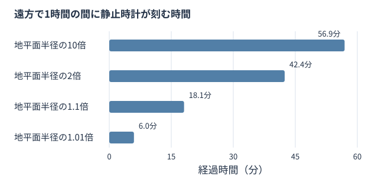
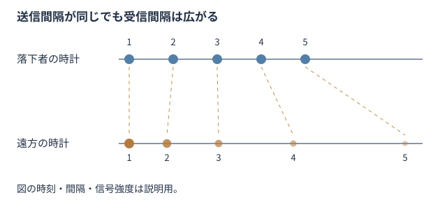
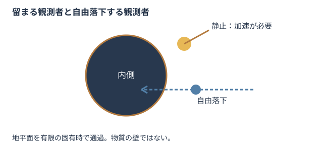
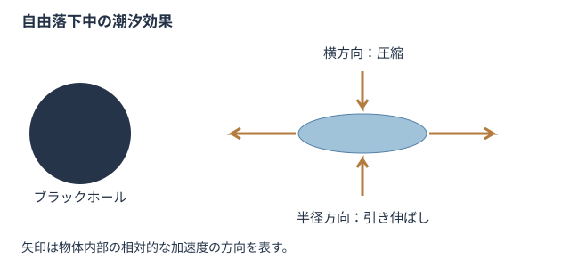
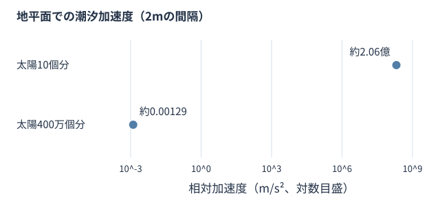
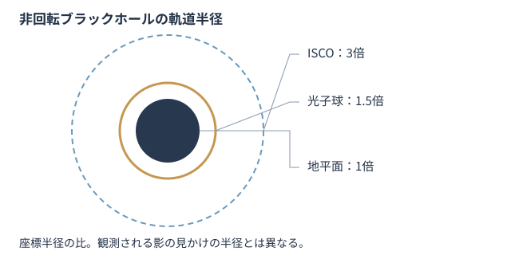
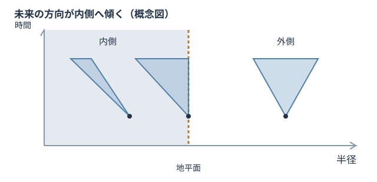
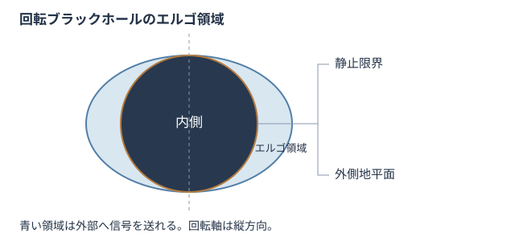

# ブラックホールに落ちたらどうなるか

::: {.callout-note title="この章で学ぶ理由"}
第11章ではブラックホールの存在を支持する観測を学びました。今回はその近くを飛ぶ架空の宇宙船を考えます。遠くに残った観測者と宇宙船の乗員は何を経験するのでしょうか。落下、時間、光、潮汐力という身近な概念が、強い重力のもとでどう変わるかを調べます。
:::

## ブラックホールは何でも吸い込む掃除機ではない

もし太陽を同じ質量の非回転ブラックホールに置き換えたとします。太陽の外側の球対称な重力場は同じ質量なら同じなので、地球の軌道は重力の観点ではほぼ変わりません。太陽光が失われることなどは別の問題です。もちろん太陽が実際にこのような変化を起こすわけではありません。

ブラックホールに近づいても、適切な速度と方向を持てば公転したり遠方へ離れたりできます。事象の地平面の内側へ入る場合と、外側を運動する場合を区別することが必要です。

本章ではまず、回転も電荷もない孤立したブラックホールを考えます。周囲の高温ガス、放射、磁場による危険は除外します。実際の天体への航行が安全だという意味ではありません。

## 重力によって時計の進み方が変わる

二人の観測者がブラックホールの外側に留まり、それぞれの時計を比べるとします。一般相対論では、遠方で静止する時計に比べ、ブラックホールに近い一定の半径に留まる時計の進みは遅くなります。

| 静止する時計の位置 | 遠方で1時間が経過する間、その時計が刻む時間 |
|---|---:|
| 地平面半径の10倍 | 約56分55秒 |
| 地平面半径の2倍 | 約42分26秒 |
| 地平面半径の1.1倍 | 約18分5秒 |
| 地平面半径の1.01倍 | 約5分58秒 |

{#fig-bh-static-clocks width=100%}

一定の半径に留まるためには、ロケットなどによって自由落下を妨げる力を加え続ける必要があります。地平面に近づくほどそのための加速度は大きくなり、地平面そのものに静止する物質の時計は実現できません。

これは静止する二つの時計の比較です。自由落下する乗員については、重力と運動による効果を含め、その軌跡に沿って時計が刻む時間（固有時）を考えます。単に静止時計の表の数値を適用してはいけません。

## 遠くから見ると落下者は永遠に止まるのか

宇宙船がブラックホールに向かって落ちながら、一定の間隔で電波を送るとします。遠方の観測者が受け取る信号の間隔は次第に長くなり、周波数は低くなり、受け取れる信号も弱くなります。これは重力による赤方偏移と落下運動、光の伝播の組み合わせです。

{#fig-bh-signal-delay width=100%}

理想化したシュワルツシルト時空では、遠方の静止時計に対応する時刻座標で地平面に達する時刻は無限大になります。しかし、これは落下者自身の時計が止まることを意味しません。また現実の望遠鏡で地平面直前の姿が永久に見え続けるわけでもありません。信号は赤方偏移と減光によってやがて検出できなくなります。

地平面を通過した後に送った信号は、遠方の外部へ届きません。遠方から通過の瞬間を確認できないことと、乗員が通過できないことは全く違います。[1][2]

## 地平面を通過する瞬間

一般相対性理論では、自由落下する小さな実験室で、潮汐力を無視できる程度に狭い範囲を考えれば、重力がない場合と同じ局所的な物理法則が成り立ちます。これが等価原理の重要な考え方です。

事象の地平面は硬い壁ではありません。十分に大きな静穏なブラックホールで、潮汐力が小さい場合には、落下者が局所的な実験だけで通過の瞬間に特別な変化を認識できるとは限りません。本人の時計も普通に進みます。地平面は、未来に外部へ信号を届けられるかどうかという時空全体の因果的な境界です。

{#fig-bh-observers width=100%}

落下する人が地平面で宇宙の無限の未来を一度に見るという説明も正しくありません。受け取れる光は落下者の世界線と光の経路で決まります。第14章以降で、観測者が経験する時間を時空の幾何学として考えます。

## スパゲティ化：頭と足が異なる重力を受ける

ブラックホールに向かって足から落下するとします。足は頭よりも中心に近いため、重力による相対的な加速度が大きくなります。その差によって落下方向に引き伸ばされ、直交する方向に圧縮される効果が生じます。潮汐力と呼ばれるこの現象が極端になると、物体は形を維持できなくなります。

{#fig-bh-tidal-stretch width=100%}

潮汐力は第8章の氷衛星の内部加熱にも関係した、身近な物理と同じ原理です。自由落下によって重力の一様な成分を取り除けても、位置による重力の違いは取り除けません。

### 大きなブラックホールほど地平面では潮汐力が小さい

ブラックホールの質量が大きいほど重力は強そうですが、地平面の半径も質量に比例して大きくなります。その結果、地平面における同じ長さに対する潮汐効果は、質量が増えるほど急速に小さくなります。

身長に相当する2メートルの距離を半径方向に離れた自由落下点について、非回転ブラックホールの地平面での相対加速度の概算を比較します。

| ブラックホールの質量 | 地平面の半径 | 2メートルにわたる相対加速度 |
|---|---:|---:|
| 太陽10個分 | 約29.5 km | 約2億600万 m/s² |
| 太陽400万個分 | 約1180万 km | 約0.00129 m/s² |

{#fig-bh-tidal-mass width=100%}

この例では太陽400万個分の天体の地平面での相対加速度は、太陽10個分の天体の約1600億分の1になります。小さなブラックホールでは地平面に達する前に潮汐力が極端になることがあります。超大質量ブラックホールでは地平面での潮汐効果が比較的小さくても、さらに内部へ進めば強くなります。[3]

これは孤立した理想的な天体についての局所的な物理量であり、人体の耐久性や宇宙船の運航を評価した計算ではありません。

## 光子球と安定な軌道

非回転ブラックホールの外側には、光が円軌道を描くことのできる特別な半径があります。光子球と呼ばれる球面の半径は地平面半径の1.5倍です。ただしこの円軌道は不安定で、わずかな変化で光は外へ逃げたり内側へ落ちたりします。

質量を持つ粒子が円軌道に留まる場合も、すべての半径で安定とは限りません。非回転ブラックホールでは、最内安定円軌道（ISCO）の半径は地平面半径の3倍です。この内側では安定した円軌道は存在しません。

{#fig-bh-orbit-radii width=100%}

| 場所 | 地平面半径に対する比 | 意味 |
|---|---:|---|
| 事象の地平面 | 1 | 外部への信号が届かなくなる境界 |
| 光子球 | 1.5 | 光の不安定な円軌道 |
| 最内安定円軌道 | 3 | 質量を持つ試験粒子の安定円軌道の内側の限界 |

光子球は地平面ではありません。光子球の内側からでも、地平面の外側で適切な方向に放たれた光は逃げられる場合があります。また、ISCOの内側にあらゆる種類の軌道が存在しないという意味ではありません。

第11章のEHT画像で見たリングは、曲がった光の経路と周囲の物質の放射が組み合わさった結果です。光子球をそのまま撮影したものではありません。[4] NASAは2024年に、太陽の約430万倍の質量を持つ非回転ブラックホールを想定した落下の可視化を公開しました。周囲の光がどのように歪むかを示す計算による映像であり、実際の落下を撮影した映像ではありません。[5]

## 地平面の内側ではどこへ向かうのか

シュワルツシルト解の内部では、未来に進む物体や光はより小さな面積半径へ向かうことを避けられません。外側でできるように、ロケットを使って一定の半径で待つこともできません。

この性質は強い力に負けるからというより、可能な未来の方向が時空の構造によって制限されていることを表します。光速より速い通常の信号を仮定して脱出を説明することはできません。

{#fig-bh-light-cones width=100%}

## 特異点は物理学の終わりなのか

非回転の古典的なブラックホール解では、内側に進むと時空の曲率が極端になり、有限の固有時で測地線を延長できない境界に達します。これを特異性と呼びます。

特異点を、通常の空間の中央にある無限密度の小さな粒として想像すると誤解が生じます。シュワルツシルト解の未来の特異性は時間方向にも関係する時空の境界であり、通常の空間に静止している物体ではありません。[6]

一般相対論の特異点定理も、適切な仮定の下で測地線の不完全性を示すもので、そこにどのような微視的物質が存在するかまで決めるものではありません。非常に強い重力の領域では量子力学と重力を統合する理論が必要になる可能性があります。現在の観測からブラックホール内部の最終状態は確認されていません。

## 回転するブラックホールでは時空も引きずられる

実際の恒星や降着物質は角運動量を持つため、ブラックホールの回転は重要です。1963年にロイ・カーが得た解は、回転する無電荷のブラックホールの外部時空を記述します。[7]

回転する質量の近くでは、静止しているつもりの観測者の基準となる慣性系も影響を受けます。これがフレームドラッギング（時空の引きずり）です。カー解には外側の地平面の外に、遠方から見て静止し続けることのできないエルゴ領域があります。エルゴ領域は地平面の内側ではなく、外へ信号を送れる場所も含まれます。

{#fig-bh-ergoregion width=100%}

回転と同じ方向に運動する粒子と逆方向に運動する粒子では、安定円軌道の限界などが異なります。したがって前節の非回転解の半径比を回転する天体にそのまま適用することはできません。回転エネルギーの取り出しと周辺の強力な放射・ジェットへの関係は第13章と第46章で扱います。

## この章のまとめ

| 内容 | 科学的な位置づけ |
|---|---|
| 静止時計の重力時間遅れ | 一般相対論の予測。弱い重力場などで検証されている |
| 地平面の有限固有時での通過 | 古典的な一般相対論の予測。乗員の実体験は観測されていない |
| 潮汐力と質量依存性 | 理論からの計算。天体の潮汐破壊などの現象と関係 |
| 光子球・ISCO | 非回転解での予測。周辺の放射や軌道観測で制約 |
| 特異性 | 古典理論の限界を示す。内部物理は未確定 |
| フレームドラッギング | 回転する質量の時空に関する予測。地球周辺などでも検証 |

### 理解度確認

1. 太陽を同じ質量の非回転ブラックホールに置き換えると地球は直ちに吸い込まれるか。
2. 地平面付近の一定半径に留まる時計と自由落下する時計は同じか。
3. 遠方から地平面通過が見えないことは、本人が通過できないことを意味するか。
4. 大きなブラックホールの地平面で潮汐力が小さくなる理由は何か。
5. 光子球と最内安定円軌道は地平面と同じか。
6. 特異性とエルゴ領域について、何が未確定で何が理論的な外部構造なのか。

**解答**

1. いいえ。球対称な外側の重力場は質量が同じなら同じである。光などの変化は別の問題。
2. 異なる。静止には加速が必要であり、自由落下時計は軌跡に沿った固有時を刻む。
3. 意味しない。受信できる信号の性質と落下者の固有時は異なる。
4. 質量に比例して地平面の半径が増し、その場所での重力の位置による違いは小さくなるから。
5. 異なる。非回転解ではそれぞれ地平面半径の1.5倍、3倍にある。
6. 特異性近傍の物理的な状態は未確定。エルゴ領域は回転するカー解の外側地平面の外に現れる構造。

### 後編への接続

第38〜42章で時空・固有時・計量・測地線・曲率を学び、第44章でシュワルツシルト解と地平面、第45章で落下・潮汐力・光子球と円軌道、第46章でカー解を扱う。特異性の量子重力による解決は第55〜57章の発展的話題とする。

### 参考資料

1. [NASA, Frequently Asked Questions on Black Holes](https://science.nasa.gov/apod/frequently-asked-questions-faqs-on-black-holes/)
2. [Einstein Online, Changing places – space and time inside a black hole (2010)](https://www.einstein-online.info/en/spotlight/changing_places/)
3. [NASA, What Happens When Something Gets Too Close to a Black Hole?](https://science.nasa.gov/universe/black-holes/what-happens-when-something-gets-too-close-to-a-black-hole/)、[Einstein Online, The elevator, the rocket, and gravity](https://www.einstein-online.info/en/spotlight/equivalence_principle/)
4. [NASA, Black Hole Anatomy](https://science.nasa.gov/universe/black-holes/anatomy/)
5. [NASA, New NASA Black Hole Visualization Takes Viewers Beyond the Brink (2024)](https://science.nasa.gov/universe/black-holes/supermassive-black-holes/new-nasa-black-hole-visualization-takes-viewers-beyond-the-brink/)
6. [Claes Uggla, Spacetime singularities, Einstein Online (2006)](https://www.einstein-online.info/en/spotlight/singularities/)
7. [Einstein Online, Rotating Black Holes, Observations, and Working in General Relativity](https://www.einstein-online.info/en/spotlight/Rotating-Black-Holes-Observations-and-Working-in-General-Relativity/)、[Frame-dragging](https://www.einstein-online.info/en/explandict/frame-dragging/)

確認日：2026-11-29。公式解説の公開本文・検索結果を参照。時計と潮汐力の表・図は標準的なシュワルツシルト解から計算したもので、観測データではない。質量・半径には太陽質量1.9885×10の30乗kg、光速299792458 m/s、万有引力定数6.6743×10のマイナス11乗のSI値を使用。数式と導出は後編に回す。自作模式図は光線追跡や数値相対論の計算結果ではない。
