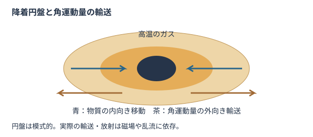
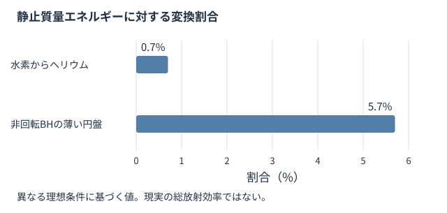
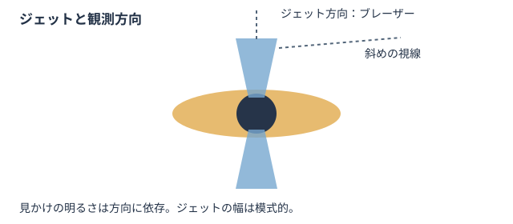
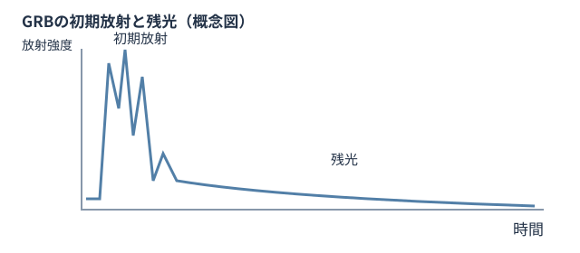
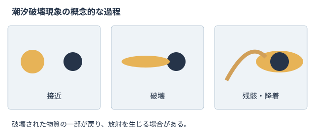

# 宇宙最大級の爆発と巨大ブラックホール

::: {.callout-note title="この章で学ぶ理由"}
前章ではブラックホールに近づく物体や光の運動を学びました。光が逃げられない領域を持つ天体が、なぜ宇宙で最も明るい現象の発生源になれるのでしょうか。ブラックホールの外側にある物質と磁場、降着と回転エネルギーに着目します。
:::

## 光らない天体の周囲が輝く

ブラックホール自身の地平面から通常の光が外へ届くことはありません。しかし周囲の物質は地平面に入る前に光を放つことができます。ガスが角運動量を持つ場合、中心にまっすぐ落ちるのではなく、周囲に降着円盤を形成することがあります。円盤内部で磁場や乱流を介して角運動量が外へ運ばれ、物質が内側へ移動すると、軌道のエネルギーの一部が熱や放射に変わります。

{#fig-accretion-disk width=100%}

第12章の最内安定円軌道は、降着物質が利用できる軌道エネルギーを考える上で重要です。非回転ブラックホールの周囲の標準的な薄い円盤では、静止質量エネルギーの約5.7パーセントが放射に変わるという理想化した計算結果になります。回転するブラックホールでは円盤の向きと自転によって効率が異なります。現実には放射されずに内側へ運ばれるエネルギーや、風・ジェットに使われるエネルギーもあります。

1キログラムの物質が持つ静止質量エネルギーの5.7パーセントは約5.1千兆ジュールです。核融合による水素からヘリウムへの変化では、反応する水素の静止質量の約0.7パーセントがエネルギーに変わります。これは二つの異なる理想化した効率を比較したもので、恒星全体と降着円盤全体の実際の放射効率をそのまま比べているわけではありません。

{#fig-accretion-efficiency width=100%}

## 銀河の中心にある巨大なエンジン

銀河の中心には、太陽の数百万倍から数十億倍に達する質量のブラックホールが存在する例があります。第11章で見たいて座A*もその一つです。周囲への物質供給が多く、中心が非常に明るく輝く場合を活動銀河核と呼びます。すべての超大質量ブラックホールが常に明るい活動銀河核を持つわけではありません。[1]

クエーサーは非常に明るい活動銀河核の一種です。遠方の天体では中心核の光が母銀河の光を圧倒することがあります。1963年に3C 273のスペクトルの大きな赤方偏移が解釈され、遠い宇宙で強大な光を放つ天体であることが分かりました。2024年12月公開のHubble観測ではコロナグラフで中心のまぶしい光を抑え、周辺の構造を調べています。[2] [公式観測画像](https://esahubble.org/images/opo2424a/) の中央の黒い円は観測装置で光を遮った領域で、ブラックホールの影の実寸ではありません。

### 太陽500兆個分の光

2024年に報告されたクエーサーJ0529−4351では、中心ブラックホールの質量は約170億太陽質量、光度は太陽の500兆倍以上と推定されました。物質の降着率も太陽1個分に相当する質量が一日あたり供給されるほどと推定されています。[3]

これは質量を天秤で測った値でも、降着する物質を一日ずつ数えた値でもありません。スペクトルと距離、放射や降着のモデルを使った推定です。強い重力レンズによる増光の有無も光度の評価に関係します。2024年の発表時点での極端な観測例として紹介し、現在の絶対的な最高記録とは断定しません。

## ジェットはどこから噴き出すのか

 ／ [CC BY 4.0](https://creativecommons.org/licenses/by/4.0/)。](../figures/external/centaurus_a_jets.jpg){#fig-centaurus-a-jets width=85%}

一部の活動銀河核では中心の両側に細長いプラズマの流れが形成されます。これがジェットです。ケンタウルス座Aは約1300万光年先にあり、複数の波長でジェットやローブを観測できます。[4]

ジェットは地平面の内側から物質が抜け出したものではありません。降着流やブラックホールの外部の磁場を通じ、エネルギーが外側のプラズマに移されると考えられています。回転するブラックホールから磁場を介して回転エネルギーを取り出す理論もあり、降着流との関係や粒子の加速の詳細は研究対象です。

ジェットの物質は光速に近い速さで運動する場合があります。遠くの天体でジェットの見かけの移動を測ると光速を超えるように見える例がありますが、こちらに近づく向きの運動によって光の到着時刻の間隔が短くなる効果で説明できます。局所的な物質の速度が光速を超えるという意味ではありません。

## ブレーザー：同じ天体でも見る方向で変わる

ジェットの一方が私たちの方向を向いている活動銀河核はブレーザーと呼ばれます。高速で接近する放射源からの光は、相対論的な効果で強く見えることがあります。これを相対論的ビーミングと呼びます。[1]

{#fig-agn-view width=100%}

したがって観測した明るさをそのまま全方向へ等しく放射される光度とみなすと、実際の放出エネルギーを過大評価することがあります。一方、すべての活動銀河核が同じ構造を持つわけではなく、物質供給、磁場、ジェットの有無、周囲の塵なども分類や観測結果に関係します。

## ガンマ線バースト：短い時間に集中するエネルギー

ガンマ線バースト（GRB）は短時間に強いガンマ線が届く現象です。活動銀河核のジェットが長期間持続する場合があるのに対して、GRBでは天体の崩壊や合体などで短時間の強い放射が生じます。

観測上は最初のガンマ線の持続時間がおよそ2秒より短いものと長いものに大別されます。長いバーストには重い恒星の崩壊に伴うものが多く、短いバーストには中性子星を含む連星の合体に伴うものが多くあります。ただし2秒という境界は起源を決定する厳密な法則ではありません。例えば第6章で紹介したGRB 230307Aのように、長いガンマ線放射と合体起源が議論される事例もあります。[5]

{#fig-grb-afterglow width=100%}

初期のガンマ線放射の後には、ジェットや周囲の物質の相互作用などによる残光が観測されることがあります。残光を可視光やX線、電波で追跡することによって、周囲の物質や放出エネルギーを推定できます。GRBすべてで最終的な中心天体がブラックホールになるか、放射がどの過程で生じるかは個別事象ごとに検討する必要があります。

## 恒星が引き裂かれる：潮汐破壊現象

第12章で学んだ潮汐力は、宇宙船だけではなく恒星全体にも作用します。恒星がブラックホールに十分近づき、恒星自身の重力で形を保つことができなくなると、潮汐破壊が起こります。破壊された恒星の物質の一部がブラックホールへ戻り、衝突や降着などによって光る場合があります。これを潮汐破壊現象（TDE）と呼びます。[6]

{#fig-tde width=100%}

すべての物質が直ちに地平面に落ちるわけではありません。外へ離れていく物質もあり、残骸が円盤を形成する過程や放射の時間変化にも未解決問題があります。ブラックホールが非常に大きければ、太陽のような恒星が地平面の外で破壊される前に捕獲されることもあります。回転・恒星の構造・軌道によって条件は変わります。

2025年にNASAが紹介したAT2024tvdは、母銀河の中心からずれた場所で観測された潮汐破壊候補です。銀河の中心以外にも大きなブラックホールが存在し得ることを調べる手掛かりとなっています。[7]

## 異なる現象を比較する

| 現象 | 主なエネルギー源・特徴 | 代表的な持続時間の考え方 |
|---|---|---|
| クエーサー | 超大質量ブラックホール周囲の降着 | 物質供給が続く期間 |
| ブレーザー | 視線方向の相対論的ジェット | 長期活動に短時間変動が重なる |
| GRB | 崩壊・合体に伴うコンパクト天体とジェットなど | 初期放射は秒程度から数百秒以上の場合もある |
| TDE | 恒星の潮汐破壊と残骸の降着など | 数週間から数か月以上の場合もある |

放射の総エネルギー、単位時間あたりの光度、地球で観測される明るさは別の量です。「最大の爆発」という言葉だけで異なる現象の順位を決めることはできません。どの量を比較しているか、観測方向や距離、推定モデルは何かを確認しましょう。

## この章のまとめ

| 成果 | 科学的な位置づけ |
|---|---|
| 活動銀河核・クエーサー・ジェット | 多波長観測で確認 |
| 降着による放射・回転エネルギー | 理論と観測に支持される説明。効率や機構はモデル依存 |
| ブレーザーのビーミング | 相対論と観測で支持 |
| GRBの崩壊・合体起源 | 複数の観測で支持。持続時間だけでは分類できない |
| 潮汐破壊現象 | 一時的な増光・スペクトル等による同定。詳細な放射過程は研究中 |

### 理解度確認

1. 光が逃げられないブラックホールの周囲が輝くのはなぜか。
2. 降着円盤で角運動量を外へ運ぶことが重要なのはなぜか。
3. ブレーザーが特に明るく見える理由は何か。
4. ジェットの物質が地平面の内側から脱出したと解釈してよいか。
5. ガンマ線バーストの持続時間だけで起源を確定できるか。
6. 潮汐破壊現象の原因となる力は何か。

**解答**

1. 地平面の外にある降着物質やジェットがエネルギーを放射するため。
2. 物質がより内側の軌道へ移動するために角運動量を失う必要があるから。
3. 視線方向に高速ジェットが向き、相対論的ビーミングで放射が強く見えるため。
4. いいえ。降着流と地平面外の磁場などを通じて外側のプラズマにエネルギーが移る。
5. できない。超新星やキロノバ、母銀河、残光などの独立した情報も必要。
6. 恒星の場所による重力の差、すなわち潮汐力。

### 後編への接続

第31章でエネルギーと角運動量、第32章で分光、第45〜46章で円軌道・回転時空、第48章で合体と重力波を学ぶ。実際の降着流やジェットの計算には磁気流体力学と放射輸送が必要で、単純な軌道計算の限界を区別する。

### 参考資料

1. [NASA, What Are Active Galactic Nuclei?](https://science.nasa.gov/mission/webb/science-overview/science-explainers/what-are-active-galactic-nuclei/)、[Black Hole Anatomy](https://science.nasa.gov/universe/black-holes/anatomy/)
2. [ESA/Hubble, Hubble view of heart of quasar 3C 273 (2024-12-05)](https://esahubble.org/images/opo2424a/)
3. [ESO, Brightest and fastest-growing: astronomers identify record-breaking quasar (2024-02-19)](https://www.eso.org/public/news/eso2402/)、[Wolf et al. 2024, Nature Astronomy](https://doi.org/10.1038/s41550-024-02195-x)
4. [ESO, Centaurus A (2009-01-28)](https://www.eso.org/public/images/eso0903a/)
5. [NASA, Gamma-ray Bursts: Harvesting Knowledge From the Universe’s Most Powerful Explosions](https://science.nasa.gov/universe/gamma-ray-bursts-harvesting-knowledge-from-the-universes-most-powerful-explosions/)
6. [NASA, What Happens When Something Gets Too Close to a Black Hole?](https://science.nasa.gov/universe/black-holes/what-happens-when-something-gets-too-close-to-a-black-hole/)
7. [NASA's Hubble Pinpoints Roaming Massive Black Hole (2025)](https://science.nasa.gov/missions/hubble/nasas-hubble-pinpoints-roaming-massive-black-hole/)

確認日：2026-11-29。公式解説・論文書誌を参照。薄い円盤の効率は理想的な非回転解のISCOの比エネルギーに基づく値。導出は後編。公式画像は配布JPEGをWebで表示確認した。3C 273は公式ページへのリンクのみとし転載しない。自作図は模式図で実測曲線ではない。
