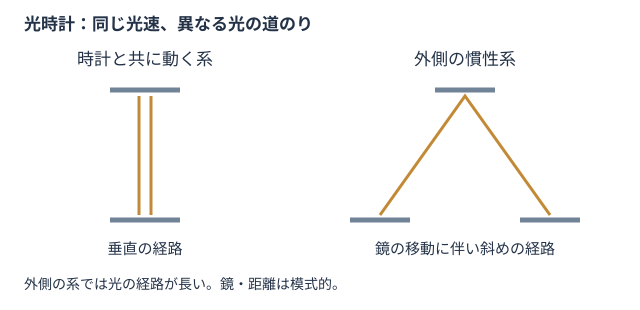
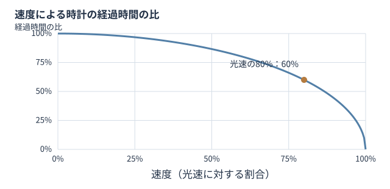
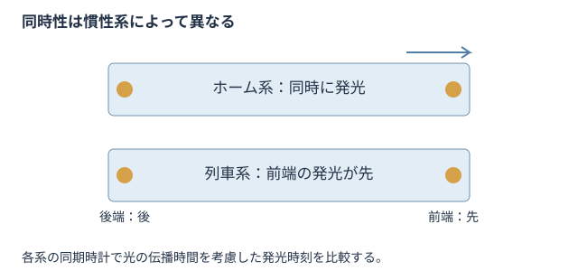
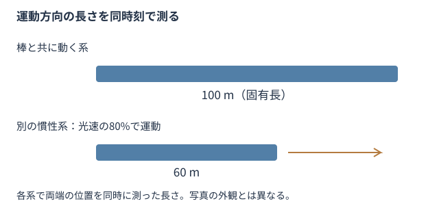
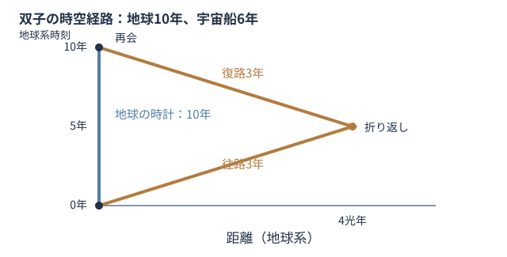
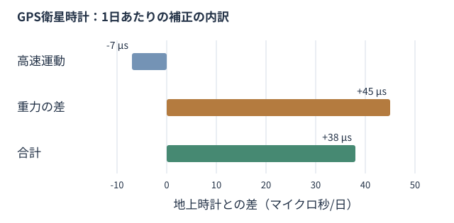

# 時間は誰にとっても同じではない

::: {.callout-note title="この章で学ぶ理由"}
第12章ではブラックホール近くの時計が遠方の時計と異なる進み方をすることを学びました。しかし時間の違いは強い重力だけで起こるわけではありません。重力を無視できる場所でも、運動する観測者同士の間で時間と空間の測り方が変わります。ここでは特殊相対性理論の出発点を、時計と光の思考実験から考えます。
:::

## 時間は宇宙全体で共通なのか

電車の中を歩く人の速度は、電車の中から測る場合とホームから測る場合で異なります。速度は観測者の運動状態によって変わる量です。一方、ニュートン力学では、離れた場所の出来事にも共通の時間を割り当てられると考えます。私たちの日常ではその近似が非常によく成り立ちます。

19世紀には電磁気学が発展し、光が真空中を一定の速さで伝わるという理解が得られました。光の伝わる速さを、普通の物体のように観測者の速度と足し引きすると、電磁気学と運動の記述をどのように整合させるかという問題が生まれます。

1905年にアインシュタインが発表した特殊相対性理論は、慣性系（外力を受けない物体が等速直線運動するような座標系）では物理法則が同じ形を持ち、真空中の光速が同じであることを出発点とします。この前提を採用すると、全観測者に共通する絶対的な時間という考えは成り立たなくなります。[1]

## 光速は追いかけても変わらない

真空中の光速は毎秒約30万キロメートルです。例えば、光速の80パーセントで走る宇宙船から前方へ光を放ったとします。宇宙船の中の観測者も、宇宙船の外に静止している観測者も、各自の慣性系で測る光の速さは同じです。

これは光がどの観測者にも同じ周波数や色で見えるという意味ではありません。第13章のジェットで触れたように、光を放つ物体と観測者の運動によって光の周波数や明るさが異なり得ます。速さと周波数を区別する必要があります。

特殊相対性理論の原理は慣性系についてのものです。光が空気や水などの媒質中を伝わる速さや、曲がった時空の特定の座標で表した光の速さを、そのまま真空中で局所的に測る光速と混同しないようにしましょう。

## 光時計で時間を測ってみる

上下に向かい合った二枚の鏡の間を光が往復する時計を想像します。時計と一緒に動く観測者から見れば、光は垂直に進んで戻ります。一方、時計が横方向に動いて見える観測者から見ると、光が反射するまでの間に鏡も移動するので、光の道のりは斜めになります。

{#fig-sr-light-clock width=100%}

両者が測る光速は同じです。外側の観測者にとって光の道のりが長ければ、往復にかかる時間も長くなります。運動する時計の一回の刻みが長く見積もられることが、時間の遅れにつながります。この結果は光時計に限らず、適切に比較したあらゆる時計に当てはまります。[2]

| 時計の速度（観測者に対して） | 観測者の時計で10年が経過する間に運動する時計が刻む時間 |
|---|---:|
| 光速の10% | 約9.95年 |
| 光速の50% | 約8.66年 |
| 光速の80% | 6年 |
| 光速の90% | 約4.36年 |
| 光速の99% | 約1.41年 |
| 光速の99.9% | 約0.447年（約163日） |

{#fig-sr-time-dilation width=100%}

表は同じ慣性系の時刻で区切った運動時計の二つの出来事を比較したものです。遠方から届く光の遅延を含む見かけの点滅周期ではありません。運動時計と一緒にいる人が自分自身の時計を遅く感じることもありません。

## 「同時に起こる」という意味も変わる

長い列車の前端と後端に、二つの閃光が発生したとします。ホームの観測者がホーム上の同期した時計で調べると、二つの発光が同時だったとします。列車の中央にいる人は、前端に向かって進み、後端から離れるため、前端の光を先に受け取ります。

ただし、受信順が異なることだけでは発光の同時性が違う証拠にはなりません。光が届くまでの時間を考慮する必要があります。列車の慣性系では前後の端から中央までの距離が同じで、真空中の光速も同じです。したがって列車の時計を光で同期して発光時刻を割り当てると、前端の発光が先、後端の発光が後になります。

{#fig-sr-simultaneity width=100%}

離れた二つの出来事の同時性は、どの慣性系で時刻を割り当てるかに依存します。これを同時性の相対性と呼びます。互いに光以下の速さの信号で結べる原因と結果の順番まで入れ替わるわけではありません。[3]

## なぜ運動する物体は短く測られるのか

棒の長さを測るには、両端の位置を同じ時刻に測らなければなりません。同時という判定が観測者によって異なるため、運動する棒の長さも観測者によって異なります。

自分と一緒に静止している棒を測った長さを固有長と呼びます。別の慣性系では、棒の運動方向の長さは固有長より短く測られます。例えば光速の80パーセントで動く、固有長100メートルの棒の運動方向の長さは60メートルです。運動に垂直な方向の長さはこの効果では変わりません。

{#fig-sr-length-contraction width=100%}

これは写真の見た目が単純に60パーセントに縮むという意味ではありません。写真には棒の異なる位置から異なる時刻に放たれた光が同時に届きます。高速物体の写真には光の伝播時間やドップラー効果なども関わります。測定する長さと画像の外観を区別することは、第4・9・11章の天体画像の読み方にもつながります。

## 双子のパラドックス

地球に留まる双子の一人と、遠い星へ向かって戻ってくるもう一人を想像します。地球と目的地は同じ慣性系に静止し、距離が4光年であるとします。宇宙船は光速の80パーセントで往復し、方向転換にかかる時間を無視します。地球の時計では片道5年、往復10年です。宇宙船の時計では片道3年、往復6年となります。

{#fig-sr-twins width=100%}

出発時と再会時に直接時計を比較すると、宇宙船側は4年若いことになります。宇宙船の内部で時間が止まったわけでも、本人にとって日々がゆっくり過ぎたわけでもありません。二人が出発と再会を結ぶ異なる時空の経路を通ったため、時計に積算される固有時が違います。

宇宙船の側からは地球の時計も運動しているのだから、地球側が若くなるのではないか、という疑問が生じます。しかし宇宙船は往路と復路で慣性系を変えています。同じ慣性系のままの地球側と対称ではなく、途中で遠方の出来事の同時刻の割り当て方が変わります。加速度そのものが直接時計を遅らせる万能の原因というわけでもありません。経路全体の固有時を比較すれば矛盾はありません。[4]

## 時間の遅れは実験で確認されている

高エネルギーの宇宙線が地球大気に入り込むと、ミューオンという寿命の短い粒子などが生まれます。静止したミューオンの平均寿命は約2.2マイクロ秒です。光速に近い速度でも、もし地球から見た寿命がそのままなら平均して進める距離は約660メートル以下になります。しかし地上でも宇宙線由来のミューオンが観測されます。

高速で運動するミューオンの崩壊までの時間は地球系では長くなり、地上へ到達できる確率が増えます。ミューオンの系では、大気の通過距離が短く測られます。どちらの説明も同じ観測を記述しています。粒子の速度分布や発生高度、崩壊は確率的な過程であることにも注意します。これは単純化した説明で、660メートルはすべての粒子に共通する最大飛行距離ではありません。

## GPSにも時間の違いが必要になる

私たちのスマートフォンで使うGPSは、人工衛星から送信される時刻情報を利用します。衛星上の原子時計の進み方には二つの相対論的な効果が関係します。

| 効果 | 衛星時計の進み方（地上時計と比べた代表値） |
|---|---:|
| 衛星の高速運動による時間の遅れ | 1日あたり約7マイクロ秒遅い |
| 地上より重力ポテンシャルが高いことによる効果 | 1日あたり約45マイクロ秒速い |
| 合計 | 1日あたり約38マイクロ秒速い |

{#fig-sr-gps-clock width=100%}

38マイクロ秒の光の移動距離は約11キロメートルです。これは未補正の時計差を光の伝播距離に換算した目安であり、GPSの位置誤差が毎日必ず11キロメートル増えるという意味ではありません。実際の測位では衛星時計・地上の時刻系・軌道や信号伝播に関する補正を行います。[5]

第12章の重力による時間の遅れは一般相対性理論に関係し、本章の運動による時間の遅れは特殊相対性理論に関係します。GPSは両方が日常の技術で重要になる例です。

## この章のまとめ

| 内容 | 科学的な位置づけ |
|---|---|
| 光速不変と相対性原理 | 特殊相対論の物理的入力。多数の実験で検証 |
| 時間の遅れ・長さの収縮・同時性 | 特殊相対論の予測とその帰結 |
| 双子のパラドックス | 異なる世界線に沿う固有時の比較。思考実験 |
| ミューオン・GPS | 相対論が現実の観測・技術と整合する例 |

### 理解度確認

1. 光速に近い速度で走る宇宙船から光を放った場合、外から測る真空中の光速は変化するか。
2. 光時計の外側の観測者から見ると、なぜ一回の刻みに時間がかかるか。
3. 光が先に届くことだけで、発光した時刻が先だと言えるか。
4. 運動する棒の長さは、なぜ写真を撮ることだけでは測定できないか。
5. 4光年先の星を光速の80%で往復する例では、地球と宇宙船の経過時間は何年か。
6. GPSの衛星時計にはどの二つの相対論的効果が関係するか。

**解答**

1. 変化しない。各慣性系で同じ光速を測る。
2. その系では鏡が移動するので、光がより長い道のりを進む必要があるから。
3. 言えない。伝播時間と各慣性系での時計の同期を考慮する必要がある。
4. 同じ時刻の両端の位置を測る必要があり、写真には異なる時刻に放たれた光が届くため。
5. 地球10年、宇宙船6年。方向転換時間を無視した理想化した例。
6. 運動による時間の遅れと、重力ポテンシャルの違いによる時計の進み方の差。

### 後編への接続

第27〜28章で関数、図形、ベクトルを学び、第38章で光速不変からローレンツ変換を導出する。第39章でミンコフスキー時空と固有時、第41章で計量を学び、曲がった時空の時計の比較へ進む。GPSの詳細な測位計算には地球の回転や信号伝播の補正が必要になる。

### 参考資料

1. [Einstein Online, Special relativity / The relativity of space and time](https://www.einstein-online.info/en/relativity_space_time/)
2. [Einstein Online, From light clocks to time dilation](https://www.einstein-online.info/en/spotlight/light-clocks-time-dilation/)
3. [Einstein Online, The definition of “now”](https://www.einstein-online.info/en/spotlight/Now/)
4. [Einstein Online, The case of the travelling twins](https://www.einstein-online.info/en/spotlight/Twins/)
5. [NIST, Putting Einstein to the Test](https://www.nist.gov/atomic-clocks/a-powerful-tool-for-science/putting-einstein-test)

確認日：2026-11-29。Einstein Onlineの公開解説とNISTのGPS補正値を確認。時間の遅れ、長さの収縮、双子の例は特殊相対論の計算値。ミューオンの平均寿命は代表値を用いた概算で、個別実験のデータ再解析は行っていない。自作図は模式図または計算値のグラフで、実測写真ではない。
