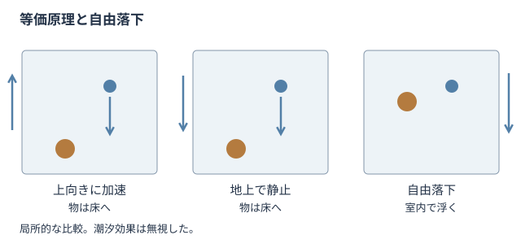
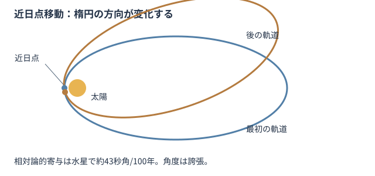
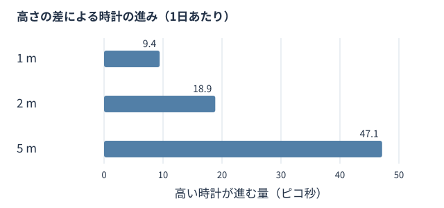
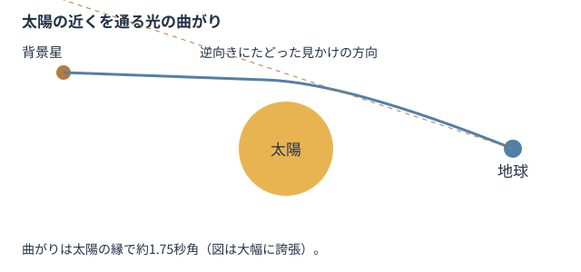
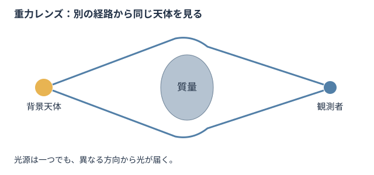
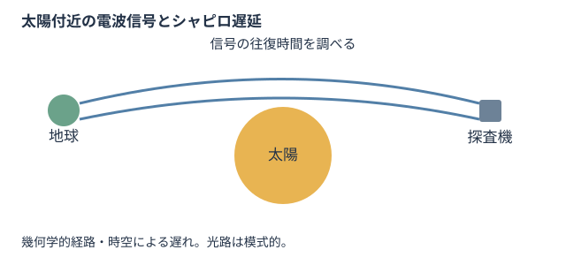

# 重力によって曲がる宇宙

::: {.callout-note title="この章で学ぶ理由"}
第14章では、時間と空間の測り方が観測者の運動によって変わることを学びました。今度は重力がある場所を考えます。水星の軌道、太陽の近くを通る光、遠方の銀河のリング、人工衛星の電波という一見異なる観測から、時空の曲がりをどのように知ることができるのでしょうか。
:::

## エレベーターの中で重力を考える

窓のない小さな宇宙船が、重力のほとんどない場所で上向きに加速しているとします。床に立つ人は床から押され、物を手から離せば床に落ちたように見えます。一方、地球の表面で静止している部屋でも、床から押され、物が下に落ちます。

{#fig-gr-equivalence width=100%}

十分に狭い範囲で潮汐効果を無視すれば、局所的な実験だけで重力による効果と加速による効果を区別できない場合があります。これがアインシュタインの等価原理の重要な内容です。自由落下する宇宙船の中では、乗員も物も一緒に落ちるので無重力に近い状態になります。国際宇宙ステーションも地球の重力が消えた場所にいるわけではありません。

しかし大きな領域では、重力の向きや強さが場所によって変わります。地球の別々の地点から落ちる物体は中心の方向へ向かうため、互いの距離が変化します。第12章の潮汐力と同じ効果で、自由落下する座標系に移っても完全に消すことはできません。一般相対論では、このような効果が時空の曲率に関係します。[1]

## 水星の軌道は少しずつ回転する

ニュートン力学で太陽と一つの惑星を理想化して考えると、惑星は閉じた楕円軌道を描きます。実際の太陽系では他の惑星の重力などによって楕円の向きが少しずつ変化します。太陽に最も近づく点を近日点、その方向が変化する現象を近日点移動と呼びます。

{#fig-gr-perihelion width=100%}

水星では他惑星の影響や観測座標の変化などを考慮しても、100年あたり約43秒角のずれが残っていました。1秒角は1度の3600分の1なので、43秒角は約0.012度です。1915年に一般相対論はこのずれを説明しました。これは水星の近日点移動の総量ではなく、従来の説明から残った主要な相対論的寄与です。[2]

太陽質量、水星の軌道長半径約5790万キロメートル、離心率約0.206、公転周期約88日を用いた一般相対論の近似計算でも、100年あたり約42.98秒角になります。後編第45章では軌道方程式からこの値を再現します。第11章の銀河中心の恒星S2でも同じ種類の相対論的歳差が観測されていますが、強い重力場での効果を調べる例として区別します。

## 重力は光の色も変える

高い場所と低い場所に同じ種類の原子時計を置くと、地球上では高い場所の時計がわずかに速く進みます。低い場所から高い場所へ光を送り、各場所で静止した観測者が測る周波数を比べると、受信側では周波数が低くなります。これが重力赤方偏移です。

光が移動する途中で摩擦によってエネルギーを失うという意味ではありません。放射する側と受信する側の時計の進み方の違いと、時空における光の伝播を合わせて記述した結果です。天体の運動によるドップラー効果や宇宙膨張による赤方偏移とは原因を区別します。

地上付近で重力をほぼ一定とする近似では、高さの差1メートルの二つの静止時計は、1日で約9.4ピコ秒（1兆分の1秒を単位とする）の差を生じます。高さ1ミリメートルの場合は約9.4フェムト秒（1000兆分の1秒を単位とする）です。2022年のJILAの研究では、ストロンチウム原子の試料内のミリメートル規模の高さの違いに対応する重力赤方偏移が測定されました。[3]

{#fig-gr-clock-height width=100%}

## 太陽の近くを通る光が曲がる

もし加速する宇宙船に横向きに光を入れれば、光が反対側の壁に届くまでに宇宙船は移動します。宇宙船の座標では光が曲がったように見えます。等価原理は重力場でも光の経路が変わることを考える手掛かりになります。ただし一般相対論による太陽付近の曲がりの全量を求めるには、局所的な加速の議論だけでは不十分で、時空の幾何学全体を使う必要があります。[1]

1919年5月29日の皆既日食では、太陽の近くに見える背景の恒星の位置が調べられました。一般相対論による太陽の縁を通る光の曲がりの予測は約1.75秒角です。日食の観測はその予測を支持しましたが、当時の観測には誤差がありました。その後の電波干渉計などの観測でより高精度の検証が進みました。[4]

{#fig-gr-solar-deflection width=100%}

## 銀河が巨大な望遠鏡になる

光が曲がる効果は太陽系だけではありません。手前に大きな質量の銀河や銀河団があり、その奥に光を放つ天体があると、光は複数の経路で観測者に届くことがあります。これが重力レンズです。

{#fig-gr-lens-paths width=100%}

通常のガラスレンズは媒質中の光の屈折を利用しますが、重力レンズでは質量が時空の幾何学を変えることによって光の経路が変化します。真空での重力による曲がりは幾何光学の範囲で波長に依存しません。ただし発光領域の大きさや分布、途中の塵・プラズマ、観測装置の分解能は波長によって異なるので、実際の画像は異なる場合があります。

### アインシュタインリングは何が光っているのか

背景天体と手前のほぼ軸対称な質量と観測者がよく整列したとき、背景天体の光が輪状に見える場合があります。これがアインシュタインリングです。配置がずれると弧や複数像になることがあり、実際の形状にはレンズの質量分布や光源の広がりも影響します。

 ／ [CC BY 4.0](https://creativecommons.org/licenses/by/4.0/)。](../figures/external/einstein_ring_smacs0028.jpg){#fig-smacs-ring width=85%}

ここで光る輪は中央の銀河を回るガスの円盤とは限りません。この画像では別の遠方銀河の像が中央の銀河の周囲に伸ばされて見えています。[5] 第11章のブラックホールの降着円盤の曲がった像と同様、重力で光の進路が変わりますが、光源とレンズの配置が異なります。

 ／ [CC BY 4.0](https://creativecommons.org/licenses/by/4.0/)。](../figures/external/quasar_lens_rxj1131.jpg){#fig-qso-lens width=85%}

一つの天体が複数に見えることがあります。例えば約60億光年先のクエーサーRX J1131-1231は重力レンズによって四つの像を持ちます。[6] 四つの独立したクエーサーだとは限りません。スペクトルの共通性や変光の対応、レンズのモデルを比較して同じ光源かどうか調べます。

| 見える特徴 | 読み取り方 |
|---|---|
| 輪・長い弧 | 背景天体の伸ばされた像。物質が輪状に存在するとは限らない |
| 複数の光点 | 同じ背景天体の複数像の場合がある |
| 中心の明るい銀河 | 光を曲げる手前の天体の光 |
| 点から伸びる細い筋 | 望遠鏡の回折像の場合がある（第4章） |

### 見えない質量を調べる

重力レンズは背景の光を増光する場合があります。理想的な幾何光学ではレンズ自体が光源を明るく発光させるわけではなく、像の見かけの面積などを変えることで受け取る総光量を変えます。このため遠方の暗い銀河を研究する自然の望遠鏡として利用されます。

多数の背景銀河の形のわずかな変形を統計的に測る弱重力レンズは、手前の質量分布の推定にも使われます。光を放たないダークマターも重力に寄与します。ただしレンズで測るのは全質量の投影に関係する情報であり、ダークマター粒子の種類そのものを同定するわけではありません。第21章で詳しく学びます。

## 光が届くまでの時間も変わる：シャピロ遅延

光が太陽の近くを通る場合、重力を無視した平坦な時空での予測と比べ、電波信号の往復時間に余分な遅れが生じます。シャピロ遅延と呼ばれる一般相対論の効果です。局所的に測った真空の光速が遅くなるのではなく、重力によって時空の幾何学と遠くから比較した時刻の関係が変化するためです。

{#fig-gr-shapiro width=100%}

2003年に報告されたCassini探査機との電波通信の研究は、太陽の近くを通る信号の周波数変化から遅延の変化を測り、一般相対論の予測を高精度で検証しました。光の曲がりなどに関わるパラメータは一般相対論の値1から約0.000021の差で、不確かさは約0.000023でした。[7] この一つの実験で重力理論の全てが証明されたわけではなく、特定の弱重力場での予測を厳しく制約した結果です。

重力レンズによる複数像でも、光の通る幾何学的な経路と重力による遅延が異なることから、一つのクエーサーの変光が別々の時刻に見えることがあります。時間差と質量モデルを利用する宇宙の距離尺度の研究にもつながります。

## この章のまとめ

| 成果 | 科学的な位置づけ |
|---|---|
| 等価原理 | 一般相対論の物理的入力。局所的な自由落下と潮汐効果を区別 |
| 水星の近日点移動 | 観測と相対論的軌道計算の整合 |
| 重力赤方偏移 | 原子時計などの実験で検証 |
| 光の曲がり、重力レンズ | 日食・電波観測・銀河画像などで確認 |
| シャピロ遅延 | 探査機との通信などで検証 |

### 理解度確認

1. 宇宙ステーションで無重力に近いのは、地球の重力が消えているからか。
2. 水星の43秒角毎世紀は近日点移動の総量か。
3. 地上で高い場所と低い場所の時計はどちらが速く進むか。
4. アインシュタインリングは必ず物質の輪を写しているのか。
5. 重力レンズで四つの光点が見えた場合、四つの天体と断定できるか。
6. シャピロ遅延は局所的な真空中の光速が低くなったことを意味するか。

**解答**

1. いいえ。乗員も宇宙船も自由落下しているため。
2. いいえ。他惑星の影響等を考慮した後の主要な相対論的寄与。
3. 高い場所。地上付近の同じ種類の静止時計を比較した場合。
4. いいえ。背景天体の光が曲げられた輪状の像の場合がある。
5. できない。複数の経路で届いた同じ光源の像かもしれない。
6. 意味しない。曲がった時空での信号伝播と遠方の時刻の比較に関係する。

### 後編への接続

第38〜42章で特殊相対論、計量、測地線、曲率、第43〜45章で重力場の方程式、シュワルツシルト解、近日点移動と光の軌道を学ぶ。弱重力レンズの質量推定と宇宙の距離尺度は第49〜52章につなぐ。

### 参考資料

1. [Einstein Online, The elevator, the rocket, and gravity](https://www.einstein-online.info/en/spotlight/equivalence_principle/)、[The equivalence principle and the deflection of light](https://www.einstein-online.info/en/spotlight/equivalence_light/)
2. [Oregon State University, Mercury](https://sites.science.oregonstate.edu/coursewikis/GGR/book/content/mercury)、[Einstein Online, A Test Bed for the General Theory of Relativity](https://www.einstein-online.info/en/spotlight/A-Test-Bed-for-the-General-Theory-of-Relativity/)
3. [NIST, JILA Atomic Clocks Measure Einstein’s General Relativity at Millimeter Scale (2022)](https://www.nist.gov/news-events/news/2022/02/jila-atomic-clocks-measure-einsteins-general-relativity-millimeter-scale)、[Bothwell et al. (2022)](https://doi.org/10.1038/s41586-021-04349-7)
4. [Royal Society, Observing general relativity (2024)](https://www.royalsociety.org/blog/2024/08/observing-relativity/)、[NASA, Testing General Relativity](https://science.gsfc.nasa.gov/attic/eclipse2017.gsfc.nasa.gov/testing-general-relativity.html)
5. [ESA/Webb, Spying a spiral through a cosmic lens (2025)](https://esawebb.org/images/potm2503a/)
6. [ESA/Webb, Jewelled ring (2024)](https://esawebb.org/images/potm2406a/)
7. [Bertotti, Iess & Tortora, A test of general relativity using radio links with the Cassini spacecraft (2003)](https://doi.org/10.1038/nature01997)

確認日：2026-11-29。原著は公開要旨、公式観測ページは本文・クレジットを参照。SMACSの配布JPEGはWeb表示確認済み、RX J1131は公式配布リンク確認済みだがWeb取得失敗のためCIで確認する。時計差は地表付近の弱重力近似。自作図は模式図または計算値で実測点ではない。
