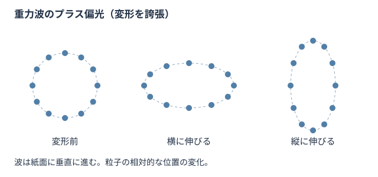
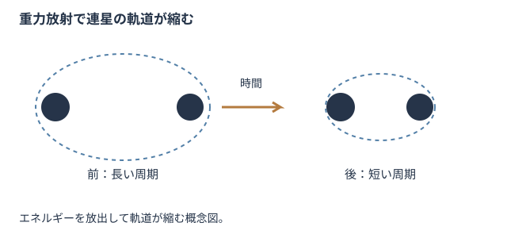
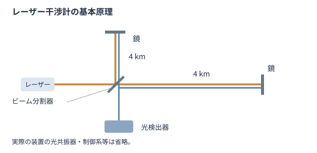
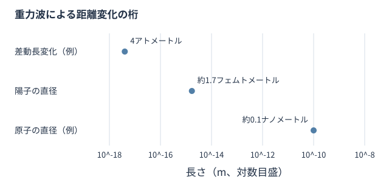
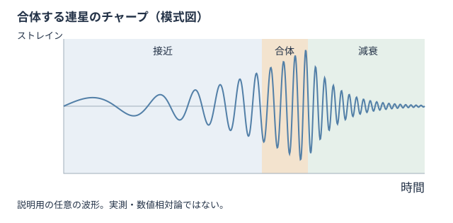
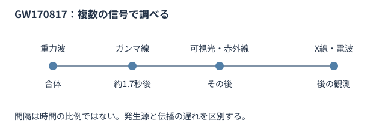
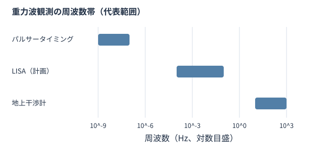

# 重力波と時空の振動

::: {.callout-note title="この章で学ぶ理由"}
第15章では物質が存在すると光の経路や時計の進み方が変わることを学びました。では、重力を生む物質が激しく動くと、遠く離れた場所の時空はどうなるのでしょうか。重力波の発見は、光だけに頼らず宇宙を調べる新しい方法を開きました。
:::

## 時空そのものの振動

水面を揺らすと波が遠くへ広がります。一般相対性理論では、質量の分布が時間とともに非球対称に変化すると、時空の幾何学の変化が波として遠方に伝わり得ます。真空中を光速で伝わるこの波を重力波と呼びます。

水面のたとえには限界があります。重力波は物質の海を伝わる振動でも、宇宙が高次元空間に実際に沈み込んでいる様子でもありません。離れて自由落下する物体の相対的な距離の変化として、その効果を測ることができます。

{#fig-gw-polarization width=100%}

例えば円周に並べた自由落下粒子は、ある瞬間には横に伸び、縦に縮みます。次の半周期では逆になります。一般相対論には、これと45度回転させた形に対応する二つの独立な偏光があります。円全体が単純に膨張・収縮する音波とは違います。

静止した球対称の天体は重力波を放ちません。球対称性を保った収縮も、一般相対論では重力波の発生源ではありません。二つの重い天体が互いを回る場合は質量分布の非球対称な変化があり、重力波を放出します。放出されたエネルギーによって軌道は徐々に変化します。

## 連星パルサー：軌道が縮んでいく

1974年にHulseとTaylorが発見したPSR B1913+16は、パルサーと別のコンパクト天体が互いに回る連星です。第10章で学んだパルサータイミングによって、軌道の変化を長期間調べることができます。

重力波がエネルギーを運び去れば、連星の軌道は縮み、公転周期は短くなると予想されます。地球から観測した周期の変化には銀河内の運動などの効果もあるので補正が必要です。長期間の観測結果は一般相対論の重力放射の予測と整合しました。この研究は1993年のノーベル物理学賞につながりました。[1]

{#fig-gw-binary-decay width=100%}

この段階では地球に到達した重力波そのものの変形を測ったわけではありません。連星の運動からエネルギー損失を確かめた、重力波の間接的な証拠です。

## 光でわずかな距離の変化を測る

米国のLIGOは、互いに直交する二本の長さ4キロメートルの腕を持つレーザー干渉計です。レーザーを二方向に分け、腕の端の鏡で反射させ、戻った光を重ね合わせます。光が通った経路の違いは波の位相の差となり、干渉によって出力光の変化として検出できます。[2]

{#fig-gw-interferometer width=100%}

重力波による距離の相対的な変化をストレインと呼びます。例えばストレインが10のマイナス21乗程度なら、4キロメートルの腕での差動長変化の目安は1メートルの100京分の4、すなわち約4アトメートルです。実際には波の入射方向や偏光、装置の応答に依存します。

{#fig-gw-strain-scale width=100%}

光も時空の幾何学に従うのだから、距離と光の波長が一緒に変わって測れないのではないか、という疑問が生じます。しかし干渉計が測るのは光の往復の位相と鏡の運動の組み合わせです。二本の腕に異なる影響が生じるため、適切な装置応答の計算で信号を求められます。

地面の振動、鏡の熱運動、光の量子的なゆらぎ、装置の制御ノイズなどがあるため、非常に精密な測定技術が必要です。複数の離れた検出器で同じ信号と整合する変化が見つかることは、装置固有のノイズと区別する上でも重要です。日本のKAGRAも国際的な重力波観測網に参加しています。

## GW150914：ブラックホールの合体を観測する

2015年9月14日にLIGOの二つの観測所が捉え、2016年2月に発表した信号がGW150914です。信号の波形は、二つのブラックホールが近づいて合体し、合体後のブラックホールが安定した状態へ移るときに放つ重力波の予測と整合しました。[3]

 ／ [利用条件](https://www.ligo.caltech.edu/page/image-use-policy)。](../figures/external/gw150914_waveform.svg){#fig-gw150914-waveform width=80%}

図の前半では振動の周期が長く、後半になると振動が速く大きくなり、合体後に減衰します。この信号は音に変換すると鳥の鳴き声のように音程が上がるため、チャープと呼ばれます。空気の振動が宇宙を伝わって来たのではなく、重力波の周波数を可聴音として再生したものです。

{#fig-gw-chirp width=100%}

| 段階 | 波形の特徴 | 物理的な意味 |
|---|---|---|
| インスパイラル | 徐々に振動が速くなる | 重力放射で軌道エネルギーが失われ、接近 |
| マージャー | 強い振動が生じる | 二天体が合体する非線形の時空変化 |
| リングダウン | 振動が減衰する | 合体後のブラックホールが定常状態へ近づく |

第11章の質量推定では、初期解析で太陽の約36倍と29倍のブラックホールが合体し、約62倍のブラックホールになりました。差に相当する約3太陽質量のエネルギーが重力波として放出されたという推定です。静止質量エネルギーに換算すると10の47乗ジュールの約5.4倍に相当します。値は丸めた推定値からの概算です。

波形の周波数がどのように上がるかは連星の質量に関係し、波形の形や振幅には自転、距離、軌道の向きなども影響します。複数のパラメータに同様の波形を与える組み合わせがあるため、推定値には不確かさが伴います。ノイズを含む信号から物理量を推定するには統計的な解析が必要です。

## ブラックホールの合体はどう見えるのか

 ／ [利用条件](https://www.ligo.caltech.edu/page/image-use-policy)。](../figures/external/gw150914_merger_sxs.svg){#fig-gw150914-merger-sxs width=100%}

この可視化では背景の星の光がブラックホールの強い重力によって曲がり、周囲に輪状の像が現れます。第11章で学んだ降着円盤が光る可視化とは、光源の設定が異なります。この図で輪になっている光は背景星の像であり、重力波そのものではありません。[4]

時空の変化を色のついた波紋や曲がった格子で示す別のシミュレーションもあります。その色は計算された量を表示するためのもので、目に見える波の色ではありません。どの物理量を可視化したのか、各画像の説明を確認しましょう。

[合体の公式動画・チャープの音声・実測波形](https://ligo.org/detections/gw150914/)を参照できます。動画・音声は転載せず公式ページへリンクします。配布元から静止画を取得できなかった版では取得不可表示を出すため、図の公式出典で実物を確認してください。

## 中性子星合体：光と重力波を一緒に見る

2017年8月17日のGW170817は、二つの中性子星の合体と整合する重力波でした。重力波の検出から約1.7秒後にガンマ線バーストGRB 170817Aが観測され、さらに可視光・赤外線のキロノバや、後のX線・電波の放射も観測されました。[5]

{#fig-gw-multimessenger width=100%}

重力波は連星の運動や潮汐による変形を調べる情報を与えます。電磁波からは周囲の物質、ジェット、元素合成などを調べられます。第6章の重元素と第9章の中性子星の状態方程式が、一つの天体現象を通じて結びつきます。このように異なる種類の信号を組み合わせる研究がマルチメッセンジャー天文学です。

1.7秒の到着時間差は重力波と光の伝播速度の差だけで決まるわけではありません。ガンマ線の発生が合体から遅れる可能性もあり、発生過程のモデルと合わせて制約を求めます。また、合体後の中心天体の詳しい進化が完全に確定したわけでもありません。

## ブラックホールの振動から一般相対論を試す

合体後のブラックホールは、打った鐘のように特徴的な周波数で振動し、その振動が減衰すると予測されます。一般相対論の回転するブラックホールのモデルでは、周波数や減衰時間は主に質量と自転によって定まります。複数の振動の成分を調べて、一つの質量・自転のブラックホールとして整合するかを検証できます。

2025年1月14日に観測されたGW250114について、2025年のLVK（LIGO・Virgo・KAGRA）共同研究は、非常に強い信号から合体後の振動とカー解の整合性、および古典的なブラックホールの地平面面積が減少しないというホーキングの面積則を検証しました。[6] 2026年6月刊行のNature論文は、同事象の合体後信号に地平面に関係する特徴があるという解析を報告しています。[7] 後者は論文の公開要旨を参照したもので、地平面内部を直接撮像した結果ではありません。振動のモデルとデータの比較による証拠です。

## 宇宙全体に広がる低周波の重力波

LIGOのような地上干渉計が感度を持つ周波数と、第10章で学んだパルサータイミングアレイが調べる周波数は大きく異なります。パルサーの信号が地球に届く時刻の変化を何年も観測し、天空上でのパルサー同士の角度に応じた時刻のずれの相関を探します。

2023年のNANOGravの15年データ解析は、67個のパルサー間に一般相対論の重力波背景の特徴と整合する相関を見いだしました。[8] 多数の超大質量ブラックホール連星が重なった背景は有力な解釈ですが、背景の成分すべての起源が確定したわけではありません。

{#fig-gw-frequency-bands width=100%}

長い周期の重力波を探すためには、観測期間や装置の構成を変える必要があります。宇宙に置く干渉計LISAは地上より低い周波数帯を調べる計画です。ここで示した周波数帯は概略で、観測感度や実際に発見できる天体の境界を表していません。

## 宇宙誕生時の重力波は見つかっているのか

宇宙初期のインフレーションなどの理論では、初期宇宙に重力波が生じる可能性があります。非常に早い時期の現象を知る手掛かりとなる一方、現在観測される連星合体の重力波とは区別して調べる必要があります。

宇宙マイクロ波背景放射の偏光には、原始重力波によって特徴的な渦状のパターンが生じると予測されます。ただし銀河内の塵による放射や重力レンズによる偏光パターンも観測に混ざります。BICEP/Keckなどの共同解析は原始重力波の振幅に制限を与えていますが、インフレーションに由来する原始重力波の確立した検出とはなっていません。[9] 第19章で宇宙背景放射を詳しく扱います。

## この章のまとめ

| 成果 | 科学的な位置づけ |
|---|---|
| 連星パルサーの軌道変化 | 重力放射の間接的証拠 |
| GW150914 | ブラックホール連星合体と整合する重力波の直接検出 |
| GW170817 | 重力波と電磁波による中性子星合体の研究 |
| GW250114 | 合体後の振動・一般相対論の検証。モデル依存の推定 |
| ナノヘルツ重力波背景 | 相関の観測的証拠。詳しい起源は研究中 |
| インフレーション由来の原始重力波 | 未確認 |

### 理解度確認

1. 重力波は物質を伝わる音波と同じか。
2. 連星パルサーの公転周期が短くなるのはなぜか。
3. LIGOはどのような量の変化を測るか。
4. チャープの周波数が高くなるのはどのような運動に関係するか。
5. ブラックホール合体の可視化の輪は重力波そのものか。
6. 原始重力波と連星合体の重力波を区別する必要があるのはなぜか。

**解答**

1. 違う。時空の幾何学の変化として真空中を伝播する。
2. 重力波がエネルギーを運び去り、軌道が縮むから。
3. 二方向の光の位相差などを通して、重力波に対する差動長の応答を測る。
4. 連星が接近し、公転周波数が高くなること。
5. いいえ。この数値可視化では背景の星の光が重力レンズで曲げられた像。
6. 発生源・周波数・観測方法が異なり、連星の重力波が確認されても原始重力波の存在を確認したことにはならないから。

### 後編への接続

第28〜29章で微分方程式と数値計算、第31章で軌道エネルギー、第32章で波動と干渉、第43章で重力場の方程式、第48章で線形化した重力波・偏光・連星放射を学びます。合体時の非線形な数値相対論や実際の信号処理を線形波動方程式だけで再現できないことも明示します。

### 参考資料

1. [NANOGrav 15年背景の解説（連星パルサーを含む）](https://nanograv.org/15yr/Summary/Background)、[Nobel Prize 1993](https://www.nobelprize.org/prizes/physics/1993/summary/)
2. [LIGO, What is LIGO?](https://www.ligo.caltech.edu/page/what-is-ligo)、[LIGO's Interferometer](https://www.ligo.caltech.edu/page/ligos-ifo)
3. [LIGO, GW150914](https://ligo.org/detections/gw150914/)、[GWOSC 公開データ](https://gwosc.org/events/GW150914/)、[LIGO DCC 図1のデータ](https://dcc.ligo.org/LIGO-G1600204-v6/public)
4. [LIGO, Two Black Holes Merge into One](https://www.ligo.caltech.edu/image/ligo20160211d)、[Image Use Policy](https://www.ligo.caltech.edu/page/image-use-policy)
5. [LIGO, GW170817 と GRB 170817A](https://ligo.org/science-summaries/GW170817GRB/)、[マルチメッセンジャー観測](https://ligo.org/science-summaries/gw170817mma/)
6. [LVK, GW250114: Testing Hawking's Area Law and the Kerr Nature of Black Holes (2025)](https://doi.org/10.1103/kw5g-d732)
7. [LVK, GW250114 reveals signatures of post-merger black-hole horizon (2026)](https://doi.org/10.1038/s41586-026-10696-0)（公開要旨のみ）
8. [NANOGrav, Evidence for a Gravitational-Wave Background (2023)](https://arxiv.org/abs/2306.16213)
9. [BICEP/Keck, Improved Constraints on Primordial Gravitational Waves (2021)](https://doi.org/10.1103/PhysRevLett.127.151301)、[Planck and BICEP2/Keck combined analysis](https://www.ias.universite-paris-saclay.fr/en/collaboration-planck-et-bicep2-keck-limite-superieure-sur-lintensite-des-ondes-gravitationnelles-primordiales/)

確認日：2026-11-29。観測発表・公式図版ページ・公開要旨に基づく。公式波形のJPEGはWeb表示確認済み、SXS静止画は公式配布URLとクレジットを確認したが取得未確認。自作図は概念図または代表値からの概算であり、GWOSCの元データを再解析したものではない。
